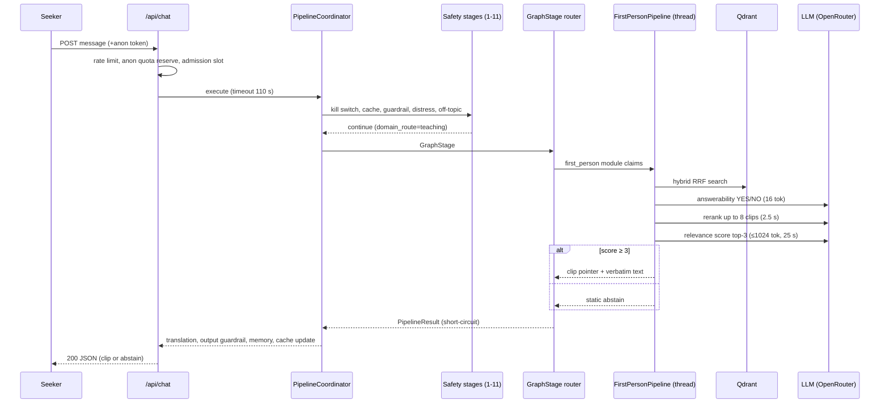

# 05 — Current architecture and end-to-end request flow

> **2026-11-06:** Superseded in part by `specifications/RETRIEVAL_AND_RAG_SPEC.md` (live first-person path traced per step at `c9b42d3e` with every LLM call and budget). Status of findings: `FINAL_PENDING_WORK_REGISTER.md`.

Owner: S1. Target: `origin/main@46b808fb`. Conventions: `CONVENTIONS.md`.

> **Erratum (lead, after the independent review in `26`). These corrections override the text below.**
> 1. Default served collection: the code serves **`first_person_v8`** unless both v10 harness flags are true (`config.py:41,209,289,305,2300-2308`; `.env.example:201,223`). The "default `first_person_v10`" cell in §1 is wrong. The owner's local v10-only setup is a [DOC-CLAIM] (root `CLAUDE.md` invariant 25).
> 2. Summary row 5 overstates the leak. A question that is not off-topic goes to the **teaching lane** (`off_topic_stage.py:591-607`; `graph_stage.py:210`; `pipeline_registry.py:86-90`). Only questions that mix a general-task word (e.g. "mental health", "career path") with an emotion word reach the general lane (`off_topic_stage.py:625-669`). SYS-002 is now P2.
> 3. SYS-001 is narrower than stated: the bridge catches its own exceptions and abstains (`first_person_bridge.py:585-596,616-627`). The node-level fall-through covers a missing pipeline context, an import failure, or an error while abstaining. SYS-001 is now P2. The serious path is ADV-03: **turning the bridge flag off** routes teaching questions to the generating prompt (`first_person_bridge.py:573-583`; `pipeline_registry.py:65-76`; `generation.py:3203`).
> 4. Relevance-scorer timeout: 25 s in code (`config.py:478-480`), **15 s in `backend/docker-compose.yml:321`**, 12 s in root `CLAUDE.md`. T1-07 pins one value.
Related: data and Qdrant (06, 08), prompts and answer behaviour (09, 10), frontend wiring (03), code debt (13), reliability and cost (15).

## 1. Summary

| # | Statement | Label |
|---|---|---|
| 1 | The backend is one FastAPI process (`backend/app/main.py`, 1,605 lines) with 231 route handlers. 91 of them are admin routes. | [V-STATIC] |
| 2 | Chat runs a 19-stage chain (`app/pipeline/stages/pipeline_builder.py:46-94`). A LangGraph runs inside stage 12 (`GraphStage`). | [V-STATIC] |
| 3 | The first-person (FP) route is a graph node selected by a registry router (`rag/pipeline_registry.py:93-115`), not a stage. | [V-STATIC] |
| 4 | Code defaults already describe "first-person-only chat": bridge ON, LLM fallback OFF, weak match ON (`app/config.py:416,437,444`). | [V-STATIC] |
| 5 | "First-person-only" is not absolute. A keyword classifier sends "unknown or non-doctrinal" questions to a general LLM answer graph (`app/pipeline/stages/off_topic_stage.py:645-680`, `graph_stage.py:200-220`). | [V-STATIC] |
| 6 | Two failure paths fall open toward the generating graph (see SYS-001). | [V-STATIC] path exists; runtime effect [INF] |
| 7 | The FP pipeline is synchronous code (6,017 lines on `main`; the stale checkout has 5,637). It runs in the default thread pool and blocks on LLM futures scheduled on the event loop (`run_llm_coroutine`, `services/first_person_pipeline.py:1417-1445`). | [V-STATIC] |
| 8 | An in-domain FP question makes up to 3 LLM calls on default config: LLM rerank, answerability gate, relevance scorer. | [V-STATIC] |
| 9 | No part of this flow has been measured on a deployed stack. Local uncached FP latency is p50 6.8–7.6 s and p95 12.3–13.9 s. | [DOC-CLAIM] `docs/plans/PROD_READINESS_TASK_LIST_2026-10-11.md` lines 454, 626-627, 1344 |

The CLAUDE.md pipeline line (`CacheCheck → RequestState → InputGuardrail → CircuitBreaker → DoctrineCache → CasualShortCircuit → Distress → ...`) is stale. The real order adds `KillSwitch` first and `OffTopic` after `CasualShortCircuit`, and it moves `Distress` before `CircuitBreaker` [V-STATIC] `pipeline_builder.py:46-94`. See CQ-009.

## 2. Component inventory

### 2.1 Runtime processes

| Process | Where defined | Role | Label |
|---|---|---|---|
| `backend` (uvicorn, 1 worker by default) | `backend/docker-compose.yml`, `Dockerfile.railway:104` (`WEB_CONCURRENCY=1`) | API, chat pipeline, in-process job-queue consumer | [V-STATIC] |
| `celery-worker` | compose; Railway only via `scripts/deploy/deploy_railway.sh --with-worker` | ingestion, OKF extraction, memory outbox, web ingest | [V-STATIC] |
| `celery-beat` | compose; Railway via `SERVICE_TYPE=celery-beat` (`start_railway.py:515`) | 6 schedules (`backend/celery_config.py:95-117`) | [V-STATIC] |
| `whatsapp-bot` | `docker-compose.prod.yml`, `whatsapp_bot/wa_bot.py` (2,003 lines, own SQLite) | WhatsApp channel; calls backend with signed anon session | [V-STATIC] |
| Supabase edge functions | `supabase/functions/` (e.g. `delete-my-account/index.ts`) | account deletion, other server functions | [V-STATIC] |
| Frontend (Vite/React) | `src/`, served by nginx or Lovable | UI (owned by S4, doc 03) | [V-STATIC] |

### 2.2 Datastores used at request time (detail in doc 06)

| Store | Request-time use | Label |
|---|---|---|
| Qdrant (`qdrant/qdrant:v1.18.0`) | FP collection (default `first_person_v10`, `config.py:209`), chat corpus `spiritual_wisdom_contextual` (`config.py:709`), semantic-cache collection | [V-STATIC] |
| Redis 7 | exact cache, job queue, rate limits, anon quota, OpenRouter budget ledger | [V-STATIC] |
| Memgraph (`memgraph-mage:latest`) | general graph (GraphRAG, LightRAG); FP graph expansion off by default | [V-STATIC] |
| Supabase Postgres | auth, profiles, memory, telemetry sink, consent receipts (139 migrations, 83 tables) | [V-STATIC] |
| Local files | `memory/okf/compiled.json`, `config/helplines.yaml`, ONNX models in image | [V-STATIC] |

### 2.3 Docker Compose services (`backend/docker-compose.yml`)

`memgraph, redis, jaeger, qdrant, backend, celery-worker, celery-beat, frontend, gptcache-server, prometheus, alertmanager, grafana, supabase-db, supabase-auth, supabase-rest, supabase-meta, supabase-kong, autoheal, liveness-watchdog` (19 services) [V-STATIC].
`docker-compose.prod.yml`: `frontend, backend, qdrant, redis, whatsapp-bot, celery-worker, celery-beat` (7) [V-STATIC]. It has no Memgraph and no Prometheus.

### 2.4 Route inventory (AST scan of `backend/app`, 231 handlers)

| Router file | Handlers | Auth dependency | Label |
|---|---|---|---|
| `app/api/admin.py` | 91 | `_require_admin` → `require_aal2` + `user_roles` admin row (`admin.py:66-68`, `services/auth_service.py:510-568, 822`) | [V-STATIC] |
| `app/api/memory.py` | 23 | mostly `get_current_user_from_supabase`; KG view and KG export allow anonymous (`memory.py:803, 900`) | [V-STATIC] |
| `app/api/health.py` | 10 | 4 unauthenticated probes; `/metrics` and drill endpoints `require_aal2` | [V-STATIC] |
| `app/api/chat.py` | 8 | `get_optional_user` + `resolve_anon_identity` + anon quota | [V-STATIC] |
| `app/api/second_brain.py` | 8 | `_authed_user_id` + passphrase-derived unlock header | [V-STATIC] |
| `app/api/ingest.py` | 8 | admin; `GET /media/videos/{video_id}` is public (`ingest.py:561`) | [V-STATIC] |
| `app/api/first_person.py` | 3 | `POST /api/first-person/query` has no auth and no anon quota (`backend/app/api/first_person.py:297-301`) | [V-STATIC] |
| others (26 files) | 80 | mix; see doc 14 §3 | [V-STATIC] |

Totals from the scan: 67 strict-auth, 22 AAL2, 14 optional-auth, 24 unauthenticated, 105 "other" (mostly `_require_admin`). 87 `Depends(get_container_async)`; one sync dependency remains (`_get_container_safely`, `app/api/compliance.py`, 3 uses) — CQ-014.

### 2.5 Pipeline stages (`pipeline_builder.py:46-94`)

| # | Stage | Live under code defaults | Note | Label |
|---|---|---|---|---|
| 1 | `KillSwitchStage` | yes | before cache on purpose | [V-STATIC] |
| 2 | `CacheCheckStage` | yes | exact + semantic tiers; bypassed for distress and personalised turns | [V-STATIC] |
| 3 | `RequestStateStage` | yes | history, language | [V-STATIC] |
| 4 | `InputGuardrailStage` | yes | | [V-STATIC] |
| 5 | `DistressStage` | yes | regex classifier; optional LLM downgrade/escalation behind flags (`distress_stage.py:520-550`) | [V-STATIC] |
| 6 | `CircuitBreakerStage` | yes | | [V-STATIC] |
| 7 | `DoctrineCacheStage` | flag `doctrine_cache_enabled` (`config.py:168`) | CLAUDE.md calls it dead on live config | [DOC-CLAIM] |
| 8 | `CasualShortCircuitStage` | yes | closed greeting vocabulary | [V-STATIC] |
| 9 | `OffTopicStage` | yes | decides `domain_route` = teaching / general / boundary | [V-STATIC] |
| 10 | `BoundedComparisonShortCircuitStage` | yes | | [V-STATIC] |
| 11 | `PersonalizeStage` | yes | returns None unless a personalize ref exists | [V-STATIC] |
| 12 | `GraphStage` | yes | LangGraph; FP node or general graph | [V-STATIC] |
| 13 | `MeditationGenStage` | yes | | [V-STATIC] |
| 14 | `TranslationStage` | yes | | [V-STATIC] |
| 15 | `ToneAdapterStage` | no-op | `return None` (`tone_adapter_stage.py:31-33`) | [V-STATIC] |
| 16 | `OutputGuardrailStage` | yes | | [V-STATIC] |
| 17 | `MemoryStage` | yes | writes memory when consented | [V-STATIC] |
| 18 | `CacheUpdateStage` | yes | | [V-STATIC] |
| 19 | `ResultAssemblyStage` | yes | | [V-STATIC] |

### 2.6 LangGraph strategies (`rag/graph_strategies.py`)

`StandardGraphStrategy` (lines 249-445) registers 24 nodes: `intent_router, handle_distress_check, resolve_parallel, resolve_followup, navigate_and_hyde, retrieve_documents, agentic_graph_traversal, rerank_documents, grade_documents, enrich_context, rewrite_query, regenerate_gate, generate_answer, reflect_on_answer, verify_answer, extract_citations, context_engineer, format_final_answer, handle_casual, handle_distress, handle_meditation, handle_fallback, web_search, cross_teacher_reasoning` plus `first_person` [V-STATIC]. `FastGraphStrategy` (453-718) and `DeepGraphStrategy` (719-791) are variants. Graphs compile once (`build_cached`, line 792) [V-STATIC].

### 2.7 ServiceContainer (`app/container.py`, 961 lines)

40 attributes, including `ollama` (holds the active LLM provider for any `LLM_PROVIDER`, `container.py:191`), `openrouter`, `krutrim`, `llm_gateway`, `multi_provider_llm`, `semantic_cache`, `exact_cache`, `doctrine_cache`, `semantic_router`, `standard_graph`, `fast_graph`, `deep_graph`, `lightrag`-related services, `second_brain`, `canonical_memory_integration`, `memory_outbox`, `retention_service`, `anon_quota_service` [V-STATIC]. The name `ollama` for the OpenRouter provider is misleading (CQ-002).

## 3. Flag state that decides the route

| Flag | Code default (`app/config.py`) | Documented local `.env` (CLAUDE.md inv. 21) | `backend/.env.example` / compose / Railway image | Label |
|---|---|---|---|---|
| `first_person_chat_bridge_enabled` | `True` (416) | `true` | not overridden | [V-STATIC] |
| `first_person_llm_fallback_enabled` | `False` (437) | `false` | not overridden | [V-STATIC] |
| `first_person_serve_weak_match` | `True` (444) | `true` | `true` | [V-STATIC] |
| `first_person_route_enabled` | `True` (222) | — | — | [V-STATIC] |
| `first_person_active_collection` | `"first_person_v10"` (209) | v10-only per inv. 25 | `.env.example:210` v10 | [V-STATIC]; live contents [LIVE-Q] |
| `first_person_llm_rerank_enabled` | `True` (247) | — | — | [V-STATIC] |
| `first_person_answerability_check_enabled` | `True` (424) | — | — | [V-STATIC] |
| `first_person_relevance_gate_enabled` | `True` (472), min score 3 (474), timeout 25 s (480) | scorer `anthropic/claude-haiku-5.5`, 12 s per CLAUDE.md inv. 24 | `FIRST_PERSON_RELEVANCE_MODEL=` empty | [V-STATIC]; drift noted in SYS-006 |
| `first_person_hyde_enabled` / `facet_split` / `context_harness` / `graph_expansion` | all `False` | harness + terminal `true` in v10-only mode (inv. 25) | `false` | [V-STATIC] |
| `semantic_cache_enabled` | `True` (1588), similarity 0.92, TTL 7 days | — | `true` in compose and Railway image | [V-STATIC] |
| `queue_enabled` | `True` (999) | — | — | [V-STATIC] |
| `max_concurrent_chat` | 12 (1014) | — | 8 in compose and `backend/.env.example` | [V-STATIC] |
| `openrouter_budget_guard_enabled` | **`False`** (645) | — | `true` in compose and `.env.example`; **not set** in `Dockerfile.railway` or `deploy_railway.sh` | [V-STATIC]; SYS-004 |
| `anon_quota_enabled` | `True`, 5 messages / 24 h (1211-1213) | — | — | [V-STATIC] |
| `is_production` | `True` (1095) | — | — | [V-STATIC] |

The owner's real local `.env` is not in the repo. Every "live" statement below assumes the documented values [LIVE-L].

## 4. Request lifecycle: `POST /api/chat`

Steps, with code references (`backend/app/api/chat.py`):

1. Rate limit `settings.chat_rate_limit` = 20/minute per client IP (`chat.py:734`, `app/core/limiter.py:23-48`) [V-STATIC].
2. Resolve identity. Anonymous users present an HMAC-signed session token; `resolve_anon_identity` rewrites the id to `anon:<payload>` (`chat.py:797`) [V-STATIC].
3. Reserve one anon-quota unit (`_enforce_anon_quota`, `chat.py:820`). Redis adapter in production; process-local fallback when Redis is down (`backend/CLAUDE.md`) [V-STATIC].
4. Admission control: a semaphore of `max_concurrent_chat` with a 10 ms wait, else 503 + `Retry-After`. Crisis-keyword messages use a separate pool and are never shed (`_admit_chat`, `chat.py:278-325`) [V-STATIC].
5. If `queue_enabled` and not incognito: enqueue to the Redis job queue and return 202 (or poll with `?wait=true`, 0.5 s interval, up to `queue_default_timeout`) (`chat.py:836-933`). The consumer is the in-process worker started in lifespan; if it never started the request is refused (`_reject_if_queue_unattended`, `chat.py:529`) [V-STATIC].
6. Else `ChatRequestOrchestrator.orchestrate` (`app/orchestrator.py`, 752 lines) → `PipelineCoordinator.execute` (`app/pipeline/pipeline_coordinator.py:129`) with `asyncio.wait_for(timeout=settings.pipeline_timeout + 5)` = 110 s (`pipeline_coordinator.py:286-292`, `config.py:119`) [V-STATIC].
7. A 200 ms pre-stage probe decides whether the user has memories, to protect cache personalisation (`pipeline_coordinator.py:365-382`) [V-STATIC].
8. `StageRunner` runs the 19 stages (§2.5). Any stage can short-circuit with a `PipelineResult` [V-STATIC].
9. In `GraphStage`, the entry router picks a module: `first_person` if `first_person_bridge_enabled()` and `_first_person_claims(state)`, else `general` (`pipeline_registry.py:67-142`) [V-STATIC].
10. Quota commit on success, release on failure (`chat.py:940-947`) [V-STATIC].

`/api/chat/v2` (`chat.py:951`) calls the same coordinator directly and adds provenance manifests. `/api/chat/stream` (`chat.py:1081`) uses `app/stream_orchestrator.py` (521 lines) and SSE; the stream holds the admission slot for its whole life [V-STATIC].

### 4.1 The first-person branch

`rag/nodes/first_person.py:first_person_node` → `app/pipeline/stages/first_person_bridge.py:run_first_person_bridge` (1,374 lines) → `asyncio.to_thread(pipeline.execute, ...)` (`first_person_bridge.py:850`) → `FirstPersonPipeline.execute` (`services/first_person_pipeline.py:3509`).

Inside `execute` (sync, worker thread), on default flags [V-STATIC]:
1. Crisis pre-check, then exact Redis cache (hit re-checks servability).
2. Embed query (BGE-M3 ONNX), Qdrant RRF hybrid search (dense + sparse).
3. Integrity gate (hash, artefact, speaker allowlist) and content-quality / standalone gates.
4. LLM rerank of up to 8 clips, timeout 2.5 s (`_llm_rerank_clips`, line 1199) — LLM call 1.
5. Answerability YES/NO gate, `max_tokens=16` (`_async_answerability_check`, line 1448), run concurrently with retrieval at line 4591 — LLM call 2.
6. Relevance scorer over top-3 clips, `max_tokens=1024`, timeout 25 s default (`_relevance_select_scored`, lines 1023-1103) — LLM call 3.
7. Serve the clip, or a static abstain (`_abstain`, `first_person_bridge.py:1216-1360`).

Distress at MODERATE or above declines the bridge (`_DISTRESS_DECLINE_LEVEL = 2`, `first_person_bridge.py:67, 679-682`) [V-STATIC]. Whether a single keyword such as "anxiety" reaches MODERATE is analysed by S3 in doc 10.

### 4.2 The general branch

Reached when (a) the bridge is off, (b) `_first_person_claims` is false (personalize turn, `general_knowledge_mode`, or the keyword classifier says "not spiritual"), or (c) the FP node raises before the bridge (`backend/rag/nodes/first_person.py:52-65` returns `{}`) [V-STATIC]. The general graph runs `intent_router` + `handle_distress_check` in parallel, then retrieval, rerank, grading, `generate_answer`, `reflect_on_answer`, `verify_answer`, `format_final_answer`. Node behaviour and prompts: doc 09.

## 5. LLM calls per request type (code defaults; [V-STATIC] unless marked)

| Request type | Path | LLM calls | Notes |
|---|---|---|---|
| Greeting ("namaste") | `CasualShortCircuitStage` | 0 | exact closed vocabulary |
| Crisis (SEVERE+) | `DistressStage` → helpline response | 0 by default; +1 if `distress_llm_downgrade_enabled` | crisis copy is never LLM-translated (`distress_stage.py:386`) |
| Distress MODERATE | bridge declines → compassion abstain or distress lane | 0–1 [INF] | doc 10 |
| In-domain FP, clip served | FP pipeline | 3 (rerank, answerability, relevance) + 0–N glue translations for Indic | HyDE, facet split, selector, JEV relevance all off |
| In-domain FP, abstain | FP pipeline | 2–3 | answerability `UNANSWERABLE` can end early |
| Out-of-corpus but "spiritual-looking" | FP pipeline | 1–3 | 13/13 abstained in a 40-question run [DOC-CLAIM] CLAUDE.md inv. 22 |
| General / unknown question | general graph | ≥3 sequential (`navigate_and_hyde`, `generate_answer`, `reflect_on_answer`) plus grading/verification | [DOC-CLAIM] L-LATENCY-1 in CLAUDE.md gives 5.4 s + 12.5 s + 2.4 s |
| Off-topic boundary (e.g. tax advice) | `OffTopicStage._static_boundary` | 0 | static text |

## 6. Diagrams

### 6.1 Component diagram

```mermaid
flowchart LR
  subgraph Client
    FE[React SPA / Lovable]:::c
    WA[WhatsApp bot]:::c
  end
  subgraph Backend["FastAPI backend (single process)"]
    API[api/chat.py\nquota + admission]
    Q[(Redis job queue)]
    ORC[Orchestrator /\nStreamOrchestrator]
    PC[PipelineCoordinator\n19 stages]
    G[GraphStage\nLangGraph]
    FP[first_person node\n→ FirstPersonPipeline\n(sync, thread pool)]
    GEN[general graph\n24 nodes]
  end
  subgraph Stores
    QD[(Qdrant)]
    RD[(Redis)]
    MG[(Memgraph)]
    SB[(Supabase Postgres)]
    OKF[[memory/okf files]]
  end
  LLM{{OpenRouter\nLLM APIs}}
  CW[Celery worker + beat]
  FE --> API
  WA --> API
  API --> Q --> ORC
  API --> ORC --> PC --> G
  G --> FP
  G --> GEN
  FP --> QD
  FP --> RD
  FP --> LLM
  GEN --> QD
  GEN --> MG
  GEN --> LLM
  GEN --> OKF
  PC --> SB
  CW --> QD
  CW --> SB
  CW --> MG
  classDef c fill:#eef
```

### 6.2 Sequence: in-domain question, documented local config



## 7. Findings

### SYS-001 — Two failure paths fall open toward LLM generation in first-person-only mode
| Field | Value |
|---|---|
| Pillars | P2, P4, P1 |
| Category | Safety of voice / routing |
| Severity | P1 |
| Type | Probable defect |
| Confidence | Medium |
| Evidence | `rag/nodes/first_person.py:52-65`: any exception before the bridge returns `{}`, and the after-edge re-runs the general entry. `app/pipeline/stages/graph_stage.py:211-220`: if the domain classifier import or call fails, `general_knowledge_mode = True`. No guard on `first_person_llm_fallback_enabled` exists anywhere under `backend/rag/` (rg returns no match). |
| Actual behaviour | On an infrastructure fault, a teaching-domain question can reach `generate_answer` and receive model-written prose. |
| Expected behaviour | With `first_person_llm_fallback_enabled=false`, every teaching-domain failure ends in the static abstain (CLAUDE.md inv. 21). |
| Root cause | Fail-open defaults were written for the era when the general graph was the primary path. |
| User impact | Rare, but the failure mode is the worst one for trust: generated "teaching" with no clip. |
| Downstream impact | Undermines the guru-review claim "nothing is generated". |
| Dependencies | S3 confirms what the general graph emits for a teaching question (doc 09/10). |
| Remediation | In FP-only mode, make the node's exception path and the classifier-failure path return the static abstain. Add a graph-level guard in `generate_answer` that refuses `domain_route=teaching` when fallback is off. |
| Acceptance criteria | Fault-injection tests: (a) bridge import raises, (b) classifier raises; both return `route_decision=first_person_abstain`, `model_used=None`. |
| Regression test | `tests/test_first_person_failopen_guard.py` (new). |
| Implementation risk | Low; small, well-isolated change. |
| Verification | [V-STATIC] for the paths; runtime effect needs a test run [INF]. |

### SYS-002 — Route choice depends on a keyword classifier; unknown questions get a generated answer
| Field | Value |
|---|---|
| Pillars | P2, P4 |
| Category | Architecture / routing |
| Severity | P1 |
| Type | Architectural risk |
| Confidence | High |
| Evidence | `off_topic_stage.py:645-680`: only questions that match `is_spiritual_domain_query`, `_ON_TOPIC_RE` or `_INNER_HELP_RE` stay in the teaching lane; all others get `general_knowledge_mode=True` and a model-written answer. `pipeline_registry.py:75-100` repeats the keyword test. |
| Actual behaviour | One endpoint serves two philosophies: verbatim clip or static abstain for recognised teaching questions; LLM prose (neutral persona, PR #76) for everything else. Which one a seeker gets depends on regex vocabulary. |
| Expected behaviour | An explicit, measured intent decision with a confusion matrix, and a stated product rule for personal questions that use no keyword. |
| Root cause | Regex routing grew incrementally (W4 2026-10-11, PR #76 2026-10-23). |
| User impact | Two similar personal questions can get two different kinds of answer. |
| Remediation | Replace the three regex checks with one router component that has a labelled evaluation set (doc 18) and a logged decision. Keep regex as a fast pre-filter only. |
| Acceptance criteria | Router precision/recall reported on ≥300 labelled questions; no question type silently changes lane between releases. |
| Regression test | Router golden set in CI. |
| Implementation risk | Medium; it changes user-visible routing. |
| Verification | [V-STATIC] |

### SYS-003 — Synchronous FP pipeline blocks thread-pool workers on cross-loop LLM futures
| Field | Value |
|---|---|
| Pillars | P1 |
| Category | Concurrency / scalability |
| Severity | P1 |
| Type | Architectural risk (with documented incidents) |
| Confidence | High |
| Evidence | `first_person_bridge.py:850` `asyncio.to_thread(pipeline.execute)`; `first_person_pipeline.py:1417-1445` `run_coroutine_threadsafe(...).result(timeout)`; private executors at 1318 and 4263; `start_railway.py:55-63` records a wedge: "AUDIT POST /api/chat -> 200 (187.863s) then a thread-stack-exhaustion MemoryError … the shared default ThreadPoolExecutor … was starved" [DOC-CLAIM]. |
| Actual behaviour | Each FP request holds a default-executor thread for the whole 4–14 s gate chain. Concurrency is capped by the executor size, not by I/O. A watchdog restarts the process when the executor canary goes stale. |
| Expected behaviour | Async end to end; LLM gates awaited, not blocked on; bounded per-dependency concurrency. |
| Root cause | The pipeline began as sync retrieval code; LLM gates were bolted on through a bridge. |
| User impact | Under modest concurrent load, requests queue or the process restarts. |
| Remediation | Convert `execute` to `async def` (or a thin async shell around pure sync CPU steps), call the provider with `await`, and remove `run_llm_coroutine`. |
| Acceptance criteria | Load test at 20 concurrent FP requests: no executor-canary staleness, p95 within 1.2× single-request p95. |
| Regression test | `gate1_load_test.py --mode first-person` (exists per `docs/architecture/first-person-path-to-prod.md` §5) plus a canary assertion. |
| Implementation risk | Medium-high: 6,017-line module with a 2,145-line `execute`. Do it after CQ-001 split. |
| Verification | [V-STATIC]; load behaviour [LIVE-R]. |

### SYS-006 — Uncached FP latency is dominated by sequential LLM gates; timeout config drifts from docs
| Field | Value |
|---|---|
| Pillars | P1, P6 |
| Category | Performance |
| Severity | P1 |
| Type | Confirmed defect (latency) + config drift |
| Confidence | High for structure, Medium for numbers |
| Evidence | Gate order §4.1. `config.py:480` relevance timeout 25.0 s vs CLAUDE.md inv. 24 "12 s budget". Measured p50 6.82–7.59 s / p95 12.3–13.9 s, uncached, local [DOC-CLAIM] task list lines 454, 626-627, 1344. Older "p95 210 ms" is retrieval-only and pre-gates [DOC-CLAIM] `first-person-path-to-prod.md` §1. |
| Actual behaviour | A served clip takes about 7 s at the median and up to about 14 s at p95. |
| Expected behaviour | First useful content in ≤ 2 s (target to be confirmed by NFR work, doc 04). |
| Root cause | Three LLM calls, two of them sequential after retrieval; the relevance scorer is a reasoning model with up to 1,024 output tokens. |
| Remediation | (1) Replace LLM rerank with the existing cross-encoder (round 2 showed p95 9.25 s vs 13.74 s, more served [DOC-CLAIM] line 627). (2) Run answerability concurrently with retrieval (already partly done). (3) Stream the clip first and the reasoning later. (4) Align timeout config with documentation. |
| Acceptance criteria | Deployed p95 for served FP answers measured and reported; target set in doc 04. |
| Regression test | latency budget test per stage. |
| Implementation risk | Low-medium. |
| Verification | [V-STATIC] structure; numbers [DOC-CLAIM]; production [LIVE-R]. |

Further findings referenced from this document: SYS-004 (budget guard default, doc 15), SEC-001 (unauthenticated FP query, doc 14), CQ-009 (stale CLAUDE.md pipeline order, doc 13).

## 8. Coverage

Read fully: `pipeline_builder.py`, `pipeline_registry.py`, `rag/nodes/first_person.py`. Read in parts: `chat.py`, `pipeline_coordinator.py`, `first_person_bridge.py`, `first_person_pipeline.py` (gate functions only), `graph_stage.py`, `off_topic_stage.py`, `graph_strategies.py`, `container.py`, `config.py` (flag lines). AST scans: all route handlers; all `Settings` fields. Not read: node bodies in `rag/nodes/*` (owned by S3), `stream_orchestrator.py` internals, frontend.
