# 17 — Target architecture and architecture decision register

Owner: lead. Pillars: all. Current architecture: `05` (request flow), `06` (data), `08` (retrieval), `09` (harness). Findings: `findings-index.md`. Roadmap: `20`.

## 1. Design principles (each one answers a root cause in `16`)

| # | Principle | Answers |
|---|---|---|
| 1 | One owner per decision. A second copy is a CI failure. | RC-1 |
| 2 | Every status is a computed output in CI, never a typed claim. | RC-2 |
| 3 | The teacher's words are only ever rendered from the store. The assistant speaks only in its own labelled voice. No path generates text in a teacher's voice. | RC-3 |
| 4 | The source registry is the authority for identity, version, rights and takedown. Vector points are derived data. | RC-4 |
| 5 | Safety decides on state, not on topic. Changes need clinician-reviewed evaluation. | RC-5 |
| 6 | An answer is a plan of layers. Depth adapts to the question. | RC-6 |
| 7 | Nothing is public or servable without a filed permission. | RC-7 |
| 8 | Small PRs, protected `main`, guards over prose. | RC-8 |
| 9 | Staging before production. Spend caps on by default. Measure p95 and usefulness there. | RC-9 |
| 10 | Prefer deletion to new components. Add a component only when a measured need exists. | Mission rule "no unnecessary components" |

## 2. Current versus target (summary)

| Area | Current (`main@46b808fb`) | Target |
|---|---|---|
| Routing | Regex `_ON_TOPIC_RE` + answerability prompt + intent classifiers, three scopes (AI-001) | One route-decision service: deterministic pre-filter, embedding router, one scope file, fail toward teaching |
| Safety | Regex MODERATE on topic words; MILD→MODERATE; topic history → SEVERE | Topic-vs-state discriminator; state-only escalation; verified helplines only |
| Teaching lane | 1 clip or abstain; 3 sequential LLM gates; sync code in a thread pool | AnswerPlan → per-facet hybrid retrieval → one evidence-judge call → evidence set → layered composer → verifier; async |
| Retrieval | v10 dense-only; dedup before gates; legacy engine in parallel | Hybrid dense+sparse RRF grouped by parent; gate then dedup; one engine |
| Graph | Memgraph + LightRAG in the stack, off the serving path, no provenance | Removed from serving and from the deploy stack; a small concept-vocabulary table in Postgres |
| General lane | Neutral LLM persona for non-doctrinal questions | ADR-002: static boundary for faculty review and beta; revisit with evidence |
| Data authority | Qdrant payloads + files under `audits/` + host paths | Postgres source registry + private checksummed source bundle |
| Rights | Owner statements; file not in the Railway image | `permission_ref` per source; non-servable by default; register shipped and checked at startup |
| Memory | 7 planes; read and not used on the teaching lane | Canonical memory only; user-stated preferences; consent-gated; used for continuity and to avoid repeated clips |
| Prompts | 37 constants + 72 inline; no versions | Prompt registry, `id@version` logged per call |
| LLM access | ~14 modules; `container.ollama` is OpenRouter | One gateway: budget, timeouts, retries, price table, telemetry |
| Caches | ≥8 mechanisms | Exact answer cache (FP), embedding cache, provider prompt caching; versioned keys |
| Evaluation | Gates skip without a deployment; AI-written gold | Offline blocking PR suite + held-out human set + calibrated judge |
| Observability | 87 system metrics; no outcome metric | Outcome events, usefulness, integrity breaches, cost per useful answer |
| Deploy | Railway IaC declares one service; never deployed since August | IaC for every service; staging; smoke and real-model load tests |

## 2b. Current-state diagrams (as built at `main@46b808fb`, code defaults)

Current request and component diagrams: `05`. Current data lineage: `06`. The four below fill the remaining current views. Sources: `05`, `06`, `08`, `09`, `12`, `26` (all [V-STATIC] unless marked).

### 2b.1 Current AI orchestration
```mermaid
flowchart TB
  IN[POST /api/chat] --> Q[anon quota] --> SC[19 stages: KillSwitch → Cache → RequestState → InputGuardrail → Distress → CircuitBreaker → DoctrineCache → Casual → OffTopic → BoundedComparison → Personalize → Graph → MeditationGen → Translation → ToneAdapter no-op → OutputGuardrail → Memory → CacheUpdate → ResultAssembly]
  SC -->|Distress ≥ MODERATE on topic words| DT[distress template + helplines]
  SC --> G[GraphStage]
  G --> REG{pipeline_registry: bridge flag on AND first-person claims?}
  REG -->|yes| FPN[first_person node → FirstPersonPipeline v8 default / v10 harness if both flags]
  REG -->|no: flag off ADV-03, general-task + emotion word, personalise turn| GEN[general graph: intent_router → navigate_and_hyde → retrieve → grade_documents → generate_answer → reflect / verify]
  FPN -->|serve| BR[bridge: one clip (+1 other video) verbatim + label]
  FPN -->|abstain| AB[static abstain]
  FPN -.->|narrow node faults SYS-001| GEN
```

### 2b.2 Current retrieval (legacy v8 path, the code default)
```mermaid
flowchart LR
  Q[question] --> ENC[BGE-M3 dense + sparse]
  ENC --> QD[Qdrant RRF over passage_dense + passage_sparse, k≈80]
  QD --> PF[payload + rights filters]
  PF --> DD[dedup per video → ≤40 videos  RET-01]
  DD --> IG[integrity gate: hash, speaker allowlist, artefacts]
  IG --> CG[content gates: ≥15 words, no crowd instructions, 23–300 words, ≤120 s, standalone]
  CG --> RR[LLM rerank top 8]
  RR --> ANSW[answerability YES/NO, fast model]
  ANSW --> REL[relevance scorer top 3, score ≥3, timeout 25 s code / 15 s compose]
  REL -->|pass| ONE[serve best clip]
  REL -->|fail or scorer error| ABST[abstain]
```
v10 harness differences: dense-only search (RET-02); parent-window enrichment; abstains on cross-parent or cross-teacher mixing; HASH_GATE on `source_text_hash`.

### 2b.3 Current context and memory flow
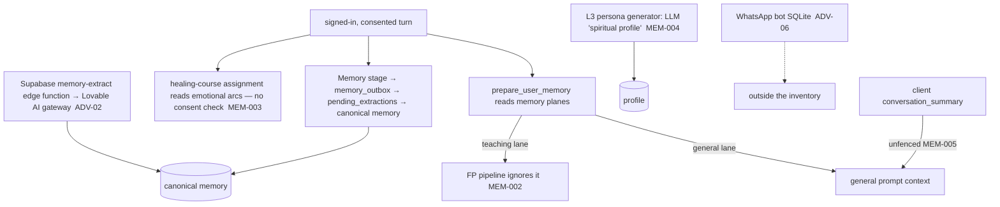

### 2b.4 Current ingestion: two lineages that never join
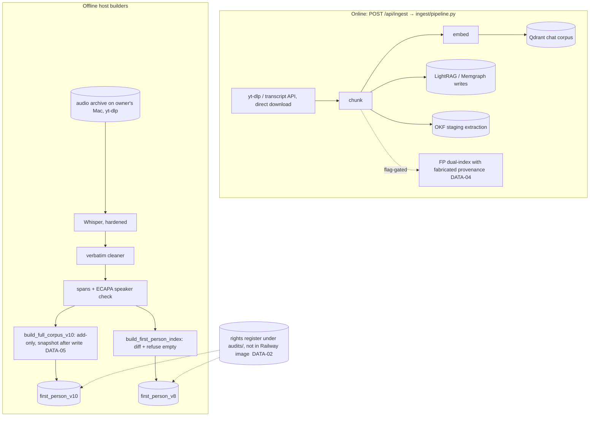

## 3. Diagrams

### 3.1 Overall application
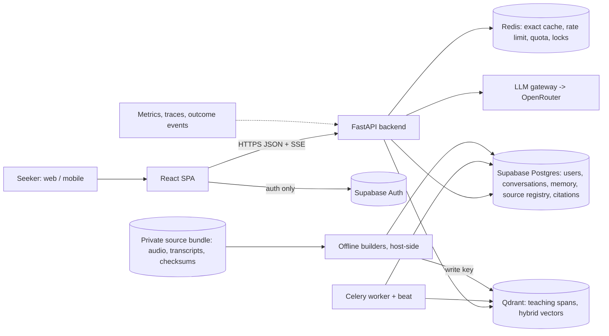

### 3.2 User request lifecycle (teaching question)
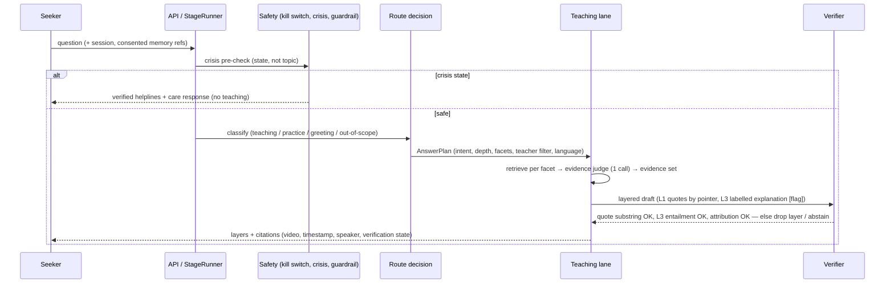

### 3.3 Data ingestion (target)
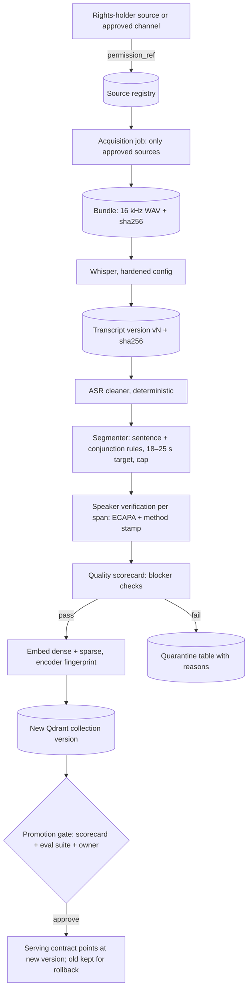

### 3.4 Video and transcript processing identities
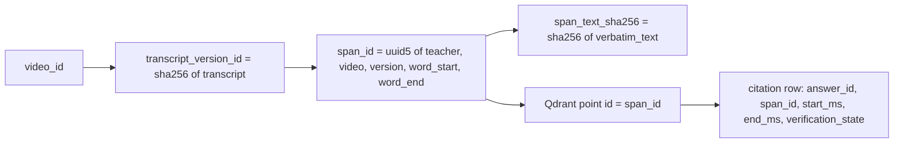
Rule: `transcript_hash` is retired. Two named fields replace it: `video_transcript_sha256` and `span_text_sha256` (DATA-03).

### 3.5 Knowledge stores (target)
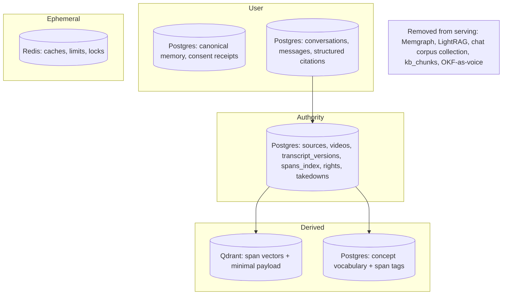

### 3.6 Retrieval
```mermaid
flowchart LR
  Q[facet query] --> E[encode dense + sparse, same encoder as index]
  E --> PF[Qdrant prefetch dense k=50, sparse k=50]
  PF --> RRF[server-side RRF]
  RRF --> GRP[group by parent, filter teacher / rights / servable]
  GRP --> G1[integrity + content + length gates]
  G1 --> DD[dedup per video and contained spans]
  DD --> J[evidence judge: one LLM call scores relevance + answerability for top N]
  J --> OUT[ranked candidates with scores and reasons]
```

### 3.7 Multi-video evidence synthesis (behind a flag; ADR-001)
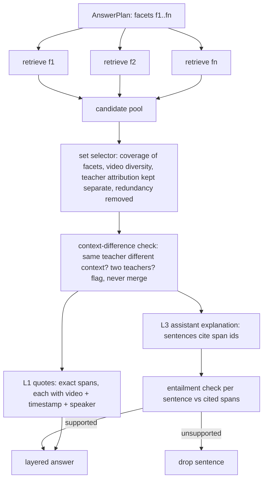
Worked example (the mission's fear question) is in `07` §4. Teacher quotes are never fused. Each teacher's span keeps its own label.

### 3.8 AI harness (target)
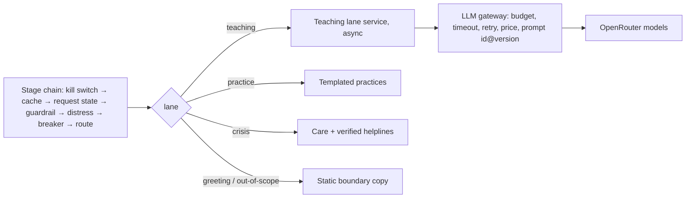
LLM calls per teaching turn: target 1 for a short answer (evidence judge), 2–3 for a deep answer (planner, judge, L3 composer). Today: 3 (`09`).

### 3.9 Prompt and context construction
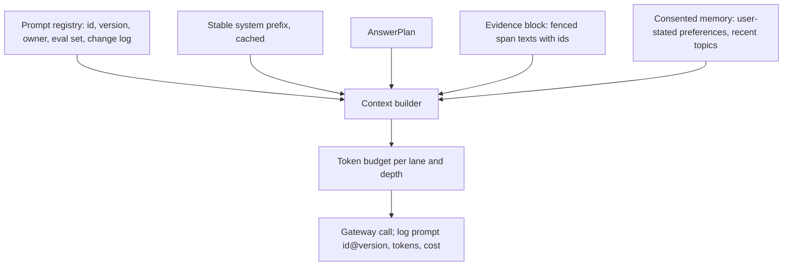
Rules:
- Untrusted text (transcripts, memory, client summaries) is always fenced and labelled as data.
- The stable prefix comes first, so provider prompt caching can apply.

### 3.10 Memory and personalisation
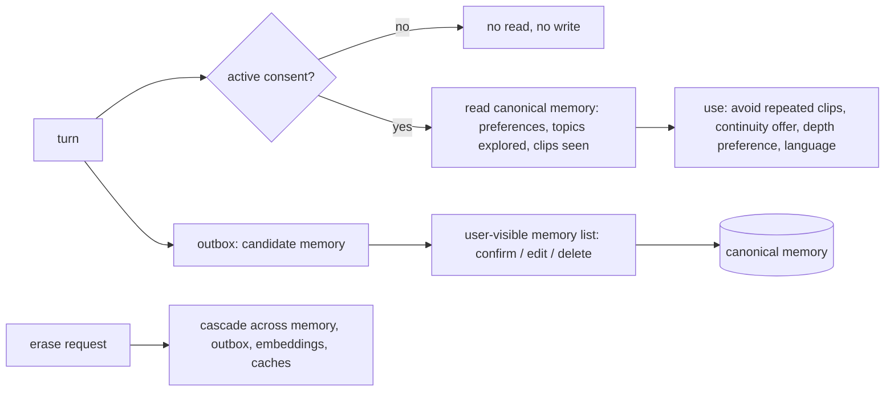

### 3.11 Safety and evaluation
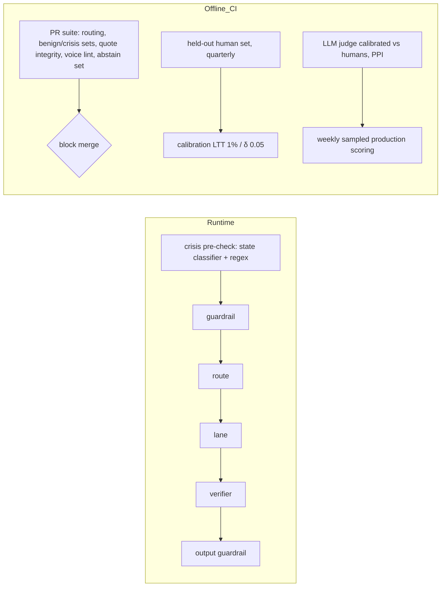

### 3.12 Observability
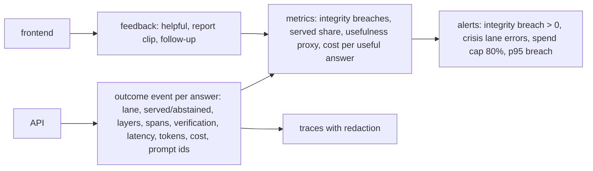

### 3.13 Deployment (Railway; target)
```mermaid
flowchart TB
  GH[GitHub main, protected] -->|required checks green| BUILD[image build + scan]
  BUILD --> STG[Railway staging env]
  STG --> SMOKE[smoke + real-model load c20 + eval suite]
  SMOKE -->|pass + owner approve| PROD[Railway production env]
  subgraph Railway services per env
    BE[backend] --- WK[celery worker] --- BT[celery beat]
    RDS[(Redis)]
    QDS[(Qdrant with volume, API keys) or Qdrant Cloud]
  end
  PROD --> SUPA[(Supabase project per env)]
  PROD --> BK[nightly off-host backups + monthly restore drill]
```

## 4. Component decisions (consolidated)

| Component | Decision | Reason | Findings | Task |
|---|---|---|---|---|
| Stage chain, StageRunner, `pipeline_registry` | Keep | Safety-first, testable, live kill switch | — | — |
| `FirstPersonPipeline.execute` (2,145 lines, sync) | Fix: split, then async | Thread starvation; untestable size | CQ-001, SYS-003 | T7-01, T7-02 |
| Bridge exact-quote assembly + integrity gate | Keep | Core integrity control | — | — |
| `fp-context-v1` schema, deterministic IDs | Keep; rename hash fields | Strongest contract | DATA-03 | T3-03 |
| Legacy FP store and engine | Fix, then Remove | Gate-then-dedup now; retire after v10 is proven | RET-01, RET-11 | T4-01, T7-06 |
| v10 context retrieval | Fix | Add sparse + RRF | RET-02 | T4-02 |
| LLM rerank + relevance + answerability | Consolidate | One evidence-judge call | RET-10, SYS-006 | T4-06 |
| Regex router + answerability scope + intent classifiers | Consolidate | One route-decision service | AI-001, SYS-002 | T4-03 |
| Distress classifier | Fix | Topic vs state | ANS-001/002, SAFE-002/003 | T4-04 |
| General LLM lane | Simplify (static boundary) pending ADR-002 | Not the product; leak target | SYS-002, AI-003 | T0-05, T4-03 |
| Generating graph (20 nodes) | Remove from chat serving; keep code until T7-06 | Fail-open target | SYS-001, RET-09 | T1-05, T7-06 |
| Quote-weaver editorial/hybrid, ingestion dual-index, `REFERENCE_VOICE` | Remove | Latent P0 | AI-006, DATA-04, SAFE-006 | T1-02 |
| Voice register / Langhanam block | Replace | Assistant register for L3 only | AI-003 | T1-06 |
| Memgraph, LightRAG, atomic GraphRAG | Remove from serving and deploy stack; freeze data | No measured value; no provenance | RET-05, DATA-08 | T3-11 |
| Concept vocabulary (small table) | Introduce | Facet tagging without a graph DB | RET-04 | T5-02 |
| Facet planner + set selector | Keep, then Fix | Basis for multi-video | RET-03/04 | T5-02 |
| AnswerPlan + layered composer + verifier | Introduce (flag) | Complete answers | ANS-004/006 | T5-01, T5-03, T5-04 |
| Source registry (`corpus_sources` → authority) | Introduce as authority | Lineage, rights, takedown | DATA-07, DATA-12 | T3-06 |
| Rights register as an `audits/` file | Replace | Ship it, pin it, check it at startup | DATA-02 | T3-01 |
| Video decisions JSON | Replace (Postgres) | Runtime state in files | DATA-18 | T3-06 |
| Supabase `kb_chunks`, `gurus` table | Remove after a usage check | Duplicate store and registry | DATA-13 | T3-07 |
| `gurus.yaml` + `guru_registry.py` | Keep; extend | Single teacher source | GURU-010/014 | T8-01 |
| Other-teacher seeds and personas | Remove | No corpus, no rights | GURU-011 | T1-04 |
| LLM provider modules (~14) | Consolidate | One gateway | CQ-002 | T7-03 |
| Caches (≥8) | Consolidate to 2–3 versioned tiers | Drift, stale answers | CQ-003 | T7-04 |
| Semantic cache on teaching answers | Remove (keep exact only) | Personalisation and staleness risk | CQ-003 | T7-04 |
| Memory planes (7) | Consolidate on canonical memory | Consent, erasure, clarity | MEM-001 | T6-01 |
| L3 persona generator | Replace | User-stated preferences only | MEM-004 | T6-03 |
| Memory API routes | Keep | Transparency and erasure | MEM-006 | — |
| Calibrator (Learn-then-Test) | Keep | Sound method | — | T10-02 |
| Release gate script | Fix | Verify provenance, not presence | EVAL-001 | T1-11 |
| Offline PR eval suite | Introduce | CI gates are inert today | EVAL-003 | T2-01 |
| Prompt registry | Introduce | Versioning, traceability | AI-004 | T2-03, T5-07 |
| Outcome events and metrics | Introduce | Usefulness signal | SYS-011 | T2-03 |
| Spend cap (budget guard) | Fix: default on, fail closed | Cost safety | SYS-004 | T1-07 |
| Cancel flow, win-back tasks | Remove | Dark pattern at deletion | UX-001 | T1-12 |
| Clip report for seekers | Introduce | Correction and guru review | PRD-006 | T6-04 |
| Repo-root shims, `langdetect` stub, WA signer | Remove | Shadowing, dead code | CQ-005, SEC-009 | T1-13 |
| Railway IaC (one service) | Fix | Declare all services and staging | SYS-007 | T9-01 |
| Private evidence store and source bundle | Introduce | Rights, sign-offs, reproducibility | DATA-01, GURU-005 | T3-09 |

## 5. Architecture decision register

Status vocabulary: Proposed (needs owner), Accepted (recommended by the lead and needing no owner decision), Owner-only (a human decision with no engineering recommendation beyond the options).

### ADR-001 — Answer composition: layered answer with a labelled assistant voice
| Field | Content |
|---|---|
| Status | Proposed. Needs the owner and, before public use, the teachers' organisation. |
| Context | Invariants 15/21 allow only a verbatim clip or an abstain. The mission requires understanding, synthesis across videos, explanation and reflection. About 11% of on-topic questions end useful today [DOC-CLAIM `15`]. |
| Options | A. Keep clip-only. B. Layered answer: L1 verbatim quotes by pointer; L2 context label (which video, when, to whom); L3 assistant explanation in the assistant's own labelled voice, each sentence entailment-checked against cited spans; L4 personal connection from consented memory; L5 reflection or practice in the assistant's voice; L6 follow-up offers. C. Free generation in the teacher's voice. |
| Decision | B, behind a default-off flag, in stages: (1) improve A first (T4-*); (2) ship B to owner-only review; (3) faculty review; (4) public only with written consent from the teachers' organisation. C is rejected permanently: it is impersonation. |
| Consequences | 1–2 more LLM calls on deep answers. An entailment verifier is needed (T5-04). The UI must show the layers distinctly (`10` §5). The labels "In our own words" and "Related, not a direct answer" already exist and are reused. |
| Measure | Usefulness ≥4/5 on ≥70% of answerable held-out items; 0 unsupported L3 sentences on the held-out set; 0 teacher-voice violations (voice lint). |

### ADR-002 — General-assistant lane
| Status | Proposed (owner). |
|---|---|
| Context | PR #76 added a neutral persona for non-doctrinal questions. It is the leak target for misrouted teaching questions (ANS-003), and a voice block applies there (AI-003). |
| Options | A. Keep a general assistant. B. Static boundary copy ("I can help with the teachings of …") plus practices and resources. C. A general assistant only for signed-in users with a visible mode switch. |
| Decision | B for faculty review and beta. Revisit C with user-research evidence (T2-07). |
| Consequences | Lower cost; fewer integrity risks; some users will find the product narrow. |

### ADR-003 — Single route-decision service
| Status | Accepted. |
|---|---|
| Decision | One module owns the scope definition (one file) and returns a lane with a reason code. Order: deterministic crisis and greeting pre-filter → embedding similarity to the teaching scope → small LLM classifier only when ambiguous. Fail toward the teaching lane for in-domain vocabulary, toward the boundary for everything else. |
| Measure | Teaching-intent routing recall ≥95% on a labelled routing set (T2-01). |

### ADR-004 — One serving schema and engine
| Status | Accepted. |
|---|---|
| Decision | `fp-context` vNext (renamed hash fields, encoder fingerprint, language field) becomes the only serving schema. The legacy `first_person_v8` engine is retired after vNext beats it on the frozen bank (T7-06). |

### ADR-005 — Remove the graph stack from serving
| Status | Proposed (owner). |
|---|---|
| Context | Memgraph and LightRAG add infrastructure and ingestion writes. They have no span provenance and no measured lift. LightRAG chunks were 41.4% contaminated [DOC-CLAIM `08`]. |
| Decision | Freeze writes. Remove them from the production deploy stack. Keep the data snapshot. Re-introduce only after an ablation shows lift on the held-out set. A concept-vocabulary table covers facet tagging. |

### ADR-006 — Distress: topic versus state
| Status | Proposed. **Clinician sign-off required.** |
|---|---|
| Decision | A state classifier (first-person present-tense disclosure, intensity, risk markers) decides the distress lane. Topic questions ("what causes anxiety") stay in the teaching lane with a gentle care footer. History escalation counts state disclosures only. The rule fails toward care on ambiguous phrasing. |
| Measure | Benign overfire ≤5% on ≥200 reviewed benign items; crisis recall 100% on the clinician core set, in each priority language. |

### ADR-007 — Postgres source registry as the data authority
| Status | Accepted. |
|---|---|
| Decision | Extend `corpus_sources` into the authority: source, video, transcript version, span index, rights `permission_ref`, takedown state. Qdrant payloads become derived and minimal. `takedown(source_id)` clears Qdrant, caches and citations, and reports what it cleared. |

### ADR-008 — Private evidence store and source bundle
| Status | Owner-only (where, and whether rights allow storing audio). |
|---|---|
| Options | A private GitHub repo for evidence; a private bucket (Supabase Storage or S3-compatible) for the bundle; checksums referenced from the public or main repo. |

### ADR-009 — Evidence-judge consolidation
| Status | Accepted, subject to a frozen-bank comparison. |
|---|---|
| Decision | Replace the LLM rerank, relevance scorer and answerability calls with one structured call that scores the top N candidates (relevance 0–3, answers-the-question yes/no, reason). Use an ONNX cross-encoder pre-rank if it keeps the frozen-bank quality. The task list reports variant B with a cross-encoder at p95 9.25 s, serving more clips [DOC-CLAIM `15`]. |

### ADR-010 — Canonical memory only
| Status | Accepted. |
|---|---|
| Decision | One system of record (canonical memory plus consent receipts). Store user-stated preferences and topics explored; no inferred "spiritual profile". Every side effect checks active consent. Erasure cascades. |

### ADR-011 — Prompt registry
| Status | Accepted. |
|---|---|
| Decision | Prompts live in versioned files with an owner and an eval set. Each LLM call logs `prompt_id@version`. A prompt change requires the PR eval suite to pass. |

### ADR-012 — Release governance
| Status | Accepted. |
|---|---|
| Decision | Branch protection on `main`. Required checks: Lint & Test, Production Readiness, offline eval suite. The release gate reads hashed private evidence. Human approvals are artefacts with a named person and a hash. Tests must never be edited to match a desired status. |

### ADR-013 — Teacher registry as the single source
| Status | Accepted. |
|---|---|
| Decision | `gurus.yaml` holds id, display names, aliases, sources, rights policy, attribution policy, voice references and allowed surfaces. Guardrail patterns, labels and filters are generated from it. A CI guard rejects new teacher-name literals in runtime code. |

### ADR-014 — Async teaching lane
| Status | Accepted. |
|---|---|
| Decision | The teaching lane is async end to end. `run_llm_coroutine` and the thread-pool hop are removed after the split (T7-01). |

### ADR-015 — Deployment topology
| Status | Proposed (owner: hosting of Qdrant). |
|---|---|
| Decision | Railway staging and production environments. Services: backend, worker, beat, Redis. Qdrant runs either as a Railway service with a volume and API keys, or on Qdrant Cloud. Supabase gets one project per environment. Memgraph is not deployed (ADR-005). |

## 6. What the target deliberately does not add

| Not added | Why |
|---|---|
| Microservices | One backend service plus a worker is enough at the measured scale. |
| A second vector database or a graph database | No measured need (ADR-005). |
| Agent frameworks beyond the existing LangGraph | The teaching lane is a fixed pipeline. Agents add cost and nondeterminism. |
| Semantic caching of teaching answers | Personalisation and staleness risk outweigh the hit rate. |
| Fine-tuned LLMs | No labelled data yet. A reranker fine-tune comes after the held-out set exists. |
