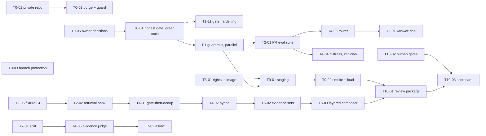

# 20 — Ordered engineering roadmap

Owner: lead. Inputs: `16` (root causes), `17` (target and ADRs), `findings-index.md`. File-level detail for P0/P1 tasks: `21`. Prompts: `25`.

## 1. Ordering rules

1. Stop the exposure and the false status first (P0). These are cheap and mostly owner actions.
2. Remove the paths that can produce a P0 (latent impersonation, fabricated provenance) before adding features.
3. Measure before optimising. The offline eval suite, the frozen retrieval bank and the outcome events come before retrieval and answer changes, because those changes must show a delta.
4. Fix data identity and the deployability of rights before any new collection is built or deployed.
5. Fix routing and the distress over-trigger before building richer answers. Otherwise the richer answers are never reached.
6. Build richer answers (ADR-001) behind a default-off flag, only after the owner decides.
7. Refactor large modules in a behaviour-identical PR, between behaviour changes, never mixed with them.
8. Deploy to staging as soon as Phase 1 cost and auth guards and T3-01 are in. Measure there.
9. One task ID per PR. Each PR keeps under about 400 changed lines of application code, excluding generated files (X-03).

## 2. Phase map (mission phases → this roadmap)

| Mission phase | Roadmap phase |
|---|---|
| 0 Repository and knowledge baseline | P0 |
| 1 Code and architecture cleanup | P1, P7 |
| 2 Data quality and ingestion correctness | P3 |
| 3 Cross-database consistency and lineage | P3 (T3-03, T3-06, T3-07) |
| 4 Retrieval and knowledge-graph correctness | P4 (T4-01, T4-02, T4-06), P3 (T3-11) |
| 5 Multi-video synthesis | P5 (T5-02, T5-03) |
| 6 Spiritual answer quality | P4 (T4-03, T4-04), P5 |
| 7 Prompt and harness architecture | P2 (T2-03), P5 (T5-07), P7 (T7-03) |
| 8 Memory and personalisation | P6 |
| 9 User mentor experience | P6 (T6-04), P1 (T1-12) |
| 10 Backend reliability | P7, P9 |
| 11 Security and safety | P1, P4 (T4-04, T4-07) |
| 12 Evaluation and observability | P2, P9 (T9-03) |
| 13 Performance and cost | P1 (T1-07), P4 (T4-06), P7 |
| 14 Frontend and product experience | P1 (T1-16), P5 (T5-03), P6 |
| 15 Guru-review readiness | P10 |
| 16 Qdrant and Railway verification | P9 (T9-04) |
| 17 Production release readiness | P10 |

## 3. Tasks

Columns: ID | Objective | Sev closed | Main files (detail in `21`) | Depends on | Size (S ≤1 day, M ≤3 days, L >3 days, agent-time) | Lane | Acceptance (short)

Lanes: A governance/repo · B safety/routing · C data platform · D retrieval/answer · E platform/ops · F product/frontend · G evaluation · H human.

### P0 — Baseline, exposure and honest status

| ID | Objective | Sev | Main files | Depends | Size | Lane | Acceptance |
|---|---|---|---|---|---|---|---|
| T0-01 | **HUMAN.** Make the repository private, or decide a purge and history rewrite | P0 | GitHub settings | — | S | H | Repo private, or owner's written purge decision |
| T0-02 | Remove tracked teaching text, transcripts, teacher audio, data backups and local paths. Extend the publication guard | P0 | `audits/evidence/public_release_v10_points_export_2026-10-21.json`, tier `*.jsonl`, `public/audio/meditation/*.mp3`, `data/*.json`, `scripts/guards/lesson_guards.py`, `scripts/guards/publication_allowlist.txt` | T0-01 decision | S | A | Guard fails on `verbatim_text` / `source_transcript_text` keys, on teacher audio without a rights row, and on `/Users/` paths |
| T0-03 | **HUMAN.** Turn on branch protection; required checks; PR-size warning | P1 | GitHub settings, `.github/workflows/` | — | S | H | A failing required check blocks a merge |
| T0-04 | Restore the honest release-gate test; correct release scopes to match notes; make `main` green | P1 | `backend/tests/test_first_person_public_release_gate.py`, `audits/evidence/FIRST_PERSON_OWNER_DECISIONS_2026-10-22.md` (owner edits scopes) | T0-05 (scopes) | S | A | CI status = computed gate status; `main` green |
| T0-05 | **HUMAN.** Owner decisions D-01…D-12 (`unresolved-questions.md`) | — | — | — | S | H | Decisions recorded in `decision-log.md` |
| T0-06 | Coding agent revalidates this audit against the current `main` (first-task prompt in `25`) | — | `audit-output/` | — | S | A | Revalidation report; drifted references listed |
| T0-07 | Resolve `lovable-sync`; route Lovable edits through PRs | P2 | branch, GitHub settings | T0-03 | S | H/A | No unreviewed branch with unique commits older than 7 days |

### P1 — Guardrails and removal of latent P0 paths (all parallel unless noted)

| ID | Objective | Sev | Main files | Depends | Size | Lane | Acceptance |
|---|---|---|---|---|---|---|---|
| T1-01 | Voice governance: rewrite the root `CLAUDE.md` "First-Person Voice Architecture" section and `AGENTS.md`; add a guard | P1 | `CLAUDE.md`, `AGENTS.md`, `scripts/guards/lesson_guards.py` | — | S | A | No instruction tells agents to generate teacher first-person text; guard test |
| T1-02 | Remove latent P0 paths: quote-weaver editorial/hybrid LLM, ingestion FP dual-index provenance, `REFERENCE_VOICE` | P2 (latent P0) | `backend/services/quote_weaver.py`, `backend/ingest/pipeline.py` (~3630–3850), `backend/services/guru_voice_langhanam.py`, `backend/app/config.py` | — | S | B | No code path can write teacher text produced by an LLM; tests |
| T1-03 | Remove unsourced teacher attributions; lint guard | P1 | `backend/app/api/teachings.py` (~60–141), `src/lib/healingCourses.ts`, `src/components/chat/DeepenAndTuneBar.tsx` | — | S | F | Every teacher attribution carries a span id or is relabelled as paraphrase |
| T1-04 | Remove other-teacher seeds and personas; unify assistant slugs; stop sending the client system prompt | P2 | new Supabase migration, `backend/services/prompt_store.py`, `assistant_registry.py`, `assistant_authorization.py`, `src/config/assistant.ts`, `src/hooks/useAssistants.ts` | — | M | F | One slug set; no Sadhguru/ISKCON/SKY data or prompts |
| T1-05 | Fail closed on the teaching route. Bridge kill switch off, FP node fault or classifier failure → static abstain (unless `FIRST_PERSON_LLM_FALLBACK_ENABLED=true` is set deliberately). Guard in `generate_answer`. Closes ADV-03, RET-09, SYS-001 | P1 | `backend/app/pipeline/stages/first_person_bridge.py` (~573–583), `backend/rag/pipeline_registry.py` (~65–76), `backend/rag/nodes/first_person.py` (~52–65), `backend/app/pipeline/stages/graph_stage.py` (~211–220), `backend/rag/nodes/generation.py` (~3203) | — | S | B | Fault-injection tests: no generated text on teaching intents |
| T1-06 | Disable the teacher register in general mode and in non-L3 prose | P2 | `backend/services/voice/register.py`, `backend/rag/nodes/generation.py` (~3214–3250), `config.py` | — | S | B | Voice-lint test passes on general-mode outputs |
| T1-07 | Spend cap on by default and fail-closed; relevance-scorer model required; Railway env explicit | P1 | `backend/app/config.py` (~478, ~645–647), `backend/Dockerfile.railway`, `scripts/deploy/deploy_railway.sh`, `backend/.env.example` | — | S | E | Startup fails if the cap or scorer model is unset in production |
| T1-08 | Auth, quota and budget on `/api/first-person/query`; rights-gate video streaming | P1 | `backend/app/api/first_person.py` (~297–301), `backend/app/api/ingest.py` (~561) | — | S | E | Anonymous scripted calls are quota-limited; unlicensed video ids return 403 |
| T1-09 | Remove seeker text from logs; guard | P2 | `backend/rag/intent_prerouter.py` (~92), `backend/rag/resolve_followup.py` (~195, ~255), guard | — | S | E | Guard test; logs hold hashes only |
| T1-10 | Consent gate on healing-course and proactive Serene Mind; no engagement prompts on safety turns | P1 | `backend/app/orchestrator_utils.py` (~577–610, ~636–705), `src/components/PushPermissionPrompt.tsx`, `src/components/chat/ChatInterface.tsx` | — | S | F | No side effect without active consent; no push prompt after a safety-route answer |
| T1-11 | Release-gate hardening: recompute agreement; require independence, valid SHA ancestry, human certifiers, helpline age; flag scope/note conflicts | P1 | `backend/scripts/ops/check_first_person_public_release.py` (~788–835), `backend/config/first_person_public_release_gate.json`, gate tests | T0-04 | M | A | Fixture tests: each defect in X-RC2 makes the gate fail |
| T1-12 | **Replace** the churn funnel (it is the only UI deletion path) with a direct confirm-and-delete flow: export offer, no save offers, no win-back emails. Neutral, opt-in streak copy. Closes UX-001, UX-002 | P1 | `backend/app/api/cancel_flow.py`, `backend/tasks/cancel_flow_tasks.py`, `celery_config.py`, `src/components/**/CancelFlow.tsx`, `src/locales/*.json` (`mood.streakRooting`), `StreakMilestoneCard.tsx` | native review for copy | M | F | No beat task or endpoint for win-back; copy reviewed |
| T1-13 | Remove root shims and stubs, the dead WhatsApp signer; make the compliance dependency async | P2 | `app/`, `rag/`, `services/`, `ingest/`, `langdetect/`, `langchain_text_splitters/` (root), `whatsapp_bot/wa_bot.py`, `backend/app/api/compliance.py` | — | S | E | Tests import real packages; `test_repo_layout` updated |
| T1-14 | Runtime hardening: datastores bound to localhost, Qdrant API key, pinned images, reject CORS wildcard in production, protect deep health | P2 | `backend/docker-compose.yml`, `docker-compose.prod.yml`, `backend/app/main.py` (~1030–1040), `backend/app/api/health.py` (~162–200) | — | S | E | Compose config test; CORS validator test |
| T1-15 | Documentation diet: archive `lessons.md`; one status file under 30 KB; `CLAUDE.md` ≤15 KB; doc-vs-code check for the stage order | P2 | `lessons.md`, `CLAUDE.md`, `AGENTS.md`, `docs/plans/PROD_READINESS_TASK_LIST_2026-10-11.md`, root loose files, guards | T1-01 | S | A | Stage order in docs = `pipeline_builder.py` (CI check) |
| T1-17 | Client safety fallback: every error state shows a verified helpline line and a retry; no developer text reaches seekers. Closes UX-007 | P1 | `src/lib/errors.ts` (~79–97), error cards in `src/components/chat/`, `config/helplines.yaml` (verified entries only) | T4-07 (for the verified list) | S | F | e2e: 500, network drop, timeout and 429 each render the support line |
| T1-18 | Stream contract: the server sends citations, labels and safety notices before or with the final text; the client discards or clearly marks an incomplete turn and never saves it as a full answer; client stream timeout. Closes UX-005 | P2 | `backend/app/orchestrator.py` (~447–468), `first_person_bridge.py` (~1014–1036), `src/lib/streaming.ts` (~308, ~320–368), `ChatInterface.tsx` (~1720–1732), `ChatMessage.tsx` (~254–256) | — | M | F/E | e2e: cut the stream after `final`; no unlabelled teacher text persists |
| T1-19 | Remove the client summary call that posts "Summarize our conversation so far." to `/api/chat`; use a server-side summary or none. Closes PRD-009 | P2 | `src/lib/transport.ts` (~433–463), `ChatInterface.tsx` (~1172–1183) | — | S | F | No summary request reaches `/api/chat`; context still bounded |
| T1-20 | Localise trust, abstain, error and quota strings; CI guard for missing chat keys. **Native review before release.** Closes UX-008 | P2 | `src/locales/*.json`, `src/components/chat/types.ts` (~297–299), `QuotaAuthPrompt.tsx` (~16–19), i18n CI check | native reviewers | S | F | 0 missing chat keys in CI |
| T1-16 | Frontend: replace relative `/api` calls with `BACKEND_URL`; lint rule. Also hide the WhatsApp button while the channel is disabled (UX-010) | P2 | `FlashcardPractice.tsx` (43, 84), `LinkSearchModal.tsx` (120), `ChatInterface.tsx` (1058, 2056), eslint config | — | S | F | Lint fails on new relative `/api` fetches |

### P2 — Measurement foundation

| ID | Objective | Sev | Main files | Depends | Size | Lane | Acceptance |
|---|---|---|---|---|---|---|---|
| T2-01 | Offline PR eval suite (blocking): routing set, benign and crisis distress sets, quote-integrity, voice lint, abstain set. Retire or relabel the admin `eval-run` edge function, which judges Gemini answers with the same model (ADV-04) | P1 | `.github/workflows/eval-gate.yml`, new `evals/pr_suite/`, `backend/tests/` | — | M | G | Runs without a deployment; blocks merge on regression |
| T2-02 | Frozen retrieval bank harness: Recall@k, MRR, nDCG on a fixture collection, plus a live runner | P2 | new `evals/retrieval_bank/`, harness script | T2-05 | M | G | Per-PR retrieval metrics posted as an artifact |
| T2-03 | Outcome telemetry: outcome event, `prompt_id@version`, tokens and cost per turn, feedback signals, value metrics dashboard | P1 | `backend/app/metrics.py`, `backend/services/telemetry_sink.py`, frontend feedback hooks | — | M | G/E | Every answer emits one outcome event; dashboard shows cost per useful answer |
| T2-04 | Golden dataset v2 tooling and protocol; judge calibration against humans. **Labels are human work.** | P1 | `evals/golden_v2/`, `backend/evaluation/gold/` | T0-05 | L | G/H | Tooling ready; ≥299 independent human items before calibration |
| T2-05 | CI job with fixture Qdrant and Redis; replace source-text tests in touched areas | P2 | `.github/workflows/`, `backend/tests/` | — | M | G | Behaviour tests run against real stores in CI |
| T2-06 | Config lint (undeclared and unread settings); remove unread settings | P2 | `backend/app/config.py`, CI guard | — | M | E | Lint passes; `extra="ignore"` replaced by a reviewed allowlist |
| T2-07 | **HUMAN.** User interviews and usability study (`02` §8) | P2 | — | T9-01 staging | L | H | Study report with recruited seekers |

### P3 — Data correctness and governance

| ID | Objective | Sev | Main files | Depends | Size | Lane | Acceptance |
|---|---|---|---|---|---|---|---|
| T3-01 | Ship the rights register with the image; startup and health check | P1 | `backend/services/first_person_serving_contract.py` (~177–186), `backend/services/qdrant/indexer.py` (~55–135), `backend/Dockerfile.railway` | — | S | C | Missing or empty register → startup failure in production; health field shows the register digest |
| T3-02 | Qdrant read-only key for the backend; write key for builders; post-sign-off digest check | P1 | `backend/app/config.py` (~710), compose files, builders | T1-14 | S | C | Backend cannot write; builders log the digest; startup verifies it |
| T3-03 | Hash-field semantics in the vNext schema; writer contract tests | P2 | `backend/domain/first_person_context.py`, `backend/services/first_person_store.py` (~172–215), `build_full_corpus_v10.py` (~349–385), `backend/ingest/pipeline.py` (~3759), `first_person_context_store.py` (~1320), frontend field | T3-04 | M | C | `span_text_sha256` and `video_transcript_sha256` replace `transcript_hash` in vNext; every writer passes the contract test |
| T3-04 | Builder per-video replace; snapshot before apply | P1 | `scripts/**/build_full_corpus_v10.py` (both copies; ~867–894, ~1238–1298) | — | M | C | A corrected video replaces its points; snapshot exists before the first write |
| T3-05 | Scorecard as the promotion gate; daily serving-collection audit; approved version = served version | P1 | `scripts/ops/data_quality_audit.py`, `fp_data_quality_scorecard.py`, new workflow, serving contract | T3-02 | M | C | Promotion refuses a BLOCKER fail; daily audit alerts on drift |
| T3-06 | Source registry as authority; `takedown()`; structured citations; video decisions in Postgres | P1 | new migration, new `services/source_registry/`, `first_person_video_decisions.py` (~98–104, ~348–367), chat response assembly | T3-08 | L | C | `takedown(source)` clears Qdrant, caches and citations and reports counts |
| T3-07 | Canonical teacher IDs in every store; remove Supabase `gurus`/`kb_chunks` after a usage check | P2 | `backend/config/gurus.yaml`, payload writers, migration | T8-01 | M | C | 100% of points use registry ids |
| T3-08 | Supabase schema snapshot in CI; squash baseline | P2 | `supabase/migrations/`, workflow | — | M | C | CI diffs the schema; duplicate `CREATE TABLE` blocked |
| T3-09 | **HUMAN + agent.** Private evidence store and source bundle; canonical transcript per (video, version) | P1 | storage (owner), builders, `youtube_loader.py`, `ingest/pipeline.py` (~542–555) | T0-05 (ADR-008) | L | C/H | Builders read only from the bundle; evidence referenced by hash |
| T3-10 | Off-host backups and restore drills for Postgres, Qdrant, audio | P1 | `infrastructure/cron/`, `.github/workflows/backup.yml` | T0-05 storage | M | E | One passed restore drill per store |
| T3-11 | Freeze and retire non-serving stores (LightRAG, Memgraph, chat corpus); OKF compile report with relative paths | P2 | `config.py` (~1367–1419), `ingest/pipeline.py` (~1270, ~1547, ~4392), compose files, OKF compiler | T0-05 (ADR-005) | M | C | Stack starts without Memgraph; no ingestion writes to the graph |
| T3-12 | Encoder fingerprint in the serving contract; startup check | P2 | serving contract JSON, validator, `config.py` (~870) | — | S | C | Mismatch → startup failure |

### P4 — Retrieval, routing and safety correctness

| ID | Objective | Sev | Main files | Depends | Size | Lane | Acceptance |
|---|---|---|---|---|---|---|---|
| T4-01 | Gate first, then dedup | P2 | `backend/services/first_person_store.py` (~730–735), `first_person_pipeline.py` (~4747) | T2-02 | S | D | Frozen bank: served share does not fall; quarantined-first cases recover |
| T4-02 | Hybrid dense + sparse RRF grouped by parent in v10 | P2 | `backend/services/first_person_context_store.py` (~429–602) | T2-02 | S | D | Frozen bank Recall@10 ≥ dense-only with CI overlap reported |
| T4-03 | Single route-decision service (ADR-003) | P2 | `backend/app/pipeline/stages/off_topic_stage.py` (~57–67, ~645–680), `backend/rag/pipeline_registry.py`, `first_person_pipeline.py` (~1329) | T2-01 routing set, T0-05 (ADR-002) | M | B | Teaching-intent routing recall ≥95% on the routing set |
| T4-04 | Distress topic-vs-state (ADR-006). **Clinician sign-off before merge to production config.** | P1 | `backend/services/serene_mind_engine.py` (~368, ~1696–1709, ~1810–1826), `distress_stage.py`, `first_person_bridge.py` (~682) | T2-01 sets, clinician | M | B | Benign overfire ≤5%; crisis recall 100% on the core set; 0 benign multi-turn SEVERE |
| T4-05 | Standard-strategy DISTRESS routes directly to the handler | P2 | `backend/rag/graph_strategies.py` (~95–99), `rag/nodes/intent.py` (~1872), `tests/test_graph_strategy_wiring.py` | — | S | B | No retrieval or grading calls on DISTRESS turns |
| T4-06 | Evidence-judge consolidation (ADR-009) | P1 | `first_person_pipeline.py` (~4960–4975, ~5118–5180, relevance ~785–1110), `rag/nodes/reranking.py` | T7-01 preferred, T2-02 | M | D | ≤2 LLM calls per in-domain turn; frozen-bank quality non-inferior; p95 improves on staging |
| T4-07 | Show only call-verified helplines; age check | P1 | `config/helplines.yaml`, `rag/meditation.py` (~117–138), `services/crisis_helplines.py` | **HUMAN** calls | S | B | Unverified entries never shown; gate checks age |

### P5 — Answer intelligence (default-off flag `ANSWER_PLAN_ENABLED`, `LAYERED_ANSWER_ENABLED`)

| ID | Objective | Sev | Main files | Depends | Size | Lane | Acceptance |
|---|---|---|---|---|---|---|---|
| T5-01 | AnswerPlan: intent, depth, mode, facets, teacher filter, language | P2 | new `backend/services/answer_plan/`, bridge | T4-03 | M | D | Plan logged per turn; flag off = no behaviour change |
| T5-02 | Per-facet retrieval; evidence-set selection across videos; concept vocabulary; TU graph builder fix | P1 | `facet_planner.py`, `set_selector.py`, `first_person_pipeline.py` (~5684–5690, ~5817–5822), `build_teaching_unit_graph.py` (~157–161, ~425) | T4-01, T4-02, T5-01 | L | D | Multi-facet held-out items: facet coverage ≥ target; no cross-teacher merge |
| T5-03 | Layered composer (ADR-001), API contract, UI rendering; one FP surface | P1 | new `backend/services/answer_composer/`, `first_person_bridge.py`, `schemas`, `src/components/chat/ChatMessage.tsx`, `CitationCard.tsx`, `TeacherWords.tsx` | T0-05 (ADR-001), T5-02, T5-04 | L | D/F | Layers rendered distinctly; voice lint 0 violations |
| T5-04 | Verifier: quote exact-substring; L3 entailment per sentence; attribution check; fenced inputs | P1 | new verifier module; `services/lettuce_detect_service.py` reuse; scorer prompt fencing (`first_person_pipeline.py` ~1047–1056) | T5-01 | M | D | 0 unsupported L3 sentences on held-out; injection fixtures fail safely |
| T5-05 | Server-side `answer_trace` for follow-ups | P2 | `first_person_bridge.py` (~752–768), conversation store | T3-06 citations | M | D | Follow-up resolves to prior spans by id |
| T5-06 | Language field on spans; labelled assistant translation after native review; a visible "machine translation" label on the client's on-demand quote translation (`ChatMessage.tsx` ~2087–2120, ADV-05) | P2 | schema vNext, bridge (~322–380) | **HUMAN** native review | M | D | Language field populated; translations labelled |
| T5-07 | Prompt registry; migrate all serve-time call sites | P2 | new `backend/prompts/`, all LLM call sites | T2-03 | M | D | Every call logs `prompt_id@version` |

### P6 — Mentor experience and memory

| ID | Objective | Sev | Main files | Depends | Size | Lane | Acceptance |
|---|---|---|---|---|---|---|---|
| T6-01 | Consolidate memory onto canonical memory; delete dead modules | P2 | `services/canonical_memory/`, `memory_service_v2.py`, `user_profile_service.py`, `services/layered_memory/`, `personalization/unified_engine.py`, `memory/episodic.py`, migrations | snapshot + owner OK | L | E | One write path; erasure tests pass |
| T6-02 | Use memory on the teaching lane: avoid repeated clips; continuity offers | P2 | bridge, `first_person_pipeline.py`, `orchestrator_utils.py` (~557–566) | T6-01 partial | M | D | No memory read when unused; repeat-clip rate falls |
| T6-03 | User-stated preferences replace the LLM persona; fence the client summary | P2 | `services/layered_memory/l3_persona_generator.py`, `rag/nodes/generation.py` (~1994–1998) | — | S | E | No inferred profile stored |
| T6-04 | Save answer and collections; seeker clip report; learning journeys v1 | P1 | `CitationCard.tsx`, `backend/app/api/feedback.py` (~336), new saved-answers API | T3-06 | M | F | Seeker can save, report and revisit; e2e tests |
| T6-05 | Backend writes assistant turns; client RLS insert `role='user'` only | P2 | migration, `src/lib/chatStorage.ts` (~400–441), `backend/app/api/chat.py` (~479–500) | — | M | F | Client cannot insert guru turns |
| T6-06 | Erasure completeness; durable, queued erasure job that works while the backend is down; a scheduled-deletion purge job, or removal of the scheduled options. Closes SEC-004, ADV-01 | P1 | `router_decisions` migration, `supabase/functions/delete-my-account/index.ts` (~48–62), memory API | — | M | E | Erasure completes with the backend down (queued) |
| T6-07 | Emotional-dependency guard. **Clinician** defines the rule | P2 | distress stage, orchestrator | clinician | S | B | Rule and tests per clinician spec |
| T6-09 | Account-level history: for signed-in users the server is the source of truth; list, open and delete conversations from any device; no silent wipe on sign-out; the retention setting is wired or removed. Closes UX-006 | P1 | `src/lib/chatStorage.ts` (~22–39, ~302–309, ~396–445, ~590–603), `UserMenu.tsx` (~131–137), `SessionExpiredHandler.tsx` (~41–50, ~88–92), conversations API | T6-05 | M | F/E | e2e: sign out and in on a second browser; history is present; per-conversation delete works |
| T6-10 | Honest product copy and controls: a first-use explainer of the three outcomes (clip, honest abstain, safety); landing copy matching the product; explanations for "Related" and "unverified clip"; personalisation copy only for effects that exist; visible quota and reset time. Closes PRD-010, UX-009, UX-011 | P2 | `src/locales/en.json` (landing keys), `ChatHelpers.tsx` (~65), `GuidancePreview.tsx` (~11–21), `QuotaAuthPrompt.tsx`, `backend/app/api/chat.py` (~117–127 `retry_after_seconds`) | T1-20 (strings) | S | F | Copy review checklist; quota remaining visible before exhaustion |
| T6-08 | Processor inventory: list every processor that receives user data (Lovable AI gateway, Sarvam STT, Sentry replays, SMTP, web push, OpenRouter); update the privacy notice; route memory extraction through the backend gateway or obtain consent | P2 | `supabase/functions/memory-extract/index.ts` (~25), `memory-extract-drain` (~22), `supabase/functions/sarvam-stt`, `src/lib/sentry.ts` (~15–26), privacy page | owner (DPA decisions) | M | E/F | Inventory filed; notice lists all processors; Sentry replay masks text inputs |

### P7 — Reliability, performance and cost

| ID | Objective | Sev | Main files | Depends | Size | Lane | Acceptance |
|---|---|---|---|---|---|---|---|
| T7-01 | Split `FirstPersonPipeline.execute` into steps; behaviour-identical | P2 | `backend/services/first_person_pipeline.py` | snapshot tests | L | E | Golden-output snapshot identical before and after |
| T7-02 | Async teaching lane; remove `run_llm_coroutine`; one loop per Celery worker | P1 | `first_person_pipeline.py` (~1417–1445), `first_person_bridge.py` (~850), `api/first_person.py`, `start_railway.py` (~55–63), `tasks/memory_outbox_tasks.py` (~264) | T7-01 | L | E | Staging c20 load: no executor starvation; watchdog removed |
| T7-03 | One LLM gateway; rename `container.ollama`; task-based model routing | P2 | `services/llm*`, `*_service.py`, `app/container.py` (~61–70, ~191, ~347) | T5-07 | M | E | One interface; per-call budget, timeout, price, telemetry |
| T7-04 | Cache consolidation with versioned keys; no semantic cache on teaching answers | P2 | `services/cache*`, `cache_stage.py`, gptcache config | T2-03 hit-rate data | M | E | 2–3 tiers; cache-key version bump invalidates |
| T7-05 | Exception and import ratchets (ruff BLE, import-linter layers) | P2 | `pyproject.toml`, CI | — | M | E | Ratchet only goes down |
| T7-06 | Retire the legacy FP engine and the generating graph from chat serving | P2 | legacy store, graph wiring, `pipeline_registry.py` | ADR-004 proof on the frozen bank | M | E | One engine; chat graph off the serving path |

### P8 — Teacher extensibility

| ID | Objective | Sev | Main files | Depends | Size | Lane | Acceptance |
|---|---|---|---|---|---|---|---|
| T8-01 | Extend `gurus.yaml`: sources, rights policy, attribution policy, aliases, voice refs, allowed surfaces | P2 | `backend/config/gurus.yaml`, `backend/services/guru_registry.py` | — | M | C | Registry schema test |
| T8-02 | Generate guardrail patterns, labels and doctrine aliases from the registry; literal-name CI guard | P2 | `guardrails/lightweight_handler.py` (~267–274), `doctrine_terms.py`, frontend labels | T8-01, T1-04 | L | C | Adding a test teacher needs only registry + content changes (`11` §6 checklist) |

### P9 — Deploy and operations

| ID | Objective | Sev | Main files | Depends | Size | Lane | Acceptance |
|---|---|---|---|---|---|---|---|
| T9-01 | Railway IaC for every service; staging environment | P1 | `.railway/railway.ts`, `.railwayignore`, Dockerfiles, `scripts/deploy/` | T1-07, T1-08, T3-01 | M | E | Staging deploy from `main` is reproducible |
| T9-02 | Smoke suite, cross-browser e2e green, real-model load test at c20 | P1 | `tests/e2e/`, `backend/scripts/ops/gate1_load_test.py` | T9-01 | M | E | Smoke and device matrix green; load report with real models |
| T9-03 | Alerting, SLO dashboards, on-call runbook | P1 | `infrastructure/`, alert rules | T2-03, T9-01 | M | E | Alerts fire in a drill |
| T9-04 | **LIVE.** Run the Qdrant (`22`) and Railway (`22b`) runbooks | P1 | — | T9-01, T3-02 | M | E/H | Runbook reports filed |

### P10 — Guru review and release

| ID | Objective | Sev | Main files | Depends | Size | Lane | Acceptance |
|---|---|---|---|---|---|---|---|
| T10-01 | Assemble the guru-review package from staging (`23` §3) | P1 | `audit-output/23`, staging exports | T9-02, T5-03 (if ADR-001 accepted) | M | A/H | Package complete per `23` checklist |
| T10-02 | **HUMAN gates:** independent gold labels (≥299, two people), clinician artefact, native-speaker reviews, helpline calls, written rights approvals, asset licences | P0/P1 | — | — | L | H | Each gate has a hashed artefact |
| T10-03 | Re-score the release scorecard; go/no-go per scope | — | `audit-output/23` scorecard | all above | S | A | Scorecard updated with evidence links |

## 4. Critical path

## 5. Parallel work and file conflicts

| Hotspot file | Tasks touching it | Sequence |
|---|---|---|
| `backend/services/first_person_pipeline.py` | T4-01, T7-01, T4-06, T7-02, T5-02, T5-04 | T4-01 → T7-01 (behaviour-identical) → T4-06 → T7-02 → T5-02 → T5-04 |
| `backend/app/pipeline/stages/first_person_bridge.py` | T4-04, T5-03, T5-05, T5-06, T7-02 | T4-04 → T7-02 → T5-03 → T5-05 → T5-06 |
| `backend/app/config.py` | T1-02, T1-06, T1-07, T2-06, T3-02, T3-11, T3-12 | Merge small PRs in this order: T1-07, T1-02, T1-06, T3-02, T3-12, T3-11, then T2-06 last |
| `backend/services/serene_mind_engine.py` | T4-04 only | Single owner |
| `backend/ingest/pipeline.py` | T1-02, T3-09, T3-11 | T1-02 → T3-11 → T3-09 |
| `supabase/migrations/` | T1-04, T3-06, T3-07, T3-08, T6-05, T6-06 | T3-08 first (snapshot CI), then the others |
| `src/components/chat/ChatInterface.tsx` | T1-10, T1-16, T1-18, T1-19, T5-03, T6-09 | T1-16 → T1-19 → T1-10 → T1-18 → T6-09 → T5-03 |
| `src/lib/chatStorage.ts` | T6-05, T6-09 | T6-05 → T6-09 |

Safe to run at once (different files): T1-01, T1-03, T1-07, T1-08, T1-09, T1-13, T1-14, T1-16, T2-03, T3-01, T3-04, T3-08.

## 6. Rollback rules (all tasks)

1. Each behaviour change ships behind a flag or as a reversible config value. The previous behaviour stays reachable for one release.
2. A new Qdrant collection never replaces the old one in place. Rollback is the contract pointing back (invariant 4).
3. A migration has a forward-fix plan. The repository rule is "no automatic down migration" (CI check exists).
4. A removal PR (T1-02, T1-13, T3-11) lists the deleted symbols, and passes tests proving no live caller remains. A replacement PR (T1-12) ships the new path first and removes the old one in the same PR only after an e2e test proves the new path works.

## 7. Phase summaries (goals, findings, non-goals, completion evidence)

| Phase | Goal | Findings addressed | Non-goals | Test plan | Completion evidence |
|---|---|---|---|---|---|
| P0 | Stop the exposure; make status honest; protect `main` | X-06, IP-001, X-01, GURU-001, GURU-004, X-02, X-03, X-04, X-05, SEC-005, DATA-19, IP-008 | No gate-logic change; no history rewrite without the owner | Guard unit tests; CI on a clean checkout | GitHub API `visibility=private` (or purge PR + guard); green `main` run URL; branch-protection settings |
| P1 | Remove latent P0 paths; close cheap P1 guardrails | ANS-005, AI-006, DATA-04, SAFE-006, GURU-012, GURU-011, IP-006, PRD-002, PRD-005, ADV-03, RET-09, SYS-001, AI-003, SYS-004, AI-007, SEC-001, SEC-002, SEC-003, MEM-003, PRD-004, UX-001, UX-002, UX-003, EVAL-001, GURU-002, GURU-003, GURU-005, GURU-006, GURU-007, CQ-005, CQ-013, SEC-006, SEC-008, SEC-009, SEC-010, X-07, CQ-009, PRD-001, UX-005, UX-007, UX-008, UX-010, PRD-009 | No distress-logic change; no new features | Fault injection; voice lint; settings validators; gate fixtures; RLS and e2e for deletion | Each PR merged with test output; fault-injection report; gate fixture report |
| P2 | Make quality and safety measurable before behaviour changes | EVAL-002, EVAL-003, EVAL-004, EVAL-005, EVAL-006, ADV-04, RET-08, SYS-011, UX-004, AI-004 (logging), CQ-008, CQ-010, PRD-008 | No behaviour change; no AI-authored gold labels | Suite self-tests; seeded regressions must be caught | A PR blocked by a seeded regression; retrieval-bank artifact; outcome dashboard; labelling started |
| P3 | Governed identity, deployable rights, write control, takedown | DATA-01 … DATA-18, RET-05, RET-07, GURU-013, IP-003, IP-005 | No in-place mutation of a serving collection | Fixture-store CI; rebuild and takedown fixtures; schema snapshot diff | Takedown report on a fixture; builder snapshot-before-write log; daily audit run |
| P4 | Right questions reach the teaching lane; right clips survive; safe distress handling | RET-01, RET-02, RET-10, SYS-006, AI-001, AI-002, ANS-003, SYS-002, ANS-001, ANS-002, SAFE-001 … SAFE-004 | No answer-composition change | Frozen bank; routing set; benign, crisis and multi-turn sets | Frozen-bank deltas; set results; clinician written sign-off for T4-04 |
| P5 | Complete answers without speaking as a teacher (flagged) | ANS-004, ANS-006, ANS-007, ANS-008, RET-03, RET-04, RET-06, PRD-007, SAFE-008, ADV-05, AI-004 | No teacher-voice generation; flags default off | Held-out set; voice lint; entailment check; flag-off snapshot | Held-out usefulness report; 0 voice violations; 0 unsupported explanation sentences |
| P6 | Consented continuity and seeker control | MEM-001 … MEM-005, ADV-01, ADV-02, ADV-06, SEC-004, PRD-003, PRD-006, SAFE-007, UX-006, PRD-010, UX-009, UX-011 | No inferred profiles; no engagement mechanics | Consent matrix; erasure drill; e2e save/report | Consent tests; erasure drill with the backend down; processor inventory |
| P7 | Simpler, async, cheaper teaching lane | SYS-003, CQ-001, CQ-002, CQ-003, CQ-006, CQ-007, CQ-011, CQ-012, CQ-014, AI-005, AI-008, RET-11 | Behaviour changes inside refactor PRs | Golden-output snapshots; staging load | Identical snapshots; c20 load report without starvation |
| P8 | Add a teacher by data, not by code | GURU-010, GURU-014, DATA-13 | Adding a real teacher | Registry schema tests; literal-name guard | Fictional-teacher dry run in fixtures |
| P9 | A reproducible staging environment that is measured | SYS-007, SYS-008, SYS-012, DATA-02 (verify), F-13, F-21 | Production deploy without the owner | Smoke; cross-browser e2e; real-model load; alert drill | Staging URL; smoke, load and drill reports; `22`/`22b` reports |
| P10 | Evidence a reviewer can trust | Human gates; scorecard | Declaring readiness without computed evidence | Gate on a clean checkout; package checklist | Hashed artefacts; updated scorecard in `23` |

## 8. Implementation status (2026-11-04)

Implemented on `feature/audit-strengthen-rag-qdrant` (head `5a9501ac` plus the docs commit), CI pending: T0-04, T1-01, T1-02, T1-05, T1-06, T1-07, T1-09, T1-10 (backend and frontend), T1-11, T1-16, T1-17, T1-19, T3-01. Details and follow-ups: `IMPLEMENTATION-AGENT-PROMPT.md` §0. All other tasks remain open.

Second batch (head `0fc474dd`): SEC-008, SEC-010, SEC-006 (parts of T1-14), CQ-013 (part of T1-13), MEM-005, SAFE-008, ADV-05. SEC-009 skipped. CI on the first batch: 5 backend failures (owner fixing). Remaining-work register: `IMPLEMENTATION-AGENT-PROMPT.md` §0d.

Third batch: CI repair (formatting, SEC-010 and T1-05 test updates), T1-03, SEC-009, T1-19 cleanup. Rights register path scrub skipped because its sha256 is pinned in three places. Details: `IMPLEMENTATION-AGENT-PROMPT.md` §0e.

T7-01 (2026-11-05, `feature/audit-strengthen-rag-qdrant` @ `0c643bc2`): `FirstPersonPipeline.execute` split into named steps (14 step methods called directly, 15 extracted in total), 2,146 → 266 lines. Golden characterization matrix (17 scenarios, `backend/tests/test_first_person_pipeline_golden.py`) recorded before the first move and unmoved at every commit. Details: `IMPLEMENTATION-AGENT-PROMPT.md` §0k.

Fifth batch (2026-11-05, `feature/audit-strengthen-rag-qdrant` @ `32e73280`): T2-05 (fixture Qdrant + Redis CI job, `fixture-stores.yml`, 7 tests in `backend/tests/test_fixture_stores.py`), T2-03 remainder (stage latency breakdown, per-call prompt/model/tokens/cost telemetry in `TokenAccumulator`, useful_answer computation, `/feedback/engagement`), T2-01 (offline PR eval suite in `evals/pr_suite/`, `backend/tests/test_offline_pr_suite.py`, wired into `eval-gate.yml`). Details: `IMPLEMENTATION-AGENT-PROMPT.md` §0l.

Sixth batch (2026-11-05, `feature/audit-strengthen-rag-qdrant` @ `13c818da`): T2-02 (frozen retrieval bank harness in `evals/retrieval_bank/`, Recall@k, MRR, nDCG@k, bootstrap 95% CI, 6 tests in `backend/tests/test_retrieval_bank_harness.py`), T2-06 (declared 14 missing settings on `Settings`, `scripts/guards/config_lint.py`, `backend/tests/test_config_lint.py`, 3 passed), T3-02 (Qdrant write governance, read-only/write key separation in config and compose, signed collection digest verification in `first_person_serving_contract.py`, `backend/tests/test_qdrant_write_governance.py`, 7 passed). Details: `IMPLEMENTATION-AGENT-PROMPT.md` §0m.
