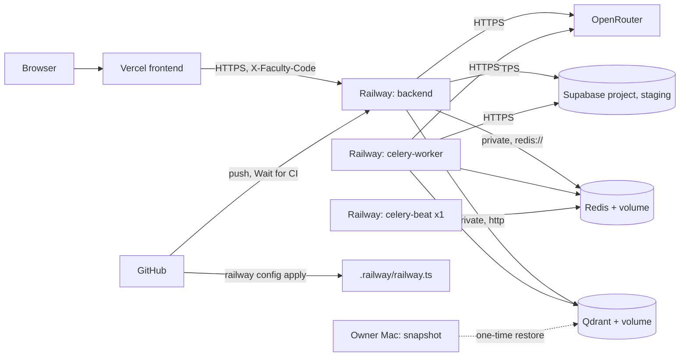

# Railway deployment and operations runbook (specification)

| Field | Value |
|---|---|
| Status | Specification. Nothing here has been run on Railway. |
| Date | 2026-11-05 |
| Head | `c9b42d3e` on `feature/audit-strengthen-rag-qdrant` |
| Depends on decisions | D-26 (Qdrant hosting), D-07 (`/api/first-person/query` clients), D-08 (evidence store and backups), D-14 (serving collection), ADR-015 |
| Companion files | `22b-railway-deployment-readiness-runbook.md` (earlier runbook, not edited), `FINAL_RAILWAY_STAGING_READINESS.md` (Gate A), `FINAL_PRODUCTION_RELEASE_READINESS.md` (Gates B and C), `FINAL_PENDING_WORK_REGISTER.md` |
| Evidence labels | `CONVENTIONS.md` section 3 |

How to read this file. A statement marked `[V-STATIC]` was read in code at `c9b42d3e`. A statement marked `[V-WEB]` comes from docs.railway.com, accessed 2026-11-05 (section 18). Several `[V-WEB]` statements come from a summarising fetch tool, not from raw page text. Check the exact wording on the page before you rely on it for an irreversible action. `[LIVE-R]` means "cannot be known without a live Railway project". Code wins over documents. Where they disagree, both are cited.

## 1. Scope and non-goals

In scope: a Railway **staging** environment and the operating procedures that production will reuse. Gate A (staging) is defined in `FINAL_RAILWAY_STAGING_READINESS.md`. Gates B and C are defined in `FINAL_PRODUCTION_RELEASE_READINESS.md`. This file does not repeat them.

Out of scope: the frontend build (Vercel), Supabase schema design, Qdrant data quality (see `22`), and any claim about production.

## 2. What 22b already covers, what it lacks, and where it is wrong

22b is a good gap list. Use its sections 1, 3, 5, 6 and 7 as inputs. This file adds what is missing. Do not edit 22b. Corrections:

| # | 22b statement | Finding at `c9b42d3e` | Evidence |
|---|---|---|---|
| C-1 | R-1: spend guard is off by default. | Stale. T1-07 landed. Guard and fail-closed default to true, and production startup refuses to run without both unless `allow_uncapped_llm_spend` is true. | `backend/app/config.py:643-648`, `:2492-2503` [V-STATIC] |
| C-2 | S-1: `/api/healthz` returns "503 during a forced Qdrant outage". | Wrong. The wrapper answers `/api/healthz` from lifespan state and heartbeat canaries. It does not probe Qdrant. Use `/api/health` with the internal token for dependency state. | `backend/start_railway.py:465-502`; `backend/app/api/health.py:194-225` [V-STATIC] |
| C-3 | §1: `.railwayignore` matching `*.ts` may affect IaC upload ("unknown"). | Resolved. Railway does not read `.railway/` during deploys. Plan and apply run where you run them. `.railwayignore` is a `railway up` upload filter. | docs `infrastructure-as-code` "Deploys"; `cli/up#file-handling` [V-WEB] |
| C-4 | R-4: Dockerfile path and builder "live only in the UI", fix by moving them into IaC. | `service()` has no Dockerfile or builder option. Use the service variable `RAILWAY_DOCKERFILE_PATH`. Railway builds with a Dockerfile whenever it finds one. | docs `infrastructure-as-code/reference`; `builds/dockerfiles`; `config-as-code/reference#specify-the-builder` [V-WEB] |
| C-5 | §4 and §7: no mention of drain time. | Default drain is 0 s. `RAILWAY_DEPLOYMENT_DRAINING_SECONDS` is set nowhere in the repo. The code assumes 60 s. See section 9. | docs `variables/reference`; `backend/app/main.py:135`; repo grep [V-STATIC][V-WEB] |
| C-6 | §4 step 5: deploy "with the variables in §3". | Missing from §3: `GIT_SHA` or a GitHub-triggered deploy. Without a concrete SHA the first-person production contract aborts startup. See section 6.3. | `backend/app/release_manifest.py:122-127`; `backend/services/first_person_release.py:119-125` [V-STATIC] |
| C-7 | §3 lists `REDIS_URL` without a policy. | The deploy script sets Redis `volatile-lru` at 256 MB. The compose files record a decision for `noeviction`. | `scripts/deploy/deploy_railway.sh:286-288`; `scripts/ops/railway_cleanup.py:181-190`; `docker-compose.prod.yml` Redis comments [V-STATIC] |
| C-8 | R-7: add `supabase db push` to the release procedure. | No procedure given. See section 11. No workflow in `.github/workflows/` applies migrations. | `.github/workflows` grep: only `backup.yml`, `supabase-schema-snapshot.yml`, `migration-revert-check.yml`, `nightly-rls.yml`, `prelaunch-gate.yml` mention Supabase CLI or schema [V-STATIC] |
| C-9 | §1: "Other services … manually created, scaled down" (cites a dated doc). | Still `[DOC-CLAIM]`. The file says "not re-verified as of 2026-10-22". | `docs/operations/railway-production-status-2026-09-20.md:3` [V-STATIC] |
| C-10 | No section on signals, PID 1, restart policy, volumes, replicas, or Celery Beat singleton. | Added in sections 8, 9, 12, 13. | — |
| C-11 | §3 lists `PORT` as "yes". | Railway injects it. Code defaults to 8000 if it is missing. Do not set it by hand. | `backend/start_railway.py:38`; docs `healthchecks` [V-STATIC][V-WEB] |

Other documents that disagree with the code:

| Document | Statement | Code |
|---|---|---|
| `CLAUDE.md` Gotchas (Railway line): "When it resumes: `/api/health` gate" | Deploy gate is `/api/healthz`. | `.railway/railway.ts:17`; `backend/start_railway.py:13-17` says the path must not be `/api/health` |
| `docs/agent/claude-md-archive/railway-deployment.md:34` | "Target `/api/health` for deployment gating". | Same as above. Archive is dated. |
| `backend/app/main.py:934` comment | Wrapper returns 200 "for 90s". | Grace is 180 s (`start_railway.py:83`). |
| `backend/app/main.py:135` comment | "Railway drainingSeconds:60". | Not set anywhere in the repo (grep, 2026-11-05). |
| `.railway/railway.ts:15-23` | Dockerfile path and watch patterns kept "in sync with Railway service settings UI". | Not expressible in IaC, see C-4. |

## 3. Facts about Railway that shape the design

| # | Fact | Label and source |
|---|---|---|
| F-1 | Config as Code (`railway.json`, `railway.toml`) is deprecated. Existing files stop being read on 2026-12-01. New services cannot opt in. | [V-WEB] `infrastructure-as-code` (also verified by the lead) |
| F-2 | IaC lives in `.railway/railway.ts`. Commands: `railway config init`, `pull`, `plan`, `apply`, `migrate`. `apply` re-plans and rejects if the environment changed. Non-interactive runs need `--yes`; destructive changes need `--confirm-destructive`. | [V-WEB] `infrastructure-as-code` |
| F-3 | Railway does not read `.railway/` during deploys. A merged change to the file does nothing until someone runs `apply`. The `railwayapp/config` GitHub action plans on PRs and applies on merge, using a project token (`RAILWAY_TOKEN`) for one environment. | [V-WEB] `infrastructure-as-code` |
| F-4 | `service()` accepts: `source`, `build`, `start`, `healthcheck`, `healthcheckTimeout`, `preDeploy`, `replicas`, `env`, `domains`, `volumeMounts`, `tracing`. It does not accept restart policy, cron, Dockerfile path, builder, watch paths, drain seconds, or resource limits. | [V-WEB] `infrastructure-as-code/reference` (summarised) |
| F-5 | A multi-repo file exports `partial`. The repo file already exports `partial = "askmukthiguru-8119b0e8"`. The first apply claims ownership of what the file declares. Renaming does not transfer ownership. | [V-WEB]; `.railway/railway.ts:5` [V-STATIC] |
| F-6 | Healthchecks run only at deploy start. They are "not used for continuous monitoring". Default timeout 300 s. Host header is `healthcheck.railway.app`. A service with a volume has brief downtime on redeploy even with a healthcheck. | [V-WEB] `deployments/healthchecks` |
| F-7 | Default restart policy is On Failure, capped at 10 restarts. A restart affects only the crashed replica. | [V-WEB] `deployments/restart-policy` |
| F-8 | On a new deploy the old one gets SIGTERM, then SIGKILL after the drain time. Default `RAILWAY_DEPLOYMENT_DRAINING_SECONDS` is 0. Default overlap is 0. | [V-WEB] `deployments/deployment-teardown`; `variables/reference` |
| F-9 | Pre-deploy commands run in a separate container, inside the private network, with the app variables. No volumes. A failure stops the deploy, with no retry. Timeout 1-3600 s, none by default. | [V-WEB] `deployments/pre-deploy-command` |
| F-10 | Private DNS: `<service>.railway.internal`. Environments created after 2025-10-16 resolve to IPv4 and IPv6. Legacy environments resolve to IPv6 only. Private networking works at runtime, not at build. Each environment has its own network. Use `http://` inside. | [V-WEB] `networking/private-networking`, `.../how-it-works` |
| F-11 | A public web server should bind `0.0.0.0` and listen on `PORT`. | [V-WEB] `networking/troubleshooting/application-failed-to-respond` (search snippet) |
| F-12 | One volume per service. Replicas cannot be used with volumes. Backups: daily (kept 6 days), weekly (27 days), monthly (89 days), manual. Manual backups are capped at 50% of volume size. Restore goes to a new volume in the same project and environment. Wiping a volume deletes its backups. The feature is marked "still under development". | [V-WEB] `volumes/reference`, `volumes/backups` |
| F-13 | Cron services must exit when done. A still-running previous run blocks the next. Not suitable for Celery Beat. Minimum interval 5 minutes, UTC. | [V-WEB] `cron-jobs` |
| F-14 | Replicas split traffic randomly. No sticky sessions. Pro plan replica limit stated as 24 vCPU and 24 GB each. | [V-WEB] `deployments/scaling` |
| F-15 | Usage limits: a soft email alert and a hard limit (minimum $10) that takes workloads offline. Hard-limit reminders at 75% and 90%. Monitors (CPU, RAM, disk, egress) alert by email, in-app and webhook, and need the Pro plan. No HTTP-error-rate monitor is documented. | [V-WEB] `pricing/cost-control`, `observability` |
| F-16 | `RAILWAY_GIT_COMMIT_SHA` is provided only "if the deploy originated from a GitHub trigger". | [V-WEB] `variables/reference` |
| F-17 | Sealed variables are not shown in the UI or API, cannot be unsealed, are not provided to the CLI, and are not copied to PR environments, duplicated environments or duplicated services. | [V-WEB] `variables` |
| F-18 | "Wait for CI" holds a GitHub-triggered deploy in WAITING until all Actions check suites finish. A failed workflow skips the deploy. | [V-WEB] `deployments/github-autodeploys` |
| F-19 | `railway up` honours `.railwayignore`. | [V-WEB] `cli/up#file-handling` (search snippet) |
| F-20 | The Redis template deploys the official `redis` image with private-by-default access. The docs do not state persistence or `maxmemory`. Changing the template makes the service yours to manage. | [V-WEB] `databases/redis` |

## 4. Topology

### 4.1 What staging needs

| Component | Needed in staging | Where | Reason |
|---|---|---|---|
| Backend API | Yes | Railway service `backend` | Serves `/api/chat`. |
| Celery worker | Yes, but may start at 0 replicas of work | Railway service `celery-worker` | Memory outbox, ingestion, OKF queues (`celery_config.py` task routes). |
| Celery beat | Yes, exactly one | Railway service `celery-beat` | Schedules (`celery_config.py:95-118`): memory drain 60 s, retention 24 h, stale-job sweep 300 s, others. |
| Redis | Yes | Railway service `redis` | Cache, rate limit, quota, Celery broker (db 1 derived, `celery_config.py:41-44`). |
| Qdrant | Yes | D-26: Railway service with volume, or Qdrant Cloud | Holds the first-person collection. |
| Supabase | Yes, a separate project per environment | External | Auth, telemetry, memory tables. ADR-015. |
| Frontend | Yes | Vercel, not Railway | `vercel.json:2-4` sets `VITE_BACKEND_URL`. |
| Memgraph | No | — | ADR-005 and ADR-015 say it is not deployed. See risk R-5 below. |
| Prometheus, Grafana, Jaeger | Not on Railway in staging | Hosted or none | `22b` section 8. Gate B item B10 owns alerting. |

### 4.2 Diagram



### 4.3 Risks in the topology

| ID | Risk | Evidence | Label |
|---|---|---|---|
| R-1 | Redis is shared by cache, quotas, rate limits and the Celery broker. Eviction can delete quota counters. | `docker-compose.prod.yml` Redis comments (noeviction); `deploy_railway.sh:286-288` (volatile-lru) | [V-STATIC] |
| R-2 | A volume-backed Qdrant cannot have replicas and has downtime on every redeploy. | F-6, F-12 | [V-WEB] |
| R-3 | One Qdrant instance is a single point of failure. | `CLAUDE.md` SPOF policy table (single node at 1k tier) | [DOC-CLAIM] |
| R-4 | The Beat service must never exceed one replica. Two Beats double every scheduled task. | `celery_config.py:95-118` [V-STATIC] | [INF] on duplicate effect |
| R-5 | The image sets `LIGHTRAG_GRAPH_STORAGE=MemgraphStorage` (`Dockerfile.railway:127`). With no Memgraph the boot waits up to 120 s for LightRAG, then up to 180 s for background init (`main.py:923`, `:938`). Worst case is 300 s plus import time, against a 330 s deploy healthcheck. The margin may be under 30 s. | `main.py:923`, `:938`; `.railway/railway.ts:18` | [V-STATIC] for timeouts; actual boot time [LIVE-R] |
| R-6 | If Qdrant is slow to restore, startup does not fail on its own. The app may start and abstain. | CLAUDE.md "Qdrant degraded" policy | [DOC-CLAIM] |

## 5. Proposed `.railway/railway.ts`

Do not create this file from this spec without a review. The import names (`github`, `image`, `volume`, `preserve`) come from the reference summary. Confirm them with `railway config init` and `railway config plan` before you rely on them. `[INF]` marks every line that is unverified.

Rules this file follows:

1. One `partial` for this repo (F-5). The name stays `askmukthiguru-8119b0e8`.
2. The Dockerfile path is a variable, because `service()` has no option for it (F-4).
3. Drain seconds is a variable (F-4, F-8).
4. Secrets use `preserve()`. You set them in the dashboard first. Sealed variables do not copy to duplicated environments (F-17), so you set them once per environment.
5. Restart policy, resource limits and usage limits are dashboard settings. The file records them as comments so a reviewer can check them (`[LIVE-R]`).

```ts
import { defineRailway, project, service, volume, github, image, preserve } from "railway/iac";

// Partial: this repo owns only the resources it declares.
export const partial = "askmukthiguru-8119b0e8";

export default defineRailway((ctx) => {
  const isStaging = ctx.isEnvironment("staging");
  const REPO = github("Harshodai/askmukthiguru-8119b0e8", {
    branch: isStaging ? "main" : "main", // [INF] use a release branch for production
    // No rootDirectory: backend/Dockerfile.railway COPYs backend/, memory/,
    // audits/evidence/<one file>, config/helplines.yaml and scripts/ops/rotate_brain_kek.py
    // from the repository root (Dockerfile.railway:34-99).
  });

  // ---- Redis (image, so that the eviction policy is ours) ----
  const redisVol = volume("redis-data", { sizeMB: 1024 });
  const redis = service("redis", {
    source: image("redis:7-alpine"),
    // Matches docker-compose.prod.yml: noeviction. Quota and rate-limit keys must not be evicted.
    start: "redis-server --requirepass $REDIS_PASSWORD --maxmemory 512mb --maxmemory-policy noeviction --appendonly yes --dir /data",
    volumeMounts: { "/data": redisVol },
    env: { REDIS_PASSWORD: preserve() },
    replicas: 1,
    // Restart policy: dashboard, On Failure (default). [LIVE-R]
  });

  // ---- Qdrant (only if D-26 = Railway service; otherwise delete this block) ----
  const qdrantVol = volume("qdrant-data", { sizeMB: 10240 }); // size: decide at staging from collection size [LIVE-Q]
  const qdrant = service("qdrant", {
    source: image("qdrant/qdrant:v1.18.0"), // pinned, as in both compose files
    volumeMounts: { "/qdrant/storage": qdrantVol },
    env: {
      QDRANT__SERVICE__API_KEY: preserve(),           // write key
      QDRANT__SERVICE__READ_ONLY_API_KEY: preserve(), // backend serving key
      RAILWAY_RUN_UID: "0",                           // [INF] only if the volume mount is not writable
    },
    healthcheck: "/", // [INF] docker-compose.prod.yml uses GET / ; check that it works with an API key set
    healthcheckTimeout: 120,
    replicas: 1, // volumes forbid replicas (F-12)
  });

  // ---- Backend API ----
  const backend = service("askmukthiguru-8119b0e8", {
    source: REPO,
    start: "python start_railway.py",
    healthcheck: "/api/healthz",
    healthcheckTimeout: 330, // must stay above _GRACE_SECONDS=180 (start_railway.py:83)
    replicas: 1,
    domains: [], // generated Railway domain for staging; custom domain only for production
    env: {
      RAILWAY_DOCKERFILE_PATH: "backend/Dockerfile.railway",
      RAILWAY_DEPLOYMENT_DRAINING_SECONDS: "60", // main.py:135 assumes 60
      ENVIRONMENT: isStaging ? "staging" : "production",
      // Private references (names resolve at runtime only, F-10):
      QDRANT_URL: `http://${qdrant.env.RAILWAY_PRIVATE_DOMAIN}:6333`,
      REDIS_URL: preserve(),               // build from the redis service in the dashboard, see 6.2
      QDRANT_READ_ONLY_API_KEY: preserve(),
      // Secrets, set in the dashboard first:
      JWT_SECRET: preserve(),
      ANON_SESSION_HMAC_SECRET: preserve(),
      BRAIN_KEK: preserve(),
      FACULTY_ACCESS_CODE: preserve(),
      METRICS_SCRAPE_TOKEN: preserve(),
      OPENROUTER_API_KEY: preserve(),
      SUPABASE_URL: preserve(),
      SUPABASE_KEY: preserve(),
      // Non-secret, explicit (see section 6 for the full matrix):
      CORS_ORIGINS: preserve(),
      ALLOWED_HOSTS: preserve(),
      FIRST_PERSON_ACTIVE_COLLECTION: "first_person_v10",
      FIRST_PERSON_CONTEXT_HARNESS_ENABLED: "true",
      FIRST_PERSON_CONTEXT_TERMINAL_ENABLED: "true",
      FIRST_PERSON_RELEVANCE_MODEL: preserve(),
      OPENROUTER_EXTRA_ALLOWED_MODELS: preserve(),
      OPENROUTER_BUDGET_GUARD_ENABLED: "true",
      OPENROUTER_BUDGET_FAIL_CLOSED: "true",
      OPENROUTER_DAILY_BUDGET_USD: preserve(),
      OPENROUTER_MONTHLY_BUDGET_USD: preserve(),
      GIT_SHA: preserve(), // set by CI on each deploy, see 6.3
    },
  });

  // ---- Celery worker ----
  const worker = service("celery-worker", {
    source: REPO,
    start: "python start_railway.py",
    healthcheck: "/api/healthz", // the worker serves it on PORT (start_railway.py:569-603)
    healthcheckTimeout: 120,
    replicas: 1,
    env: {
      RAILWAY_DOCKERFILE_PATH: "backend/Dockerfile.railway",
      RAILWAY_DEPLOYMENT_DRAINING_SECONDS: "60",
      SERVICE_TYPE: "celery",
      CELERY_QUEUES: "ingestion,embedding,indexing,okf,memory",
      CELERY_CONCURRENCY: "1",
      ENVIRONMENT: isStaging ? "staging" : "production",
      // Same secrets and store URLs as the backend. A worker that lacks
      // ANON_SESSION_HMAC_SECRET fails at import (docker-compose.prod.yml beat comment).
    },
  });

  // ---- Celery beat: exactly one instance ----
  const beat = service("celery-beat", {
    source: REPO,
    start: "python start_railway.py",
    // No healthcheck: beat serves no HTTP (start_railway.py:514-531).
    replicas: 1, // never raise
    env: {
      RAILWAY_DOCKERFILE_PATH: "backend/Dockerfile.railway",
      RAILWAY_DEPLOYMENT_DRAINING_SECONDS: "30",
      SERVICE_TYPE: "celery-beat",
      ENVIRONMENT: isStaging ? "staging" : "production",
    },
  });

  return project("resilient-embrace", {
    resources: [redis, qdrant, backend, worker, beat],
  });
});
```

Notes on the file:

- `CELERY_QUEUES` allowed values are `ingestion,embedding,indexing,okf,memory` (`start_railway.py:103`, `:106-114`). The production compose file also lists `transcription` and `celery`; the Railway wrapper would reject them (`start_railway.py:103`). That is a difference to resolve when you port the compose command. [V-STATIC]
- The `memory` queue holds the memory outbox drain. If you leave it out, T1-10 consent behaviour does not run. [INF]
- `workers`: `WEB_CONCURRENCY` is 1 in the image (`Dockerfile.railway:109`). Keep it. Memory per worker is duplicated (`start_railway.py:127-137`).
- Variables with `preserve()` must already exist in the environment when you run `railway config plan`. [INF]
- Whether `env` accepts `RAILWAY_*` names is unverified. If `plan` rejects it, set those two variables in the dashboard and record that in the plan output. [INF]
- The project name `resilient-embrace` is copied from the existing file (`.railway/railway.ts:25`). The staging environment is an environment inside that project, not a new project. [INF] Check whether the owner wants a separate project instead.
- Production, after the staging proof: the same file with `ctx.isEnvironment("production")` choices. Gate B owns that step.

## 6. Variable matrix

"Service" means where the variable is needed: B = backend, W = worker, T = beat. Worker and beat import `app.config`, so they need every variable that startup validators check (`docker-compose.prod.yml` beat comment) [V-STATIC].

### 6.1 Required by startup validators

| Name | Req | Secret | Service | Default in code | Where validated |
|---|---|---|---|---|---|
| `ENVIRONMENT` | Yes | No | B W T | `local` | Must be `production` or `staging` when `IS_PRODUCTION=true`: `config.py:2638-2646`; `main.py:761-784` (`check_startup_posture`) |
| `IS_PRODUCTION` | Set by image | No | B W T | `true` (`config.py:1111`) | Image sets `true` (`Dockerfile.railway:107-108`) |
| `JWT_SECRET` | Yes | Yes | B W T | none | Import fails if unset: `services/auth_service.py:32-33`. Must equal the Supabase JWT secret if HS256 tokens are verified: `auth_service.py:429-434` |
| `ANON_SESSION_HMAC_SECRET` | Yes | Yes | B W T | none | `config.py:2364-2369` |
| `BRAIN_KEK` | Yes | Yes | B W T | none | `config.py:2475-2479` |
| `FACULTY_ACCESS_CODE` or `FACULTY_GATE_DISABLED=true` | Yes | Code is secret | B | none | `config.py:2484-2490`; `main.py:761-784` |
| `OPENROUTER_API_KEY` | Yes | Yes | B W | none | `config.py:2419` (provider `openrouter`) |
| `OPENROUTER_BUDGET_GUARD_ENABLED`, `OPENROUTER_BUDGET_FAIL_CLOSED` | Default true | No | B W | `true`, `true` (`config.py:643`, `:648`) | `config.py:2492-2503` |
| `OPENROUTER_DAILY_BUDGET_USD`, `OPENROUTER_MONTHLY_BUDGET_USD` | Set explicitly | No | B W | 10.0, 40.0 (`config.py:640-641`) | `Field(gt=0)` at `config.py:640-641` |
| `FORWARDED_ALLOW_IPS` | Yes | No | B | `""` (`config.py:137`) | Image sets `10.0.0.0/8,127.0.0.1` (`Dockerfile.railway:115`); wildcard refused: `config.py:2597-2598`; empty refused: `start_railway.py:627-635` |
| `ALLOWED_HOSTS` | Yes for any custom domain | No | B | `localhost,127.0.0.1` (`config.py:1107`) | `config.py:2588-2592`; middleware `main.py:1038-1042` adds `.railway.app` |
| `CORS_ORIGINS` | Yes | No | B | localhost list (`config.py:1092`) | Bare `*` refused: `main.py:1062-1070`; middleware `main.py:1138-1145` |
| `QDRANT_URL` | Yes | No | B W | `http://localhost:6333` (`config.py:709`) | Not validated at boot. A wrong URL shows as degraded behaviour. [INF] |
| `QDRANT_READ_ONLY_API_KEY` (or `QDRANT_API_KEY`) | Yes if Qdrant has keys | Yes | B | `""` (`config.py:714`) | Fallback order: `services/qdrant/client.py:115-116` |
| `QDRANT_WRITE_API_KEY` | Only for builder jobs | Yes | none on Railway | `""` (`config.py:717`) | "The running backend container never receives this key" (`config.py:715-716`). Keep it off all three Railway services. |
| `REDIS_URL` | Yes | Yes | B W T | `redis://redis:6379/0` (`config.py:1002`) | `default:` user is stripped: `config.py:2394-2403` |
| `SUPABASE_URL` | Yes | No | B W | `http://host.docker.internal:54321` (`config.py:793`) | Not validated. A wrong value is silent apart from `Telemetry Sink insert failed` (`CLAUDE.md` Gotchas). [DOC-CLAIM] |
| `SUPABASE_KEY` (service role) | Yes | Yes | B W | `""` (`config.py:794`) | Not validated at boot. [INF] |
| `METRICS_SCRAPE_TOKEN` | Yes (deep health, metrics) | Yes | B | unset (`config.py:1063`) | Fail closed: `app/api/health.py:173-180` |

### 6.2 Serving posture (set explicitly, never rely on a default)

| Name | Staging value | Default in code | Where read |
|---|---|---|---|
| `FIRST_PERSON_ACTIVE_COLLECTION` | `first_person_v10` | `first_person_v10` (`config.py:205`) | `config.py:2308-2327` |
| `FIRST_PERSON_CONTEXT_HARNESS_ENABLED` | `true` | `false` (`config.py:282`) | v10-only needs both: `config.py:2320-2321` |
| `FIRST_PERSON_CONTEXT_TERMINAL_ENABLED` | `true` | `false` (`config.py:298`) | same |
| `FIRST_PERSON_ROUTE_ENABLED` | `true` | `true` (`config.py:215`) | `first_person_release.py:96` |
| `FIRST_PERSON_MODE` | `retrieval_only` | `retrieval_only` (`config.py:189`) | `first_person_release.py:102-103` |
| `FIRST_PERSON_CHAT_BRIDGE_ENABLED` | `true` | `true` (`config.py:409`) | live per request |
| `FIRST_PERSON_LLM_FALLBACK_ENABLED` | `false` | `false` (`config.py:430`) | T1-05 |
| `FIRST_PERSON_SERVE_WEAK_MATCH` | `true` (owner decision, CLAUDE.md inv. 21) | `true` (`config.py:442`) | — |
| `FIRST_PERSON_RELEVANCE_MODEL` | `anthropic/claude-haiku-5.5` per CLAUDE.md inv. 24 | `""` (`config.py:476`) | Empty uses the provider default, which is not the measured scorer. |
| `OPENROUTER_EXTRA_ALLOWED_MODELS` | must include the scorer model | `""` (`config.py:605`) | Model policy validator `config.py:2423` |

Warning. With the harness flags at their defaults, `FIRST_PERSON_COLLECTION` resolves to `first_person_v8` (`config.py:2308-2327`, `_LEGACY_FP_COLLECTION` at `config.py:41`). Staging then serves v8, not v10. D-14 must decide which. `CLAUDE.md` invariant 23 (v8) and 25 (v10-only) conflict; the code default is v8-compatible.

`REDIS_URL` for the private network: build it from the Redis service password and private domain, for example `redis://:<password>@redis.railway.internal:6379/0`. The password must not appear in `.railway/railway.ts`. [INF]

### 6.3 Release identity (new gap)

The first-person production contract requires a concrete `release_id` and `git_sha` (`first_person_release.py:119-125`). The manifest reads `GIT_SHA`, then `RAILWAY_GIT_COMMIT_SHA` (`release_manifest.py:122-127`). Railway sets `RAILWAY_GIT_COMMIT_SHA` only for GitHub-triggered deploys (F-16). `scripts/deploy/deploy_railway.sh:295` deploys with `railway up --detach`, which is not a GitHub trigger. [V-STATIC][V-WEB] Conclusion: a script deploy can abort startup with "release manifest must contain a concrete git_sha". [INF] Fix (NEW-RW-2): let GitHub trigger deploys, or have CI set `GIT_SHA` to the commit before each deploy.

### 6.4 Variables the deploy script sets that need attention

| Variable | Script line | Problem |
|---|---|---|
| `JWT_SECRET` | `deploy_railway.sh:219-222` | Generated randomly with `openssl rand -hex 32`. Code verifies HS256 tokens with it (`auth_service.py:429-434`) and the config comment says it is "Shared with Supabase" (`config.py:1120`). A random value may reject real Supabase tokens. Unknown whether the Supabase project uses asymmetric keys. [INF] |
| `CORS_ORIGINS` | `:224` | Hard-coded `https://askmukthiguru.lovable.app`. Staging needs the staging frontend origin. |
| `QDRANT_COLLECTION` | `:244` | `spiritual_wisdom_contextual`, not the first-person collection. Chat bridge uses `FIRST_PERSON_*`. Unknown whether non-FP paths need it. |
| Redis policy | `:286-288` | `volatile-lru`, 256 MB. See C-7 and R-1. |
| Missing | — | `ENVIRONMENT`, `FACULTY_ACCESS_CODE`, `METRICS_SCRAPE_TOKEN`, `ALLOWED_HOSTS`, `GIT_SHA`, all `FIRST_PERSON_*` flags, budget variables, `QDRANT_*_API_KEY`, `RAILWAY_DEPLOYMENT_DRAINING_SECONDS`. |
| `NEO4J_*`, `MEMGRAPH_URI`, `LIGHTRAG_GRAPH_STORAGE` | `:236-241` | Point at a Memgraph service. ADR-015 says Memgraph is not deployed. See R-5. |

A misspelled variable is silently ignored (`extra="ignore"`, `config.py:55`). T2-06 added a config lint for the repo, not for the Railway environment. After every deploy, read the "Serving posture" log line (`main.py:1122-1135`) and compare it with section 6.2.

## 7. Build, start, healthcheck and restart, per service

| Service | Build | Start | Healthcheck | Restart | Notes |
|---|---|---|---|---|---|
| backend | `backend/Dockerfile.railway`, context = repo root (`:34`, `:81-99`) | `python start_railway.py` (`Dockerfile.railway:149`) | `/api/healthz`, 330 s | On Failure, max 10 (default F-7). Exits non-zero on 60 s of stale heartbeat (`start_railway.py:180-213`). | Wrapper returns 200 for 180 s, then real state (`:465-502`). A failed lifespan returns 503 at once (`:467-472`). |
| celery-worker | same image | `SERVICE_TYPE=celery` branch (`start_railway.py:534-611`) | `/api/healthz` on `PORT`: 200 while the child lives | On Failure | Exit code of the child is the process exit code (`:611`). |
| celery-beat | same image | `SERVICE_TYPE=celery-beat` branch (`:515-531`) | none | On Failure | One replica only. |
| redis | image `redis:7-alpine` | `redis-server …` (section 5) | TCP only; no HTTP | On Failure | Needs a volume for AOF. |
| qdrant | image `qdrant/qdrant:v1.18.0` | image default | see section 5 | On Failure | Redeploy has downtime (F-6). |

Build facts. Railway uses Railpack by default for new services, but builds with a Dockerfile whenever it finds one (F-4 area, `config-as-code/reference#specify-the-builder`). The repo Dockerfile is named `Dockerfile.railway`, not `Dockerfile`, so auto-detection does not find it. You must set `RAILWAY_DOCKERFILE_PATH` (section 5). If you forget, Railway may fall back to Railpack and build the wrong thing. [INF]

`.dockerignore` at the repo root excludes `scripts/*` except `scripts/ops/rotate_brain_kek.py`, excludes `*.md`, `tests/` and `docker-compose*.yml` (`.dockerignore:54`, `:57-59`, `:88`, `:93`). It does not exclude `audits/evidence/…rights_manifest…json`, `config/helplines.yaml` or `memory/`. [V-STATIC]

## 8. Signal handling and graceful shutdown

| # | Finding | Evidence | Label |
|---|---|---|---|
| G-1 | The image runs `python start_railway.py` as the container's main process. | `Dockerfile.railway:149` | [V-STATIC] |
| G-2 | Backend mode: uvicorn runs in-process with one worker (`start_railway.py:649-657`). Uvicorn handles SIGTERM. The wrapper then sets `_shutdown_event` and waits up to 60 s for the lifespan (`:449-463`). The lifespan waits up to 45 s for in-flight requests (`main.py:135`, `:952`). | as cited | [V-STATIC] |
| G-3 | Railway default drain is 0 s (F-8). A new deploy can therefore SIGKILL the old one almost at once. The code comment assumes 60 s. No repo file sets it. | `main.py:135`; repo grep | [V-STATIC][V-WEB] |
| G-4 | Worker and beat modes install no signal handler. `grep signal start_railway.py` finds only comments. The parent blocks on `worker.wait()` or `subprocess.run`. A SIGTERM to a Python PID 1 with no handler is ignored by Linux. The Celery child would then never get a warm-shutdown signal and would be killed by SIGKILL. Whether Railway wraps the process in an init is unknown. | `start_railway.py:515-531`, `:567-611` | [INF]; wrapper behaviour [LIVE-R] |
| G-5 | In-flight Celery tasks use `task_acks_late=True` (`celery_config.py:82`), so a killed task is redelivered. The visibility timeout is 3600 s (`:85`). Tasks must be idempotent. | `celery_config.py:82-93` | [V-STATIC] |
| G-6 | Railway healthchecks do not run after deploy (F-6). `start_railway.py` already says so and exits non-zero on a wedged canary (`:13-22`, `:180-213`). This matches the docs. | — | [V-STATIC][V-WEB] |
| G-7 | A lifespan that raised leaves the process alive and `/api/healthz` at 503. No exit follows. On a first deploy the deploy fails. On a later boot of an already-live replica, Railway sees a live process. The comment calls this "a separate owner decision". | `start_railway.py:491-494`, `:411-413` | [V-STATIC] |

Required changes:

1. NEW-RW-1: set `RAILWAY_DEPLOYMENT_DRAINING_SECONDS=60` on backend and worker, and correct the `main.py:135` and `:934` comments.
2. NEW-RW-3: in `start_railway.py`, forward SIGTERM to the Celery child in worker and beat modes and wait for it. Add a test that sends SIGTERM to the wrapper and expects child shutdown.
3. Staging proof: deploy a no-op change, watch the old backend log "Graceful drain complete" in the deploy logs. If the line is missing, the drain is too short. [LIVE-R]

## 9. Networking

| Topic | Design | Evidence |
|---|---|---|
| Public ingress | Backend only. Generated Railway domain in staging. Custom domain with TLS for production. | F-11; `networking/domains` (page content was thin) [V-WEB] |
| Backend bind | `0.0.0.0` on `PORT`. Correct for public traffic. | `start_railway.py:651-652`; F-11 |
| Private traffic | Backend to Redis and Qdrant over `*.railway.internal`, `http://` and `redis://`. | F-10 |
| IPv6 | In a new environment (created after 2025-10-16) names resolve to IPv4 and IPv6, so a service bound to `0.0.0.0` is reachable. In a legacy environment names resolve to IPv6 only. A service bound to IPv4 only is unreachable. Check the environment creation date. If legacy, set Qdrant and Redis to listen on `::`. | F-10 [V-WEB]; the `QDRANT__SERVICE__HOST` variable name is [INF] |
| Healthcheck host | `healthcheck.railway.app`. The wrapper answers `/api/healthz` before any host check. `TrustedHostMiddleware` also allows it (`main.py:1038-1042`). | F-6 [V-WEB]; [V-STATIC] |
| Forwarded IPs | `FORWARDED_ALLOW_IPS=10.0.0.0/8,127.0.0.1`. `ProxyHeadersMiddleware` trusts the same list (`main.py:1391-1394`). The Railway edge must come from that range, which is unverified. | [INF]; [LIVE-R] |
| CORS | Exact origins only, no bare `*`. Staging origin is the Vercel preview or staging URL. | `main.py:1062-1070` |
| Faculty gate | `/api/chat*`, `/api/first-person*`, `/api/jobs*`, `/api/search*` need `X-Faculty-Code`. Health and metrics are exempt. | `faculty_gate.py:23-32` |
| Database egress | Supabase is external, over HTTPS (REST) and possibly Postgres. Private networking does not reach it. | ADR-015 |

## 10. Qdrant connectivity options (D-26)

The corpus exists only on the owner's Mac (finding DATA-01, `FINAL_PENDING_WORK_REGISTER.md` row DATA-01). Staging needs the `first_person_v10` collection loaded. `22` owns the data validation. This section owns the placement.

| Option | How | Pros | Cons | Label |
|---|---|---|---|---|
| A. Railway service with volume | Image `qdrant/qdrant:v1.18.0`, volume at `/qdrant/storage`, API keys, private URL | One platform. Private network. No new vendor. Matches compose. Prior measurement: Qdrant used ~1.33 GB RAM when it served the old corpus. | Volume downtime on redeploy. No replicas. Volume backups "still under development". Restore only within the same environment. Load needs a snapshot restore path (below). | [DOC-CLAIM] for the 1.33 GB (`docs/operations/railway-production-status-2026-09-20.md`) |
| B. Qdrant Cloud | Managed cluster, HTTPS URL, API key | Managed backups and upgrades. No volume handling. | New vendor and cost. Public HTTPS egress with an API key. Data leaves the Railway project. Data-processing terms need a decision (D-08). | [INF] |
| C. Owner's Mac via tunnel | Tunnel from Railway to the Mac | No upload. | Fails whenever the Mac sleeps. Exposes a personal machine. Not acceptable for a staging gate. | [INF] |

Recommendation: A for staging, because it is the only option that tests the Railway topology end to end. Decide production with cost data from staging (D-26 text). Revisit B if the Railway volume backup limits (F-12) fail the restore drill (Gate B item B9).

Load procedure for option A (NEW-RW-6). This needs the owner's Mac and a live Railway project:

1. On the Mac, create a snapshot of `first_person_v10` with the existing script `scripts/ops/snapshot_qdrant.py` (read the script first). Record the snapshot sha256.
2. Open a temporary path to the staging Qdrant (Railway TCP proxy or `railway ssh`/`connect`). Do not use the Qdrant write key from a Railway service. Use it from the Mac only.
3. Upload the snapshot through Qdrant's snapshot-recover API. [INF] Verify the exact API in `22` before running.
4. Close the temporary path.
5. Run the checks in `22` (point count, `source_text_hash` equals `sha256(verbatim_text)` on every point, encoder dimension 1024, rights register join).
6. Record counts, digest and date. File them by hash (D-10).

Security rules. The backend gets only the read-only key (`config.py:714-716`). The write key stays on the Mac. Qdrant is not exposed publicly after step 4.

## 11. Supabase migrations

Verified. Migrations live in `supabase/migrations/` (22 SQL files at this head). `supabase/config.toml` and `schema_snapshot.sql` exist. No deploy script and no workflow applies migrations to a hosted project. `deploy_railway.sh` never calls the Supabase CLI. T3-08 added a CI schema snapshot and a duplicate-`CREATE TABLE` lint. Rollback is manual: `-- REVERT:` blocks, never automatic (`docs/runbooks/MIGRATION_ROLLBACK.md:3-9`). [V-STATIC]

Decision: do not apply migrations from a Railway pre-deploy command. Reasons: the pre-deploy container runs once per deploy, has no retry, and a failure blocks the deploy (F-9). Supabase is external, so a pre-deploy run would need a database URL with owner rights inside the Railway project. A schema change should be a reviewed step, not a side effect of an app deploy. Use a manual step with a dry run.

Procedure (staging, then production), NEW-RW-5:

1. Confirm the Supabase staging project is separate from production (ADR-015). Record its project reference.
2. From a clean checkout of the release commit, run the Supabase CLI against the staging project. Use the "migration list" command to compare local and remote history. Do not apply yet.
3. Read every pending migration and its `-- REVERT:` block.
4. Take a dump of the staging database with the same command `backup.yml` uses (`supabase db dump`, `backup.yml:54-78`).
5. Apply the pending migrations to staging. Use the CLI's push command with a dry run first. [INF] Exact flags: confirm with `supabase db push --help`.
6. Run `nightly-rls.yml` logic or `staging-security-verification.yml` (manual dispatch) against staging.
7. Record the migration head in the release record.
8. Deploy the app only after step 7 passes. Make migrations backward compatible with the previous app version so a rollback of the app stays safe. [INF]
9. For production, repeat steps 1-8 with the production project and an owner approval.

Unknown without a live project: which migrations are already applied to which hosted project (`22b` R-7 says a faculty-labels migration is not applied, `[DOC-CLAIM]`).

## 12. Staging to production promotion

| Step | Action | Condition |
|---|---|---|
| 1 | Freeze a commit on `main` (T0-03 branch protection). Record the SHA. | CI required checks pass. |
| 2 | Let Railway deploy the commit to staging through the GitHub trigger with Wait for CI (F-18). | A GitHub trigger sets `RAILWAY_GIT_COMMIT_SHA` (F-16). |
| 3 | Apply migrations to staging (section 11). | Before the app deploy. |
| 4 | Run the smoke set (section 15) and the load test (T9-02). | Real models. |
| 5 | File the evidence under `audits/evidence/` by hash, with the SHA. | D-10. |
| 6 | Apply migrations to production. Deploy the same commit to production. Do not rebuild from a different ref. | Gate A passed. |
| 7 | Re-run the smoke set on production. | Gate B owns the rest. |

Note. Railway builds each environment from source. It does not promote an image between environments. "Same image" in `22b` section 4 step 10 means the same commit, not the same image digest. [INF] A rebuild from the same commit with a pinned lockfile should give the same dependencies, but the model download at build time (`Dockerfile.railway:44-49`) reads the network. Record the build log digest for each environment.

## 13. Resources, replicas, volumes, cost

PR environments. Railway can create temporary environments per pull request (docs `environments`). Do not enable them for this project. Sealed variables are not copied into them (F-17), each would need its own Redis, Qdrant volume and Supabase project, and the corpus cannot be loaded into each. This is a recommendation, not a verified limit. [INF]

Multi-region. Replicas can be placed per region (F-14, F-4). Staging uses one region. Volume-backed services are bound to the volume region. Region choice for production is a Gate B decision.

| Topic | Design | Evidence |
|---|---|---|
| Backend memory | About 1.81 GB when running with ONNX models (old measurement). Set an explicit limit and watch RSS. | `docs/operations/railway-production-status-2026-09-20.md` [DOC-CLAIM]; limit settings [LIVE-R] |
| Backend replicas | 1 in staging. With more replicas, per-replica caps multiply: `max_concurrent_chat` is per worker process (`config.py:1030`, `start_railway.py:127-137`). Memory is duplicated per replica. In-process caches and coalescers are not shared. | [V-STATIC] |
| Beat replicas | 1. | R-4 |
| Qdrant, Redis replicas | 1 (volumes forbid more). | F-12 |
| Volumes | Redis 1 GB to start; Qdrant sized from the collection and its snapshots at staging. A volume cannot shrink. | F-12 |
| Usage limit | Set a hard limit with a custom email alert below it. Reminders come at 75% and 90% of the hard limit. The hard limit takes all workloads offline, including the safety route. Choose it knowing that. | F-15 |
| LLM spend | App-side guard on by default (T1-07). Also set a provider-side key limit at OpenRouter. | `config.py:643-648` |
| Cron | Do not use Railway cron for Beat. | F-13 |
| Sleeping | `CLAUDE.md` archive records that serverless sleep did not trigger because traffic kept resetting the timer. Do not enable sleep on backend, worker or Beat. | `docs/agent/claude-md-archive/railway-deployment.md:18` [DOC-CLAIM] |

Cost numbers. This file gives none. The docs fetched do not list unit prices. The older repo note quotes $10/GB-month RAM and $20/vCPU-month (`railway-deployment.md:12`, `[DOC-CLAIM]`, not re-verified). Get current prices from the Railway pricing page before you budget.

## 14. Backup, restore and rollback

### 14.1 Application rollback

| Case | Action |
|---|---|
| Bad app deploy | In the dashboard, roll back to the previous deployment (`deployments/deployment-actions#rollback`) [V-WEB]. Record the previous deployment id before each release. Whether a rollback also reverts variables is unknown [LIVE-R]. |
| Bad variable | Revert the variable. Variable changes are staged and need a deploy (`variables`). Env changes need a redeploy, not a restart (CLAUDE.md invariant 23 lesson). |
| Bad IaC change | `railway config plan --out` before every apply, and apply the saved plan. Plan and apply fail if the environment drifted (F-2). |
| Bad migration | Manual `REVERT` block, reviewed. Prefer a forward fix when data is at risk (`MIGRATION_ROLLBACK.md:9-10`). |

### 14.2 Data rollback by collection switch

First-person serving is one name: `FIRST_PERSON_ACTIVE_COLLECTION` (`config.py:205`). Explicit `FIRST_PERSON_COLLECTION` and `FIRST_PERSON_CONTEXT_COLLECTION` override it (`config.py:2308-2327`). To roll back:

1. Confirm the old collection still exists in Qdrant (a new version is a new collection; the old one stays for rollback, CLAUDE.md invariant 4).
2. Set the variable to the old name. If you roll back from v10 to v8, also set `FIRST_PERSON_CONTEXT_HARNESS_ENABLED=false` and `FIRST_PERSON_CONTEXT_TERMINAL_ENABLED=false`, because v10-only posture needs both true (`config.py:2320-2321`).
3. Redeploy the backend. The startup contract check must pass (`main.py:886`).
4. Read the "Serving posture" log line. Run the in-corpus and out-of-corpus smoke checks.

### 14.3 Backup and restore

| Store | Backup | Restore | Status |
|---|---|---|---|
| Qdrant on a Railway volume | Railway volume backups (daily/weekly/monthly, manual) plus a Qdrant snapshot copied off Railway | Railway restore creates a new volume in the same environment (F-12). Snapshot recover through the Qdrant API (`restore-snapshot.md`) | Unproven. T3-10 and Gate B item B9. |
| Redis | AOF on volume; treat as rebuildable. Quotas reset on loss. | Recreate service | Loss degrades quotas and caches (CLAUDE.md policy). |
| Supabase | `backup.yml` dumps roles, schema and data (`:54-78`) | Restore into a scratch project | The workflow is reported failing (SYS-012). `[DOC-CLAIM]` |
| Audio archive and evidence | Owner Mac, off-Railway | — | D-08 |

Warning. Wiping a Railway volume deletes its backups (F-12). Keep one snapshot outside Railway.

## 15. Post-deploy smoke set

Set these shell variables first. Do not paste real secrets into shared logs.

```bash
BASE="https://<staging-backend-domain>"       # generated Railway domain
FAC="<FACULTY_ACCESS_CODE>"                   # from the secret store
ORIGIN="https://<staging-frontend-origin>"    # must be in CORS_ORIGINS
INTERNAL="<METRICS_SCRAPE_TOKEN>"
```

Request body fields come from `ChatRequest` (`app/schemas/__init__.py:136-168`): `messages` (list), `user_message`, optional `session_id`, `language`. `extra="forbid"`, so unknown fields give 422. The response model is not fixed (`response_model=None`, `app/api/chat.py:733`). Check the response shape once and record it. Expected `route_decision` values come from `CLAUDE.md` invariant 21 and are `[DOC-CLAIM]` until checked on staging.

| # | Check | Command | Expected | Label |
|---|---|---|---|---|
| S-1 | Liveness | `curl -sS -o /dev/null -w "%{http_code}\n" $BASE/api/healthz` | `200` after boot; body `{"ok":true,"status":"alive"}` (`start_railway.py:270`) | [V-STATIC] |
| S-2 | Shallow health | `curl -sS $BASE/api/health` | JSON with only `ready` and `status` (`health.py:183-191`, SEC-010) | [V-STATIC] |
| S-3 | Deep health | `curl -sS -H "Authorization: Bearer $INTERNAL" $BASE/api/health` | Full per-service body incl. `rights_register` with `present:true`, `asset_count>0` (`health.py:228-235`) | [V-STATIC] |
| S-4 | Readiness | `curl -sS -o /dev/null -w "%{http_code}\n" $BASE/api/ready` | `200` when Qdrant and the LLM circuit are ready; `503` otherwise (`health.py:601-615`) | [V-STATIC] |
| S-5 | Auth rejection | `curl -sS -o /dev/null -w "%{http_code}\n" -X POST $BASE/api/chat -H 'Content-Type: application/json' -d '{"messages":[],"user_message":"hello"}'` | `401` with `x-faculty-gate: denied` (no code header) (`faculty_gate.py:55-72`) | [V-STATIC] |
| S-6 | CORS rejection | `curl -sS -i -X OPTIONS $BASE/api/chat -H "Origin: https://evil.example" -H "Access-Control-Request-Method: POST"` | No `access-control-allow-origin` header for the evil origin (`main.py:1138-1145`) | [V-STATIC] |
| S-7 | CORS accept | same with `-H "Origin: $ORIGIN"` | `access-control-allow-origin: $ORIGIN` | [V-STATIC] |
| S-8 | Greeting | `curl -sS -X POST $BASE/api/chat -H "X-Faculty-Code: $FAC" -H 'Content-Type: application/json' -d '{"messages":[],"user_message":"namaste"}'` | Canned greeting, no clip, `model_used` null | [DOC-CLAIM] CLAUDE.md inv. 21 |
| S-9 | Crisis | same endpoint with a message from the existing crisis probe set (take the text from `backend/evaluation/`; do not invent one, and never call a real helpline) | Helpline text from `config/helplines.yaml`, no clip | [DOC-CLAIM]; probe set path [INF] |
| S-10 | In-corpus | same endpoint with 3 questions from the frozen retrieval bank (`evals/retrieval_bank/`, T2-02) | `route_decision=first_person_bridge`, a clip with a source and a verbatim quote, or a static abstain | [DOC-CLAIM] |
| S-11 | Out-of-corpus | same endpoint with 3 non-spiritual questions from the abstain set (`evals/pr_suite/`, T2-01) | Static abstain, no clip | [DOC-CLAIM] |
| S-12 | Metrics token | `curl -sS -o /dev/null -w "%{http_code}\n" $BASE/internal/metrics` then again with `-H "Authorization: Bearer $INTERNAL"` | `401` or `403` without; `200` with (`health.py:785-790`) | [V-STATIC] |
| S-13 | Posture log | Read the backend deploy log for the line starting `Serving posture:` | Collection, bridge, fallback, weak_match, scorer model all match section 6.2 | [V-STATIC] `main.py:1122-1135` |
| S-14 | Worker alive | `railway logs` for celery-worker shows the Celery ready line; beat log shows scheduler start | Both present | [LIVE-R] |
| S-15 | Budget refusal | Temporarily set a very low `OPENROUTER_DAILY_BUDGET_USD` on staging, send one in-corpus question | Controlled budget error, not HTTP 500 | [LIVE-R] |

If a check fails, stop. Do not continue to the load test.

## 16. Monitoring

| Topic | Statement | Label |
|---|---|---|
| Railway healthcheck | Runs at deploy start only. It is not continuous monitoring. After go-live Railway does not check the endpoint. | [V-WEB] `deployments/healthchecks` |
| Process restart | Railway restarts on non-zero exit only. The wrapper's watchdog exits non-zero after 60 s of stale canary (`start_railway.py:91`, `:206-213`). | [V-STATIC] |
| Railway monitors | CPU, RAM, disk, egress. Pro plan. Alert by email, in-app, webhook. No HTTP error monitor documented. | [V-WEB] |
| External uptime probe | Needed. Probe `/api/healthz` and the shallow `/api/health` every minute from outside Railway. The docs suggest an Uptime Kuma template. | [V-WEB] |
| Dependency state | `/api/health` with the internal token. Metrics at `/internal/metrics` with the token (`health.py:785-790`). | [V-STATIC] |
| Outcome metrics | T2-03 added `answer_outcome` and per-call LLM telemetry (`app/answer_outcome.py`, `app/metrics.py`). Alert rules for them are Gate B item B10. | [V-STATIC] |
| Logs | Railway log search supports filters by service, replica and deployment. Retention is not stated in the fetched page. | [V-WEB]; retention [LIVE-R] |

## 17. Railway-specific incident playbooks

Each playbook is: symptom, check, action. Severity and on-call owner are Gate B items. Use `docs/runbooks/ONCALL.md` for contacts.

### 17.1 Crash loop

1. Symptom: the service restarts repeatedly. After 10 restarts Railway stops (F-7).
2. Check the log for `Refusing to start unsafe posture` (`main.py:805-809`), `ValueError` from a validator (`config.py:2366`, `:2419`, `:2476`, `:2485`, `:2497`), `anon_session_hmac_secret is required`, or `FORWARDED_ALLOW_IPS must be set` (`start_railway.py:627-635`).
3. Action: fix the named variable. Redeploy. If the cause is code, roll back (section 14.1).

### 17.2 Out of memory

1. Symptom: container killed, log ends without a traceback.
2. Check the memory graph. Compare with the old ~1.81 GB figure `[DOC-CLAIM]`. Check `WEB_CONCURRENCY` (must be 1) and `CELERY_CONCURRENCY`.
3. Action: raise the service memory limit, or lower concurrency. Do not run embedding builds in this container (CLAUDE.md invariant 18).

### 17.3 Healthcheck failure at deploy

1. Symptom: deploy marked failed. The old deployment keeps serving.
2. Check: grace is 180 s, then `/api/healthz` is 503 until the real lifespan finished (`start_railway.py:473-497`). Boot with no Memgraph can take up to 300 s plus import (R-5). The timeout is 330 s.
3. Check the log for `Fatal error in real lifespan` (`start_railway.py:412`). That sets `_lifespan_failed` and returns 503 at once.
4. Action: fix the failing step. If the cause is boot time, raise `healthcheckTimeout` and keep `_GRACE_SECONDS` lower (the test `backend/tests/test_healthz_grace_masking.py` guards this, `.railway/railway.ts:14`).

### 17.3b Live wedge after deploy

1. Symptom: chat hangs and `/api/healthz` is 503.
2. The watchdog exits the process after 60 s (`start_railway.py:91`). Railway restarts it.
3. If restarts stop at 10, redeploy by hand.

### 17.4 Private DNS failure

1. Symptom: Qdrant or Redis unreachable by `*.railway.internal`. Private networking is not available during build (F-10).
2. Check the environment creation date (F-10). In a legacy environment the target must listen on IPv6.
3. Check the service names. A renamed service changes its DNS name.
4. Action: use the private domain variable by reference. Set the target to listen on `::` if legacy. Redeploy the target, then the backend.

### 17.5 Bad variable

1. Symptom: wrong posture after a deploy. A misspelled name is ignored (`config.py:55`).
2. Check the `Serving posture:` log line and the effective values (section 6.2).
3. Action: correct the variable. Redeploy. Add the name to the T2-06 config lint if it is a repo setting.

### 17.6 Cost spike

1. Symptom: provider spend or Railway usage rises.
2. Check OpenRouter usage. Check which route spends. `/api/first-person/query` may be unauthenticated (SEC-001, open, D-07). The faculty gate covers `/api/first-person*` when `FACULTY_ACCESS_CODE` is set (`faculty_gate.py:27`).
3. Action: lower the budget cap, or set `FIRST_PERSON_ROUTE_ENABLED=false` and redeploy. Check the Railway usage page and the usage limit (F-15). Remember a hard limit takes everything offline, the safety route included.

### 17.7 Qdrant data loss or corruption

1. Symptom: the app abstains on in-corpus questions, or health shows Qdrant unhealthy.
2. Check the collection exists and its point count (`22`). Check the volume state.
3. Action: restore the Railway volume backup or recover the snapshot (section 14.3). If not possible, switch the collection by variable to a known-good one (section 14.2).

## 18. Railway documentation used (accessed 2026-11-05)

Read through the Railway docs search and fetch tools and through WebFetch. Several pages were returned as summaries.

- https://docs.railway.com/infrastructure-as-code
- https://docs.railway.com/infrastructure-as-code/reference
- https://docs.railway.com/deployments/healthchecks
- https://docs.railway.com/deployments/restart-policy
- https://docs.railway.com/builds/dockerfiles
- https://docs.railway.com/config-as-code/reference (search snippet: builder note)
- https://docs.railway.com/deployments/monorepo
- https://docs.railway.com/networking/private-networking
- https://docs.railway.com/networking/private-networking/how-it-works
- https://docs.railway.com/networking/private-networking/library-configuration
- https://docs.railway.com/networking/troubleshooting/application-failed-to-respond (search snippet)
- https://docs.railway.com/networking/domains (thin page)
- https://docs.railway.com/deployments/pre-deploy-command
- https://docs.railway.com/deployments/deployment-teardown
- https://docs.railway.com/deployments/deployment-actions (search snippet: rollback)
- https://docs.railway.com/deployments/github-autodeploys
- https://docs.railway.com/variables and https://docs.railway.com/variables/reference
- https://docs.railway.com/volumes/reference and https://docs.railway.com/volumes/backups
- https://docs.railway.com/cron-jobs
- https://docs.railway.com/deployments/scaling
- https://docs.railway.com/pricing/cost-control
- https://docs.railway.com/observability
- https://docs.railway.com/environments
- https://docs.railway.com/databases/redis
- https://docs.railway.com/cli/up (search snippet: `.railwayignore`)

Not found or not confirmed: PR-environment behaviour for private networking, log retention, a Railway page on non-PID-1 signal handling, Qdrant-specific Railway guidance, per-unit prices, and whether a rollback restores variables.

## 19. What cannot be verified without a live Railway project

| # | Item | Label |
|---|---|---|
| U-1 | Which services, volumes and variables exist today and whether any service still uses a Config File path | [LIVE-R] |
| U-2 | Whether `env` in `.railway/railway.ts` accepts `RAILWAY_*` names, and the exact helper import names | [LIVE-R] `railway config plan` |
| U-3 | Environment creation date (legacy or new private network) | [LIVE-R] |
| U-4 | Whether Railway wraps the container in an init that forwards SIGTERM to a non-PID-1 child | [LIVE-R] |
| U-5 | Real boot time without Memgraph, against the 330 s healthcheck | [LIVE-R] |
| U-6 | Memory and CPU of each service under load | [LIVE-R] (T9-02) |
| U-7 | Whether the Railway edge source falls inside `FORWARDED_ALLOW_IPS` | [LIVE-R] |
| U-8 | Qdrant `/` and health paths with an API key set; snapshot recover over a temporary tunnel | [LIVE-R] |
| U-9 | Volume backup behaviour and restore time at the real data size | [LIVE-R] |
| U-10 | Whether rollback restores variables; plan-tier limits for monitors and replicas | [LIVE-R] |
| U-11 | Whether Supabase uses HS256 or asymmetric keys, hence what `JWT_SECRET` must be | [LIVE-R] / [HUMAN] |
| U-12 | Current migration head of each hosted Supabase project | [LIVE-R] |
| U-13 | Real latency, error rate and cost per answer | [LIVE-R] (T9-02) |

## 20. Acceptance criteria

Each item is checked on the exact commit and environment. The Gate A checklist in `FINAL_RAILWAY_STAGING_READINESS.md` uses the same items.

1. `railway config plan` against staging shows only the resources in section 5, with no destructive change.
2. A staging deploy from the GitHub trigger finishes with the backend healthcheck passing, and the `Serving posture:` line matches section 6.2.
3. `deep health` shows `rights_register.present=true` and `asset_count>0`.
4. Smoke checks S-1 to S-15 pass.
5. A deploy of a no-op change shows a graceful drain in the old backend log.
6. A SIGTERM test on the worker and beat services ends the Celery child cleanly (after NEW-RW-3).
7. One restore drill of the Qdrant collection into a scratch volume passes (the full drill is Gate B B9).
8. An external probe alerts within 5 minutes when the backend is stopped on purpose. [INF] The 5-minute value is a proposed target, not a measured one.
9. A usage limit and an email alert are set and screenshotted.

## 21. Ordered implementation tasks

| Order | ID | Task | Files | Depends on | Rollback |
|---|---|---|---|---|---|
| 1 | D-26 | Owner chooses Qdrant hosting | `unresolved-questions.md` | cost data | — |
| 2 | NEW-RW-4 | Fix `deploy_railway.sh`: remove `volatile-lru` tuning (or set `noeviction`); stop generating a random `JWT_SECRET`; add the missing variables from 6.4; remove the Memgraph block if ADR-005 holds | `scripts/deploy/deploy_railway.sh`, `scripts/ops/railway_cleanup.py` | — | git revert |
| 3 | NEW-RW-1 | Set drain seconds in IaC; fix `main.py:135` and `:934` comments | `.railway/railway.ts`, `backend/app/main.py` | — | git revert |
| 4 | NEW-RW-2 | Release identity: GitHub trigger with Wait for CI, or CI sets `GIT_SHA` | CI workflow, Railway settings | — | unset variable |
| 5 | NEW-RW-3 | Forward SIGTERM to the Celery child; add a test | `backend/start_railway.py`, `backend/tests/` | — | git revert |
| 6 | T9-01 | Write the full `.railway/railway.ts` (section 5), create the staging environment, run `plan` then `apply` | `.railway/railway.ts`, `.railwayignore` (check the `*.ts` pattern still excludes nothing needed) | D-26, NEW-RW-1/2/4, T1-08 or D-07 decision | `railway config apply --plan` of the previous plan; delete the staging environment |
| 7 | NEW-RW-5 | Migration procedure and a manual workflow for staging | `.github/workflows/`, `docs/runbooks/` | T3-08 | revert migration per `REVERT:` block |
| 8 | NEW-RW-6 | Qdrant snapshot load and checks | operator steps, `22` | T3-02, D-26, D-08 | delete the staging volume, restore the previous snapshot |
| 9 | NEW-RW-8 | Measure boot time without Memgraph. If over budget, add a setting that skips LightRAG init, with tests for both flag states | `backend/app/main.py`, `backend/app/config.py` | T9-01 | flag off |
| 10 | T9-02 | Smoke suite (section 15) and a real-model load test | `backend/scripts/ops/gate1_load_test.py`, `tests/e2e/` | T9-01 | — |
| 11 | NEW-RW-9 | Usage limit, Railway monitors, external uptime probe | Railway settings, an external probe | T9-01 | disable monitors |
| 12 | T3-10 | Off-host backups and restore drill | `infrastructure/cron/`, `.github/workflows/backup.yml` | D-08 | — |
| 13 | T9-03 | Alert rules and SLO dashboards | `infrastructure/prometheus/` | T2-03, T9-01 | — |
| 14 | NEW-RW-7 | Correct the stale health-gate statements in `CLAUDE.md` Gotchas and `claude-md-archive/railway-deployment.md`; correct 22b | those files | — | git revert |
| 15 | T9-04 | Run the live runbooks (`22`, this file) and file the reports | evidence store | T9-01 to T9-03 | — |

Already done and used here: T1-07 (spend guard on by default), T3-01 (rights register in image, startup check, health field), T3-02 (key governance), SEC-006, SEC-008, SEC-010 (`FINAL_PENDING_WORK_REGISTER.md`).

Config as Code. `railway.json` and `railway.toml` are absent at this head (`ls` returned no file). The 2026-12-01 cutoff therefore affects only a Config File path that might still be set on a service in the dashboard (U-1). Check it as part of T9-01.
