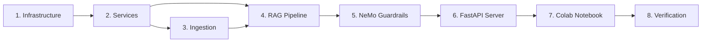

# Product Opportunities — Ruthless UX & Hardcoding Audit

*Generated 2026-08-12 from a full read of user-facing source (`src/`) and the backend surfaces that feed it. Every row was confirmed against live code, not assumed. This is a tracked backlog: pick a row, do the "How to fix", check it off. Line refs drift — verify before editing.*

**Scope:** everything shown to a user — chat, TTS/audio, Knowledge Graph, profile, landing, meditation, admin, i18n, accessibility, error states. Not scoped to a feature; ruthless across all of it.

## Severity legend

- 🔴 **P0** — user sees something fake, broken, or off-brand right now, OR a stated product promise (privacy, "the gurus' voice") is contradicted.
- 🟠 **P1** — real gap that measurably weakens the experience for a large slice of users.
- 🟡 **P2** — hygiene / hardcoding / tech-debt that will bite later; not user-visible today.
- 💎 **OPP** — not broken, but a concrete move from "fine" to "best-in-class".

Model-route column: which tier to hand the fix to — `haiku` mechanical, `sonnet` bounded implementation, `opus` design/architecture.

---

## 1. Things shown to the user that are FAKE or MOCK

| ID | Area | Finding (verified) | Sev | How to fix | Route |
|----|------|--------------------|:---:|-----------|:-----:|
| F1 | Knowledge Graph | `src/components/kg/KGConceptMap.tsx:24` ships a hardcoded 10-node `DEMO_DATA` — and one node is **"J. Krishnamurti"**, not the product's *Sri Krishnaji*. Real Neo4j graph has **11,136 edges / 7,512 nodes** but users hit the mock on any fetch miss (`isDemo` flag). A marquee feature is faked and name-wrong. | 🔴 | Wire the UI to live `/api/kg/subgraph`; remove/clearly-label the demo; fix the off-brand node. Show a real (even small) subgraph rather than a fabricated one. | opus |
| F2 | Admin dashboard | `src/admin/lib/api.ts` + 8 pages import from `src/admin/lib/mockData` — **write actions** (`promoteAdmin`, `demoteAdmin`, `upsertAlertRule`, `triggerReingest`, `activatePromptVersion`, `deleteGoldenQuestion`, `upsertGoldenQuestion`, `listLogs`) resolve to mock. `ALLOW_MOCK = DEV && VITE_ALLOW_MOCK`, but the imports mean these admin surfaces are mock-shaped and several may be no-ops against a real backend. | 🔴 | Audit each `mockData` import: confirm a real backend endpoint exists and is called in prod; delete the mock path or gate it hard. An admin who "promotes an admin" and it silently mocks is a trust bug. | opus |
| F3 | Landing / social proof | `src/components/landing/SampleWisdomSection.tsx:89` renders "rated" + stars; verify whether ratings/testimonials/counts are hardcoded. Fake social proof is a legal + trust risk. | 🟠 | Confirm every number/testimonial on the landing page is real or clearly illustrative; wire to real metrics or remove. | sonnet |

## 2. Stated promises the code contradicts

| ID | Area | Finding | Sev | How to fix | Route |
|----|------|---------|:---:|-----------|:-----:|
| P-1 | Privacy / "all-local" | `src/hooks/useAutoTranslate.ts:15` calls **external `api.mymemory.translated.net`** — sends user text off-box. Contradicts the "privacy-first / zero-external-call / all-local" positioning. Backend already exposes `/api/translate` (Sarvam). | 🔴 | Route auto-translate through the backend `/api/translate`; drop the third-party call. | sonnet |
| P-2 | "The gurus' voice" | TTS default is the robotic browser `speechSynthesis`; **Sarvam neural voice is only a fallback for Indic languages** (`useTextToSpeech.ts:120`). The warm neural voice — arguably the product's soul — is buried. | 🟠 | Make Sarvam neural the default guru voice for all languages; browser as fallback. See OPP-1. | sonnet |

## 3. Incomplete / disabled / thin surfaces

| ID | Area | Finding | Sev | How to fix | Route |
|----|------|---------|:---:|-----------|:-----:|
| I1 | i18n | Only **62 of 134** `.tsx` components use `t()` (~54%). Hardcoded English in user-facing components (`SampleWisdomSection`, `DailyTeaching`, `MeditationStats`, `SpiritualWelcomeBanner`, …). For an Indic-first multilingual product, ~half the UI doesn't translate. | 🟠 | Sweep the 72 non-`t()` components; extract strings to the i18n catalog. Batchable, mechanical. | haiku→sonnet |
| I2 | Accessibility | Only **57 of 134** components carry any `aria-`/`role`. Screen-reader users hit large unlabeled regions (chat stream, KG canvas, meditation controls). | 🟠 | a11y pass: labels on icon buttons, live-region for streaming answers, KG keyboard nav + text alt, focus management in modals. | opus |
| I3 | Error/empty/loading UX | Only **16** components reference `ErrorBoundary`/`EmptyState`/`Skeleton`/`offline`/`retry`. Thin failure states — most surfaces likely show a spinner or nothing on error. | 🟠 | Add empty/error/skeleton states to the high-traffic surfaces (chat, KG, profile, sources). Offline banner (PWA already present). | sonnet |
| I4 | Admin jobs | `src/admin/pages/JobsPage.tsx:60` — "Queue is currently disabled. Set `queue_enabled=true`". A shipped feature shown as off. | 🟡 | Decide: enable the queue path or hide the surface until it's real. | sonnet |

## 4. Hardcoded values that should be config/constants

| ID | Where | Finding | Sev | How to fix | Route |
|----|-------|---------|:---:|-----------|:-----:|
| H1 | Backend safety/quality dials | Inline thresholds not in `settings`: `serene_mind_engine.py:403,407` distress `0.65/0.75`; `ontology_validator.py` `0.7`; `colbert_maxsim.py` `0.5/0.2`; `adaptive_chunking_service.py:242,256` `0.72`; `web_search_guardrails.py:474` `0.6`; RAPTOR gate `0.35`. Can't tune a **distress threshold** without a deploy. | 🟡 | Promote to `app/config.py` `settings` fields with the current values as defaults. Distress ones first (safety). | sonnet |
| H2 | Reference URLs | `rag/nodes/utils.py:127-141` hardcodes ekam.org, an Amazon book link, breathingroom.com, theonenessmovement.org. Content baked into code. | 🟡 | Move to config or OKF metadata so links change without a code deploy. | haiku |
| H3 | Frontend magic timeouts | Scattered literals: `ChatHelpers.tsx` slow-phase `6000/15000`; toast dismissals `1500/2000`; reload `600`; KG sim `repulsion 600 / linkDist 95 / gravity 0.008`. | 🟡 | Named constants in one module; expose the KG sim ones as UI controls (already partly stateful). | haiku |

## 5. "Fine → best-in-class" opportunities

| ID | Area | Opportunity | Impact | How | Route |
|----|------|-------------|:------:|-----|:-----:|
| OPP-1 | **Guru voice / audio** | Manual per-message speaker button today. Make the **Sarvam neural voice the default**, add **opt-in autoplay when an answer finishes streaming**, sentence-highlight-while-reading, and a distinct calm cadence. Turns a buried button into the emotional core of the product. | ★★★ | `useTextToSpeech` + `ChatMessage` + a profile toggle; backend Sarvam TTS path already exists (`/api/speech/tts`). | opus |
| OPP-2 | **Knowledge Graph** | Once F1 wires real data: click-to-expand a node, **shortest-path between two concepts**, teacher filter, and **doctrine-sourced "why these connect" edge explanations**. A genuinely explorable teaching-graph over 11k real edges is a feature nobody in this space ships. | ★★★ | `KGConceptMap` + `/api/kg/*`; edge explanations from OKF/retrieval. | opus |
| OPP-3 | **Resurface teachings (SRS)** | The **spaced-repetition backend exists** (`api/srs.py`) but is barely in the UI. Proactive "revisit this teaching" nudges + a review surface would build a real retention loop that's already half-built. | ★★★ | Wire `api/srs.py` to a review card + reminder; `FlashcardPractice.tsx` may already be a start. | opus |
| OPP-4 | **Profile → journey** | Metrics, streaks, memory, persona already exist as scattered tiles (`ProfileStatTiles`, `MemoryManager`). Compose them into a **"your beautiful-state journey"** timeline + meditation-progress viz. | ★★ | Recompose existing `useMetrics`/`useProfile` data; no new backend. | opus |
| OPP-5 | **Answer transparency** | Citations panel is solid. Add inline citation **hover-preview**, a per-answer **confidence badge** (backend already computes `confidence_score`), and a "grounded in N teachings" trust line. | ★★ | `ChatMessage` + `CitationPanel`; data already on the streamed result. | sonnet |
| OPP-6 | **Wisdom cards** | Share works (`navigator.share` + PNG download). Level up with **server-rendered OG images** so a shared link unfurls with the actual card in social/WhatsApp, not a generic preview. | ★★ | Backend OG-image route; frontend already generates the canvas. | sonnet |

---

## Suggested order (impact ÷ effort)

1. **P-1 external translation** — privacy hole, one hook. (sonnet)
2. **F1 Knowledge Graph real data** — kills the fake marquee feature. (opus)
3. **OPP-1 guru voice default + autoplay** — signature win, user-requested. (opus)
4. **F2 admin mock audit** — trust bug in the ops surface. (opus)
5. **H1 distress thresholds → config** — safety dial, cheap. (sonnet)
6. **I1 i18n sweep** — batchable, half the UI. (haiku→sonnet)
7. OPP-2/3/4 — the deep product bets, after the fakes are gone.

## What's already good (don't "fix")

- Auth is mature: MFA (`MFAChallengePage`, `TwoFactorSettings`), diagnostics, latency dashboard.
- Onboarding `GuidedTour` is real and i18n-keyed.
- Wisdom-card sharing uses native `navigator.share` with a PNG fallback.
- Chat streaming has thinking-pills, citation click-through, distress indicator, error banner.
- Mood check-in surfaces exist (`MoodCheckIn`, `MoodBanner`).

*Verification: findings confirmed against `KGConceptMap.tsx`, `admin/lib/api.ts`, `useAutoTranslate.ts`, `useTextToSpeech.ts`, `serene_mind_engine.py`, `rag/nodes/utils.py`, and t()/aria/error-state file counts across `src/`. Counts are from grep sweeps 2026-08-12 and will drift.*

---
---

# Roadmap — Execution Strategy

*Migrated verbatim from the former `docs/ROADMAP.md` on 2026-08-12 (that file was removed; this section is now its home). Tracks feature requests, priorities, and shipped work — the HOW to SPEC_DEV.md's WHAT.*

## Execution Philosophy
- **Radical simplicity**: The simplest robust solution for each phase
- **Zero re-work**: Solve friction in markdown before it hits the compiler
- **Atomic phases**: Each phase is independently testable and commit-worthy
- **Dependency-first**: Build foundations before features

## Phase Map



## Completed

| # | Feature | Branch/Commit | Shipped |
|---|---------|---------------|---------|
| 1 | Infrastructure: `backend/` tree, `requirements.txt`, `docker-compose.yml`, `.env.example`, `config.py` | Phase 1 | Pre-2026 |
| 2 | Services Layer: `qdrant_service`, `embedding_service`, `ollama_service`, `ocr_service` | Phase 2 | Pre-2026 |
| 3 | Ingestion pipeline scaffolding: `youtube_loader`, `image_loader`, `cleaner`, `raptor`, `pipeline.py` | Phase 3 | Pre-2026 |
| 4 | LangGraph RAG 11-layer pipeline: states, prompts, meditation, all nodes, `graph.py` | Phase 4 | Pre-2026 |
| 5 | NeMo Guardrails: `config.yml`, `topics.co`, `rails.py` (check_input/check_output) | Phase 5 | Pre-2026 |
| 6 | FastAPI Server: `main.py` (CORS, 3 routes), `dependencies.py`, `/api/chat`, `/api/ingest`, `/api/health` | Phase 6 | Pre-2026 |
| 7 | Colab Notebook: 7-cell one-click setup | Phase 7 | Pre-2026 |
| 8 | Verification: hallucination <1%, response <3s, distress >90%, safety, citations, E2E | Phase 8 | Pre-2026 |
| 9 | `bulk_ingest_async.py` — sequential queue stages (retries/backfills + new), circuit breaker, DLQ, ETA, dual-DB tracking | Phase 3 | 2026 |
| 10 | `extract_transcripts.py` — batch Apify extraction (359 videos), `transcripts/_state.json` | Phase 3 | 2026 |
| 11 | Retired 2026-08-12: book-to-skill integration and generator were removed after dependency verification. | Phase 3 (retired) | 2026 |
| 12 | `telemetry_sink.py` — async Supabase telemetry sink for queries, responses, events | Phase 3 | 2026 |
| 13 | Heal 220 poisoned Neo4j entity descriptions via `scripts/ops/heal_neo4j_poison.py` | `main` | May 2026 |
| 14 | Benchmark cache bypass (`is_benchmark` guard in `main.py`) to prevent score inflation | `main` | May 2026 |
| 15 | Raise `SEMANTIC_CACHE_SIMILARITY` threshold 0.92 → 0.96 | `main` | May 2026 |
| 16 | Fix dead `ContextualChunkingService` — passes `full_document` at all 3 `_augment_chunks` call sites | `main` | May 2026 |
| 17 | Integrate ekimetrics DCC+BI+RC metrics via `AdaptiveChunkingAdapter` | `main` | May 2026 |
| 18 | **R3**: Graceful shutdown drain — `_INFLIGHT` counter + 30s drain on SIGTERM | `main` | May 2026 |
| 19 | **R4**: Per-node timing in `GraphState.node_timings` — accumulated by `log_metrics` at ms precision | `main` | May 2026 |
| 20 | Build and integrate three codebase graph & memory MCP servers: Graphify, Claude-Mem, CodeGraph | `main` | June 2026 |
| 21 | Resolve Node 25 WASM compiler Zone allocation memory crashes — link explicitly to Node 22 LTS | `main` | June 2026 |
| 22 | Housekeeping: prune locked dead git worktrees (agent-*) and delete stale merged local branches | `main` | June 2026 |
| 23 | Consolidate benchmark execution under `backend/benchmarks/` with multi-turn, cache, Self-RAG, CoVe, citation, category-score reporting | `main` | June 2026 |
| 24 | Expose `/api/chat` evaluation metadata (`faithfulness_score`, `relevancy_score`, `confidence_score`, `verification`, `hallucination_flag`) | `main` | June 2026 |
| 25 | **R5**: Circuit breaker on LLM provider via `tenacity` | Wave 1 | June 2026 |
| 26 | **Q1-Q4**: Chunk size evaluation, token budget guard, eval harness | Wave 2 | June 2026 |
| 27 | **S3**: Replace Redis coalescer `sleep(0.1)` with `BLPOP`-style blocking wait | Wave 3 | June 2026 |
| 28 | **P1**: Persist telemetry to Redis Streams instead of `BackgroundTasks` | Wave 4 | June 2026 |
| 29 | Benchmark Recovery: timeout escalation, CoT strip rules, adversarial_traps queries, citation denominator filter | `main` | June 2026 |
| 30 | Integrate OpenRouter as primary cloud LLM provider option using Llama free models | `main` | June 2026 |
| 31 | Production Readiness Fixes: semantic cache threshold → 0.78, L1 Redis cache, lightweight guardrail LLM bypass fix, real SSE streaming, prompt contradiction fixes, semantic parent/sentence-boundary child splitting with content hash deduplication | `main` | June 2026 |
| 32 | Anthropic Gateway Integration: direct `AnthropicGateway` with prompt caching + Citations API, `--use-batch` in `eval_runner.py`, migrate 12 hardcoded P1 thresholds to Settings | `main` | June 2026 |
| 33 | Production Audit Fixes (2026 Audit Report): cache LettuceDetect results in state, scale context budget by query tier, query rewrite validation fallback, `confidence_gating_floor` setting, dev docker-compose password fallbacks | `main` | June 2026 |
| 34 | Personal KG Visualizer: `seed_personal_kg.py` (40 ontology concepts), `GET /api/memory/knowledge-graph`, `MemoryManager.tsx` SVG graph visualizer, `memoryApi.ts`, 435 tests pass | `main` | Jul 8, 2026 |
| 35 | **Embedding dimension invariants (2026-07-16 incident fix)**: `_ensure_encoder()` rejects mismatched dim; `_verify_collection_dimension()` asserts at startup; `generate_answer()` short-circuits on empty context; Docker pre-cache with pinned model revision; fail-closed validation for malformed vector config | `main` | Jul 16, 2026 |
| 36 | **Security audit: remove NIM cross-provider failover**: External API calls as silent fallback removed from container DI; `_call_api()` fallback_model branch eliminated; `failover_provider.py` catches fallback exceptions | `main` | Jul 17, 2026 |
| 37 | **Streaming short-circuit fix**: `generate_answer()` emits fallback answer through stream_queue protocol before early return; regression test coverage | `main` | Jul 17, 2026 |
| 38 | **3-Pass Generation & Guru Tone Refactoring**: Pass 1 (inline citation verification) + Pass 2 (factually grounded draft generation) + Pass 3 (Guru voice tone adapter), Reflexion prompt constants, `asyncio.to_thread` Neo4j traversal | `main` | Jul 21, 2026 |
| 39 | **LightRAG Qdrant-Direct Ingestion**: `scripts/ingest_lightrag_data.py` scrolling 89,053 `spiritual_wisdom` points directly into Qdrant & Neo4j via OpenRouter `gemma-3-12b-it` | `main` | Jul 22, 2026 |
| 40 | **First-person elevation, chat bridge & Docker redeploy (Tasks 1–5)**: Step 4c balancing fix (δ=0.05 harness-fitted + calibration-profile-threshold gate, defect-pinning test rewritten, harness `compare` 0-discordant vs frozen baseline), `FirstPersonBridgeStage` registered before `GraphStage` **shipped OFF** (`FIRST_PERSON_CHAT_BRIDGE_ENABLED=false` in root `.env`, kill-switch live-proofed), baked-image rebuild + `up -d` redeploy (mount-free `baked-ok`, health ready), 9-gate validation battery, and full first-person E2E audit → verdict **NOT locally prod-ready** (6 P0 / 10 P1 / 9 P2, 14-item backlog) | local, uncommitted (owner approves commits) | Sep 30, 2026 |

## In Progress

| # | Feature | Branch | Status |
|---|---------|--------|--------|
| 1 | Remaining 357-video ingestion run (Qdrant + Neo4j KG) | `main` | Deferred per user direction, June 2026 — 359 extracted, 75 ingested, 357 remaining; 29 permanently failed (DLQ) |
| 2 | LightRAG KG backfill sweep for 72 Qdrant-only videos (`--retry-lightrag-missing`) | `main` | Deferred per user direction, June 2026 |
| 3 | Full-suite test isolation for `test_health_check` and `test_retrieve_documents_empty_results_is_safe` | `main` | Known order-dependence under full ~925-test run; not yet isolated |
| 4 | Cross-provider LLM failover for OpenRouter 429s | `main` | NIM provider exists but wiring removed per security audit (external silent fallback); revisit if natively available local fallback is desired |
| 5 | **First-person corpus provenance closure (fp-context-v1)** | `main` | 2026-10-21 audit: per-span ECAPA verdicts missing for 1,631/2,737 spans, citation↔audio-window alignment failing for 298/2,737 (18 cite past the audio end), deterministic span-id word coordinates disagreeing with the ASR artifacts for 2,107/2,737. `FIRST_PERSON_CONTEXT_HARNESS_ENABLED` stays `false` until all three close. Also blocked on `soundfile` missing from the release image and a calibration artifact without `cosine_floor`. See `docs/FIRST_PERSON_V5_V10_COMPLETION_2026-10-21.md` §3. |
| 6 | **First-person serving path has no legacy-schema fallback** | `main` | `FIRST_PERSON_COLLECTION=first_person_v10` points the legacy clip store at the fp-context-v1 collection, whose payloads lack `first_person_eligible`, so the legacy search matches nothing. With the harness off, the local stack serves no first-person teaching at all. Needs an owner decision: restore a legacy collection for `FIRST_PERSON_COLLECTION`, or keep the harness as the only first-person path. |

## Deferred / Needs Planning

| # | Task | Effort | Notes |
|---|------|--------|-------|
| D1 | **Sarvam vLLM self-host** | Large (50GB GPU) | No GPU available in environment. Entire vLLM server + model download is ~50GB GPU-memory task. Defer until GPU instance (A100/H100) provisioned. Requires docker-compose GPU support. |
| D2 | **GDS (Graph Data Science) plugin for Neo4j** | Medium | Only `apoc` + `n10s` loaded. GDS requires separate Neo4j plugin download + license (community edition limitations). Add to `NEO4J_PLUGINS` once GDS CE works with Neo4j 5.17. Louvain/PageRank stubs already exist in `kg_algorithms.py` — they return degraded results. |
| D3 | **n10s SPARQL engine** | Medium | n10s 5.x dropped its built-in SPARQL engine entirely. `/api/kg/sparql` is a read-only Cypher passthrough. Either downgrade to n10s 4.x (incompatible with Neo4j 5.17), or implement custom SPARQL→Cypher translation layer. |
| D4 | **OWL/RDF full roundtrip** (RDF→Neo4j→RDF) | Medium | n10s export works (10.5MB TTL, 7,481 nodes). Full roundtrip (import→query→re-export) needs more testing. Add SPARQL→Cypher query bridge and verify n10s import preserves all node properties. |
| D5 | **n10s inference / schema reasoning** | Small (blocked) | `n10s.schema.check` and `n10s.inference.schemaInference` were removed in n10s 5.x. No replacement available. If inference needed, consider a custom Python reasoner over the TTL export. |
| D6 | **OWASP ZAP security scan** | Small | `owasp/zap2docker-stable` Docker pull fails — Docker Hub auth denied via `.docker_clean` DOCKER_CONFIG bypass. Run ZAP with standard Docker config (`sudo` or non-bypass) or switch to `ghcr.io/zaproxy/zaproxy`. |
| D7 | **Manim spiritual visualizations** | Medium | Manim requires heavy system dependencies (FFmpeg, Cairo, LaTeX) and is a reference-use tool, not production code. Add to a `docs/` or `notebooks/` companion repo. Not eligible for main app Docker. |
| D8 | **Marketing / CLG content** | Non-code | Blog posts, case studies, landing page copy. Create a separate `content/` repo or Notion workspace. |
| D9 | **Waitlist strategy** | Medium | Pre-launch signup collection — email capture, invite tiers, referral tracking. Not urgent until product-market fit validated. Placeholder doc at `docs/marketing_strategy.md`. Requires Stripe/email integration when activated. |
| D10 | **Daily Wisdom Newsletter** | Medium | Scheduled email automation sending daily teaching excerpts. Requires content curation pipeline, email provider (Resend, SendGrid), unsubscribe management. Defer until ingestion complete and chat UX stable. Concept doc in `docs/marketing_strategy.md`. |
| D11 | **Full learning paths** (Karma→Dharma→Moksha progression) | Large (pedagogy) | Requires pedagogical design + content curation — not an engineering task. Add as a specification document first; implement as a guided UI layer after Phase E6 chat UX is stable. |

## Backlog (Sorted by Complexity: Easy → Hard)

| # | Feature | Effort | Notes |
|---|---------|--------|-------|
| 1 | Hybrid BM25+vector search fallback | Small | BM25 logs "0 results" for 2/12 queries (expected — keyword-based). Consider hybrid fallback when BM25 returns 0. |
| 2 | Reduce LLM `reasoning_effort` for slow RAG paths (q3, q8) | Small | q3 and q8 slow (92s, 130s) — complex RAG with full citation enrichment. Correct (200, not 500) but slow. |
| 3 | In-graph cache short-circuit in `retrieval.py:723` | Small | Pipeline-level cache (cache_stage.py) short-circuits correctly; in-graph cache doesn't short-circuit generation. Pipeline cache handles the common case. |
| 4 | Security checklist items 13-22 (WAF, rate limiting, DDoS, audit logging, backup verification, incident response runbook) | Medium | 12/22 done. Items 13-22 require infra/platform decisions beyond code changes. |
| 5 | Embedding cache invalidation after batch encode change | Medium | Phase B moved to `encode_batch` for primary queries but expansion queries still encode individually. Acceptable — expansion runs in parallel with LLM call, so encode time is hidden. |

## Dependency Graph

```
requirements.txt (no deps)
  └→ config.py (no deps)
      └→ qdrant_service.py (needs Qdrant running)
      └→ embedding_service.py (needs sentence-transformers pip)
      └→ ollama_service.py (needs Ollama running)
      └→ ocr_service.py (needs easyocr pip)
          └→ youtube_loader.py (needs yt-dlp, whisper)
          └→ image_loader.py (needs ocr_service)
          └→ cleaner.py (no deps)
          └→ raptor.py (needs embedding_service, ollama_service)
          └→ pipeline.py (needs all above)
              └→ states.py (no deps)
              └→ prompts.py (no deps)
              └→ meditation.py (no deps)
              └→ nodes.py (needs services + states + prompts)
              └→ graph.py (needs nodes)
                  └→ rails.py (needs NeMo)
                      └→ main.py (needs everything)
                          └→ AskMukthiGuru.ipynb (needs main.py)
```

## Timeline Estimate

| Phase | Estimated Effort | Cumulative |
|-------|-----------------|------------|
| 1. Infrastructure | 30 min | 30 min |
| 2. Services | 1 hour | 1.5 hours |
| 3. Ingestion | 1.5 hours | 3 hours |
| 4. RAG Pipeline | 2 hours | 5 hours |
| 5. Guardrails | 30 min | 5.5 hours |
| 6. FastAPI | 30 min | 6 hours |
| 7. Colab | 1 hour | 7 hours |
| 8. Verification | 1 hour | **8 hours total** |

> **3 months of engineering compressed into 1 day of high-leverage execution.**

## How to Use

1. **New request**: Add a row to "User Requests (Unsorted)" (or directly to "Backlog" if clearly scoped)
2. **Prioritize**: Move from Unsorted to Backlog with a priority number, sorted by complexity (Easy → Hard)
3. **Start work**: Move from Backlog to "In Progress", create branch
4. **Ship**: Move from "In Progress" to "Completed" with ship date and branch/commit
5. **Defer**: If blocked on infra, resources, or external decisions, move to "Deferred / Needs Planning" with reason and path forward

## Completed (Aug 11, 2026) — 13-Fix Audit Remediation Batch

- `$HYPERRESEARCH_BIN` replaces 34 machine-specific absolute paths in root CLAUDE.md (portable, repository-relative).
- Cache + coalescer isolation for client-supplied assistant config (`assistant_config_present` guards; bounded SHA-256 fingerprint incl. M3 auth gate; raw prompt never in keys).
- Sarvam gateway: base-URL validation (https + documented allowlist, keyed traffic only to `api.sarvam.ai`), `follow_redirects=False`, rotation skips already-tried indices (exhausted only when all keys excluded).
- Removed 📚 long-answer auto-pass in `lettuce_detect_service.py` (faithfulness never short-circuits on formatting).
- `start_railway.py` fail-fast on missing/wildcard `FORWARDED_ALLOW_IPS`; lifespan cleanup hardened (`pump=None` init, `global _last_heartbeat`).
- Personalization-probe failures now DEBUG-log (user_id + exception) with conservative behavior preserved.
- SPEC_DEV.md margin wording names Self-RAG detection; subsystem-inventory.md Speech section now reflects the local-only policy (Sarvam Cloud TTS/translate flagged unapproved, no granted exception).
- Validation: 1565 backend tests pass; 2 pre-existing infra-dependent failures (Redis/Supabase not running locally).

## Completed (Jul 31, 2026) — Security + RLS + Metrics + Release Readiness Epic

- AAL2/MFA regression E2E extended (`security-aal2.spec.ts`, `serviceWorkers: 'block'` fix) — 251 E2E green.
- Backend `require_aal2` dependency + `/api/health/mfa` probe (12 tests).
- RLS: idempotent WITH CHECK migration, cross-user verifier script (12 probes green), nightly CI workflow.
- Supabase leaked-password protection enabled manually (Pro) — verify script added.
- Metrics parity: pydantic/zod shared schema, `GET /api/metrics`, `useMetrics` hook + ProfilePage Journey card.
- Streak-based healing course assignment (service + API + HealingPathCard) — 37 backend + 17 frontend tests.
- Release-readiness document `docs/RELEASE_READINESS_2026_07_30.md` (Railway + Lovable decision + rollback).
- Langhanam unified guru voice (default-off, benchmark-gated).

## Multimodal retrieval follow-ups (Aug 19, 2026)

The current release adds an ephemeral extraction MVP at `POST /api/chat/upload` for documents, PDFs, images, audio, and video. The next production-quality increment should introduce an asynchronous artifact lifecycle with malware scanning, resumable upload state, page/frame/segment evidence offsets, modality-specific vector fields, explicit consented persistence, tenant-scoped deletion, and competency-question evaluation for each modality. Audio and video should remain transcript-plus-timestamp evidence until a reliable media-aware retrieval index exists. No durable file search or corpus ingestion should be implied by the chat attachment affordance.

## Technical Debt / Follow-ups

- **Added 2026-10-22 (first-person v10 Phase 4/5)**: the independent rights register (`audits/evidence/public_release_phase4_rights_manifest_2026-10-22.json`, 751 assets) and the corpus-tier manifests are built and pinned, but **the owner has not signed off the register for the `fp-context-transcript-v2` corpus** — B5 stays open (`register_owner_confirmation: pending_owner_review`). Owner action: review the register and record the sign-off.
- **Added 2026-10-22 (first-person v10 Phase 4/5)**: 45 speaker-label conflicts are quarantined and awaiting a human decision. Owner action: fill the decision / reviewer / timestamp columns in `audits/evidence/public_release_phase4_speaker_conflict_review_2026-10-22.md` after listening to each window. Nothing is relabelled automatically.
- **Added 2026-10-22 (first-person v10 Phase 4/5)**: the 1,126 distinct transcript-variant spans stay in `variant_candidate` and are never served. Admitting them needs a separate, explicit owner decision (they are text variants, not exact reconstructions).
- **Added 2026-10-22 (first-person v10 Phase 4/5)**: the B4 serving contract (`backend/config/first_person_serving_contract.json`) declares the legacy family `first_person_v1`…`v9` and the fp-context `first_person_v10`, but the **local Qdrant has no legacy-schema first-person collection**, so the legacy path now fails closed by design (`abstain_reason=serving_contract_violation`). Creating or restoring one needs a separate approval (snapshot + dry-run + rollback).
- **Added 2026-10-22 (first-person v10 Phase 4/5)**: the owner-only local review mode (`backend/scripts/ops/fp_local_review_preview.py`) reads `audits/evidence/` from the repository root, which the runtime image does not contain — so the HTTP surface must be run from the host, not from the container. A containerised owner preview would need an approved volume mount.

- **Added 2026-10-18**: calibration gold-labelling human hours are now speed-only via `backend/scripts/ops/gold_label_cli.py` (one-keypress TUI, AI hints never gold, `--order hard`/`--status`); the gold protocol itself is unchanged — `evals/gold_set_v1/` annotator CSV sheets, `score_gold.py` adjudication, and `fit_threshold.py`'s 299-confident-zero-error gate remain authoritative.
- **Added 2026-10-18**: speaker trust-signal batch verification tool landed (`backend/scripts/ops/batch_speaker_recheck.py` — read-only/payload-only recheck of unverified first-person clips against the owner-validated 2026-10-11 strict centroid + per-window criteria); awaiting batch results before any `speaker_verified` payload updates.
- **Added 2026-08-26**: Indic RAG latency policy now disables HyDE by default and caps Indic CRAG rewrites at one (`RAG_INDIC_USE_HYDE=false`, `RAG_INDIC_MAX_REWRITES=1`). Local n=1 evidence reduced Hindi backend latency from 30.00s to 16.12s (-46.3%) with the same abstained grounded-partial fallback metadata; run a held-out multilingual faithfulness/NDCG evaluation before enabling Indic HyDE or widening the retry cap.
- Flip `langhanam_voice_enabled` after a live-LLM benchmark run (OpenRouter key 403 locally).
- Set repo secrets for nightly RLS workflow; review ephemeral-prod-user cleanup before enabling.
- Local dev requires service URL overrides (docker hostnames in `.env`) — document in start_local.sh.
- 8 pre-existing vitest failures at legacy `src/test/*` paths (duplicate newer suites at `src/test/components/*` pass) — delete stale suites.
- 3 pre-existing backend test failures depend on HF model revision `3a90cc8b42f5acec95e57c1e2433ba3b71ba9eef` which 404s — **partially resolved 2026-08-01**: tokenizer and all 7 registry models are now pinned to valid SHAs (`_MODEL_REVISIONS`); only the ONNX encoder (`gpahal/bge-m3-onnx-int8`) has no hardcoded revision (hash 404s) and relies on the Docker pre-baked snapshot + `HF_REVISION` env — the remaining failures likely still hit that path. Mock model loading in tests or resolve a valid encoder SHA.
- Evaluate late chunking (candidate B, §8.5) on the ONNX INT8 encoder, not the PyTorch fp32 baseline — quantization must not degrade the pooling behaviour late chunking depends on (`docs/engineering-notes/corpus-remediation-and-migration-plan.md`).
- 3 pre-existing env-dependent test failures (all files unmodified): `test_graphrag_fusion::test_self_test` (execs `backend` — fails unless run from repo root), `test_quality_gate::test_playlist_complete` (needs live Celery broker), `test_ruthless_phase2::test_feedback_lessons_mining` (needs live Qdrant). Fix: run pytest from repo root and start infra, or mark them `@pytest.mark.integration`.
- **Fixed 2026-08-01**: `tests/test_persona_store.py` (7 tests) — feature now implemented: `get_persona` returns `(content, updated_at)`, `save_persona` writes a real `updated_at`, `_is_persona_fresh` staleness gate (fail-open) wired into `prepare_user_memory` via new `persona_max_age_days` setting (default 30).
- Set `FORWARDED_ALLOW_IPS` (e.g. `10.0.0.0/8`) on the Railway service before the next deploy — `start_railway.py` exits at startup without it (Railway currently paused). Docker compose (plain uvicorn) is unaffected.
- No local TTS or local translation exist — unapproved Sarvam Cloud paths remain in `backend/app/api/speech.py` until either ships or an explicit exception is documented.
- `test_quality_gate::test_playlist_complete` and `test_testauth_not_registered_in_prod` fail without live Redis + local Supabase — infra-dependent, pre-existing.
- **Added 2026-09-30 (first-person E2E audit backlog #1; source `.claude/tasks/first_person_e2e_audit_2026-09-29.md` Final / `audit_2026-09-29/B.md,D.md`)**: Fit an abstention gate on labeled out-of-corpus data (score floor or rank1−rank2 margin — **not** threshold tuning; threshold 0.45 has zero abstention power, OOC top-1 up to 0.6476, OOC/in-corpus cosine medians overlap 0.51–0.56) → only then re-enable `FIRST_PERSON_CHAT_BRIDGE_ENABLED=true` + `up -d backend`. Gate: OOC query returns `is_direct_answer=false`, ≥2/27 pinned unanswerable questions abstain, audit gates G9+G11 GREEN.
- **Added 2026-09-30 (audit backlog #2, calibration honesty)**: produce an honest calibration profile from a B1-labeled golden set via `run_calibration.py` and commit it (CLAUDE.md invariant 3 needs ≥299 confident gold items with 0 errors at δ=0.05 — current real budget is 14 labels); never point `FIRST_PERSON_CALIBRATION_PATH` at the three untracked byte-identical `n=300/ucb=0.009` JSONs (test-fixture origin, `audit_2026-09-29/E.md`), else demote every `n=300` claim in docs.
- **Added 2026-09-30 (audit backlog #9, OKF verbatim repair)**: 126/2090 `key_teachings` (43 entries) are not verbatim in their own source transcript yet feed `QuoteWeaverAssertionGate` as authoritative quote sources (`audit_2026-09-29/C.md` C-9/GAP-O4) — plus 14 mojibake-only + 2 `find_artifact()`-failing teachings (GAP-O2/O3); repair sources in `memory/okf/*.md`, recompile, and add compile-time `find_artifact` + verbatim gates (xfails in `tests/test_okf_integrity_gaps.py` must flip XPASS).
- **Added 2026-09-30 (audit backlog #7/#8, corpus integrity)**: re-index/re-embed the 52/144 points violating `id==uuid5(...)` with stale embeddings (mean cos 0.9146 vs 0.9786), produce a drop-manifest for the 16 unlogged deletions (14 videos), add the `rights_cleared` keyword index, and replace count-only post-write verification with vector spot-retrieval (R2 — a point written without `passage_dense` currently passes hash+count and silently drops the dense leg).
- **Added 2026-09-30 (Task 4 new finding, owner item)**: chat response cache is language-insensitive — byte-identical English answer served to a Hindi-preference user, in tension with the cache-key invariant (key must carry language); also investigate the 63.7s Hindi chat tail (Task 4 gate log).
- **Added 2026-09-30 (audit backlog #5/#6/#11, lint/CI baselines) — ✅ lint + golden-25 portions closed 2026-10-03**: ~~ruff RED 145 errors/68 files (44 pre-existing at HEAD)~~ → D4 burn-down: `cd backend && ruff check .` (CI ruff 0.15.13) green — 122 auto + 13 manual fixes + 1 documented per-file-ignore (`repair_v7_clips.py` I001, Wave-4a ownership) in `backend/pyproject.toml`; ~~wire golden-25 as a real CI gate~~ → D5: `.github/workflows/golden25-gate.yml` (real harness run on SHA-pinned golden-25, honest-skip without secrets — **⚠️ measured 2026-10-03: 0 secrets set anywhere (`gh secret list` + API total_count + all environments empty; exact `gh secret set` commands in session report §9e)**). **Thresholds MEASURED + PASS 2026-10-03 (evening)**: canary-gated golden-25 run 2 (`golden25_healthy_2026-10-03.json`, 0/15 TO canary first) returned top1_hit **0.16** / 3 TO / 0 errors against run 1's 0.12 / 8 TO → thresholds set at observed floors (`TOP1_MIN=0.12`, `SAME_VIDEO/SAME_CLIP=0.0` = measured twice, floor-only pre-ingest) with in-file provenance; workflow logic replicated locally against both run JSONs → **PASS/PASS**; checklist §D row 5 = ✅ PASS. **Still required: post-mass-ingest re-measure of all three + provenance replacement in the same change** (index 144 → ~2,500). Remaining from this entry: ~~format drift (129 files) + `git diff --check` exit 2 unverified~~ **✅ both closed 2026-10-03 (late): `ruff format --check .` = 1206 files formatted / 0 remainder (21-lane hold lifted by owner Ask 3) + `git diff --check` = 0 findings (both other-lane EOF blanks fixed)**; ~~`test_settings_guards::test_getattr_names_are_declared` + `test_first_person_route` ×2~~ **✅ fixed 2026-10-03 (D1 §6.2/§6.3)** — the 2 undeclared flags (`first_person_content_quality_gate_enabled`, `first_person_llm_rerank_enabled`) declared on `Settings` (default `False` = byte-identical behavior, now env-wirable) and `_pipeline()` gate-loop capture degraded to its documented persistent-loop fallback when constructed outside a running loop (`llm_loop=None` was already supported by `_answerability_check`); ~~`test_verify_ingest_readiness::test_inspect_all_and_dashboard`~~ **✅ fixed 2026-10-03 (D1 §6.4)** — `find_spec("mlx.core")` guard (raises `ModuleNotFoundError` when `mlx` absent → CI ubuntu too); still open: `test_quality_gate::test_playlist_complete`/`test_testauth_not_registered_in_prod` pre-existing failures (neither appeared in the final full-suite run); container suite ≠ CI suite; D1 §6.1 (S1 conflict) + §6.5 (commit-or-drop untracked work) **resolved 2026-10-03 (owner Ask 5/6: S1 fixed at root cause; all 4 untracked files = COMMIT, session report §9b/§9c)**. All 3 fixes verified: 24/24 focused + 149/149 first-person family + ruff green. ~~**New debt 2026-10-03**: `test_clips_v2::test_b` fails deterministically — S1 head-recovery heuristic vs never-absorb-host-speech invariant, attribution-safety tradeoff needs an owner decision; not a D4 regression~~ **✅ CLOSED 2026-10-03 (owner Ask 5): root-cause host-exclusion gate in `relabel_turn_start_prefixes` — a prefix starting after a terminal-punctuated TEACHER word is a completed turn, so the O-word is genuine host speech and is never absorbed (precision over recall; recovery stays open at transcript start and after HOST/unknown terminals). +1 regression test; `test_clips_v2` 27 passed; final full suite 0 failed / 8478 passed.**
- **Added 2026-10-09 (PR #60 prelaunch-gate audit thread, branch `fix/prelaunch-gate-local-supabase`)**:
  - **Open**: `src/lib/chatStorage.ts` swallows the supabase `.error` on conversation upsert/insert — cloud sync fails silently (this masked local schema drift); surface/log `.error` and add a regression test.
  - **Open**: local Supabase is 7–8 migrations behind (`supabase migration up` never run; pending set includes `conversations.summary`) — add an explicit `npx supabase migration up` step + `supabase migration list` drift check to the local-dev runbook and/or `scripts/prelaunch.sh`.
  - **✅ Done**: `.github/workflows/prelaunch-gate.yml` now runs `npx supabase start` + `supabase status --output json` before the gate, so CI provisions a real stack and applies all 128 migrations (`rls-cross-user` rebuilds the preview bundle against it via `discoverLocalSupabaseEnv()`, overriding the inherited mock `VITE_SUPABASE_*` placeholders).
  - **✅ Done**: migration `supabase/migrations/20261007000000_faculty_answer_labels.sql` added with a superuser-safe guard.
  - **✅ Done**: `scripts/prelaunch.sh` isolates Playwright artifacts per suite (`--output test-results/<suite>/`) so one failing suite can no longer wipe another suite's screenshots/traces.
  - **✅ Done**: e2e determinism — `tests/e2e/rls-cross-user.spec.ts` seeds onboarding/consent localStorage; `tests/e2e/a11y-smoke.spec.ts` waits for the cookie banner to settle before the axe scan; H9 reflection-label vitest added in `src/test/components/ChatMessage.test.tsx`.
- **Added 2026-10-22 (repository-wide dead-code sweep)**: 78 tracked files removed as dead — 37 frontend components/hooks/assets, 21 backend modules, 12 duplicate or derived docs, 2 files that violated the repo's own ignore/rights policy, and 4 relocated research notes. Each removal was gated on a resolved-import check (AST for Python, import-specifier resolution for TypeScript), not on a name grep. Follow-ups and open items:
  - **`scripts/` vs `backend/scripts/` drift was real and is now closed.** Three duplicated paths outside `scripts/ops/` had diverged in *both* directions; because the container bind-mounts repo-root `scripts/` at `/app/scripts` (shadowing the image's baked `backend/scripts`), the container was running the stale copies while CI and the host ran the backend ones. The worst case was `verify_rls_policies.py` — a **security control** whose in-container copy was missing the `canonical_memories` RLS probe (the most sensitive table in the schema). All three pairs are reconciled and `backend/tests/test_repo_layout.py::test_cross_tree_shared_scripts_are_identical` now pins every shared path; the one intentional same-name/different-tool pair (`eval/run_ragas_eval.py`) is declared in `_DIFFERENT_TOOLS` and asserted to stay distinct. **Open: the duplication itself is still structural debt** — the root tree exists only because `backend/scripts/` is not bind-mounted. A single-tree design (mount `backend/scripts` at `/app/scripts` and drop the root copies) would remove ~62 duplicate files and the drift class entirely, but it is a compose/runner change that needs an owner decision and a `docker exec` usage audit.
  - **`backend/scripts/eval/run_ragas_eval.py` (the old golden-set harness) is superseded** by the repo-root `scripts/eval/run_ragas_eval.py` (standalone RAGAS runner, covered by `tests/test_ragas_claim_ledger.py`), but a planning note still asks for it to be hardened with CI thresholds. It was left in place pending an owner call on which runner is canonical; the golden-set data file `backend/scripts/eval/golden_questions.json` is independently used by `backend/benchmarks/run_comprehensive_ragas.py` and must stay.
  - **`memory/okf/compiled.json` is a 10.4 MB tracked binary artifact** whose 429 entries all carry absolute host paths (`/Users/harshodaikolluru/...`) that do not resolve inside `/app`. It is read at runtime by `rag/nodes/retrieval.py` and `services/memory/okf_store.py`, so it was deliberately **not** removed, but it should be generated at image-build time (or gitignored with a build step) rather than committed, and its `path` fields should be repo-relative.
  - **`memory/okf/staging/` holds 820 unreviewed LLM-extracted entries.** The only thing keeping them out of live answers is the `_excluded_parts = {"staging", "_scripts"}` filter in `backend/services/memory/okf_store.py`. That single filter is a release-critical invariant, not an implementation detail.
  - **`.agent/` (457 files) is gitignored yet tracked** — committed via `git add -f` before the ignore rule existed. It holds 108 skills that exist nowhere else and is the canonical home for the ECC/Antigravity harness, so it was kept; but the ignore rule and the tracked state should be reconciled deliberately (either untrack it, or delete the rule).
  - **`.agent/` and `.agents/` share 24 skill directories that are byte-identical apart from entry-file case** (`SKILL.md` vs `skill.md`). `.agents/` was flattened for 4 of its 27 skills and not for 23. The flattening was applied to `.agent/` but never to `.agents/`. One canonical casing per harness, with the other referencing it, would remove ~24 duplicated directories.
  - **`docs/production-readiness/` still holds ~2 MB of regenerable raw forensic capture** (`rerun-2026-08-24/`, 45 files, and 6 × `loop-runs/*/summary.tsv`) that `scripts/ops/rerun_parallel_forensics.sh` and `scripts/ops/loop_validate.sh` reproduce. It was **left untouched** because the documentation governance register classifies `docs/production-readiness/` as historical, append-only material — the 2026-08-29 cleanup pass explicitly declined it. Removing it is an owner call, not a cleanup call.
  - **`docs/architecture/source-report.md` is flagged by its own README as containing fabricated facts**, and ~27 production-readiness documents describe a `scripts/ingestion/` tree that was deleted in commit `c5372d61` (78 files) — every such reference is now a dead path. A stale-reference repair pass over the *active* document set is the highest-value remaining documentation work; the deleted `scripts/ingestion/` tree is the single largest source of broken paths.
  - **`evals/results/query_results.json` (174 KB) and `evals/benchmarks/*.html` (180 KB) have no producer left** — their generating scripts were deleted, and the results are from a superseded model era. They are stale evidence, not reproducible evidence.
- **Added 2026-10-22 (first-person v10 Phase 2 — per-span ECAPA evidence)**: `backend/scripts/ops/regenerate_v10_span_ecapa_verdicts.py` produced **1,600 span-keyed verdicts** for the Phase-3 exact candidate (verified 1,529 · guru mismatch 45 · below floor 26) and a regenerated calibration (`cosine_floor=0.282826`, held-out test false accepts 0/262, false rejects 0/262). Artifacts: `audits/evidence/public_release_phase2_*_2026-10-22.*`; report `public_release_phase2_report_2026-10-22.md`. Follow-ups and open items:
  - **The false-accept rate is not human-certified.** The trial labels come from the same two human-confirmed anchor moments the references are widened from, so the measured FAR/FRR is a *relative* consistency measurement on held-out videos. The repo's speaker-label sheets (`docs/attribution/pilot_audit_60_quotes.csv`, `label_40clips_UlOt31lBhLY.csv`, `label_UlOt31lBhLY_15min.csv`) all have **blank speaker columns**, so a certified FAR needs a human to actually fill one — a **B7** dependency. Until then, no per-span verdict may be cited as a certified speaker verification.
  - **The corpus's own video→teacher label is wrong for 45 of 1,600 spans** (40 `krishnaji→preethaji`, 5 `preethaji→krishnaji`, 11 videos, 25 of them in one video). Those spans are refused, never verified, but the **video-level assignment itself needs repair** before any candidate is written — a per-video teacher label that disagrees with the voice in a quarter of its spans cannot be trusted for the other spans either.
  - **1,137 spans are still quarantined** (1,127 transcription variants + 10 unlocatable). Admitting the variant tier is an owner decision, not a code change; the variant reconstruction ratio distribution (min 0.40 / p10 0.923 / p50 0.989) is the input to that decision.
  - **`speechbrain` is not in `backend/requirements.lock`**, so the Phase-2 generator cannot run inside the release image. `soundfile` was deliberately **not** added (the stdlib `wave` module reads the archived 16-bit PCM / mono / 16 kHz WAVs and rejects the header-only stubs). If in-image execution is wanted, that is a separate approval plus `uv pip compile backend/requirements.txt --output-file backend/requirements.lock`; the app import graph and the CI suite are unaffected today because the import is lazy.
  - **The Phase-2 artifacts are file packages only.** Writing the candidate or the verdicts into a collection needs its own authorisation, a Qdrant snapshot and a corpus-version-isolated collection (`fp-context-transcript-v2` must never be attached to the live `first_person` alias while B5/B6/B7 are open).
- **Added 2026-10-22 (first-person v10 — the three evidence defects + owner-only preview in Docker)**: Defect 1 (the speaker-conflict packet wrote the *slice* width into a field named `audio_duration_ms`, the name the Phase-2 verdict uses for the *complete WAV*), Defect 2 (all 10 `unlocatable_quarantine` rows had an empty `source_span_id`, and two `(video_id, guru_id)` pairs repeated) and Defect 3 (1,127 variant rows → 1,126 rebuilt ids, previously described as a "byte-identical duplicate" — it is a **deterministic-id collision** between two distinct live spans) are fixed. Tier arithmetic now reconciles to **2,737** rows = **2,737** distinct live source span ids, with `rows_dropped: 0` and `rows_deduplicated: 0`. Artifacts: `audits/evidence/public_release_phase4_tier_*_2026-10-22.jsonl`, `public_release_phase4_deterministic_id_collisions_2026-10-22.jsonl`, `public_release_phase4_speaker_conflicts_v2_2026-10-22.jsonl`, `public_release_owner_packet_{rights,speaker,variant,clinician,gold_label}_2026-10-22.md`. Follow-ups and open items:
  - **The deterministic-id namespace is still incomplete and the collision is still unresolved.** `make_source_span_id(guru_id, video_id, corpus_version, word_start, word_end, transcript_hash)` has no component for the **source span identity**, so two distinct live spans that resolve to the same reconstructed word window collide. The fix is *not* backward-compatible (it re-keys every span and invalidates the 1,600 Phase-2 verdicts, the rights join, the tier manifests and the pinned local-review contract), so it was deliberately **not** applied and the two spans stay quarantined. **Open owner item:** either approve a corpus-version bump that re-keys the corpus and re-runs Phase 2 → Phase 3 → rights → tiers → contract, or accept the two spans as permanently excluded. Until then `b7d1c4a0…` is not a usable identity for either span.
  - **The upstream Phase-3 builder was hardened but its artifact set was NOT regenerated.** `rebuild_v10_asr_coordinates.py` now detects duplicate rebuilt ids across the candidate *and* variant populations and quarantines every member. The shipped Phase-3 manifests still carry the pre-hardening rows (the collision was already visible there — both members were present — so nothing was hidden), but the file hashes predate the fix. **Open:** re-run Phase 3 under the hardened builder when the ASR artifacts are next available, then regenerate Phase 4 downstream; the pinned `first_person_local_review.json` contract must be regenerated in the same change.
  - **The local-review contract is pinned by sha256 and the label is part of it.** A contract that pins a label other than the canonical two-line label is treated as stale and the mode refuses to start. **Open:** any future change to the label or to the pinned artifact set must regenerate `backend/config/first_person_local_review.json` in the same commit, or the owner-only preview silently stops starting.
  - **The owner-only preview now runs inside the local container, which required two read-only mounts** (`../audits:/app/audits:ro`, `./config:/app/backend/config:ro`) and `FIRST_PERSON_LOCAL_REVIEW_ROOT=/app`. The mount set is **local-only**; the production image still has no `audits/` tree, and the route refuses in production mode anyway. **Open:** if the owner wants the preview on another host, the same three compose settings must travel with it.
  - **`scripts/` vs `backend/scripts/` is still structural debt** and this change added three files to `backend/scripts/ops/` only. They are reachable in-container under `/app/backend_scripts` (not `/app/scripts`, which the repo-root bind shadows) — **do not** copy them into the repo-root tree unless they are added byte-identically to both.
