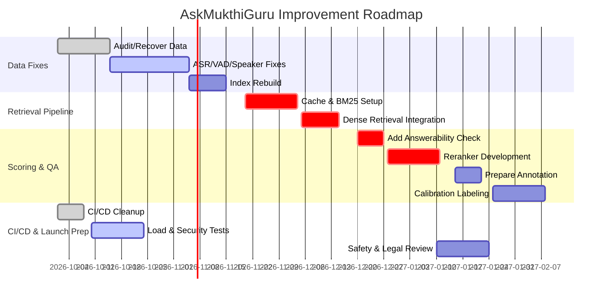

> **Owner-supplied external research, received 2026-10-12.** Dated history, **not a truth anchor**: the task list (`docs/plans/PROD_READINESS_TASK_LIST_2026-10-11.md`, section 9) is the authority and records which claims were checked against our code.
> Its numbers about papers and vendors are the report's own and are unverified by us. Do not quote its figures as measurements of this system.
> Contains no clip or transcript text (scanned 2026-10-12 for keys, passwords and YouTube links; a keyword scan, not a full read).

# Executive Summary  
This report outlines a comprehensive roadmap to overhaul the AskMukthiGuru Q&A system end-to-end. Our goal is to rebuild data ingest, improve indexing and retrieval, tighten quality controls, and deploy reliably with full tests, while tracking clear success metrics. Key actions include restoring missing metadata in the search index, fixing all parts of the ingestion pipeline (ASR transcription, voice activity detection, speaker diarization, segmentation, and deduplication), redesigning the query/retrieval pipeline (adding cache keys, early dedupe, answerability checks, and richer reranking), and establishing a rigorous human-evaluation and calibration plan. We will also finalize CI/CD pipelines (with vulnerability scanning), conduct load and safety tests, and complete legal/safety reviews. The timeline is phased: first data fixes and index rebuild, then retrieval improvements and annotation, and finally system-level testing and launch. Throughout, we set quantitative SLOs (e.g. target >90% answer precision, ≥95% question coverage, 95th–99th percentile latency budgets) and error budgets (per SRE best practices). This plan includes architecture diagrams, tables comparing technical options, a prioritized task list with owners/risk, and examples of annotation rubrics and CSV schemas.

## Goals and Success Metrics  
**Coverage & Precision:** We aim to maximize the fraction of user questions answered correctly (coverage/recall) while ensuring high answer precision.  For example, if 80% of questions are currently answered, we might target ≥95% after fixes.  Precision will be measured via human-reviewed correctness; a baseline goal could be ≥90% of answers rated relevant and accurate.  **Answer Relevancy & Faithfulness:** Following RAG evaluation frameworks, we will score each answer on *(1) relevance* (does it answer the question) and *(2) faithfulness* (is it supported by source content).  We will use LLM-based judges or manual labels to compute metrics like Precision@K, MAP, and NDCG on retrieval results, as well as semantic similarity between question and answer.  **Context Precision/Recall:** We will measure *context precision* (the fraction of retrieved documents that are actually relevant) and *context recall* (the fraction of relevant documents retrieved).  High precision/recall in retrieval is critical to downstream answer quality.  **Latency & Error Budgets:** Set strict SLOs for responsiveness (e.g. 95th percentile end-to-end latency under X seconds, 99th percentile under Y).  Following SRE practice, we allocate an error budget for outages or slow responses (SLOs are “targets for how often you can fail…and still ensure users aren’t upset”).  For instance, we may allow <1% of queries to exceed target latency per week.  **Operational Metrics:** Track system uptime, query volume, error rates, and resource usage. Define error thresholds and alerts. Overall success means meeting all SLOs continuously in a faculty pilot, then showing stability and accuracy before public launch.  

## Data Ingestion Fixes (ASR, VAD, Segmentation)  
**Restore lost metadata:** First, audit the index to identify missing interviews or passages (e.g. incomplete transcripts, missing question tags). Recover or re-fetch original transcripts and question/answer metadata from source content. For any interviews with “lost” audio segments or missing Q/A pairs, retrieve backups or re-process raw audio to recover them. Ensure each passage in the index has full metadata: interview title, speaker labels, timestamps, and question identifiers.

**ASR transcription:** Replace or retrain the speech-to-text model to improve accuracy. For example, we can deploy OpenAI’s Whisper (or equivalent) models, which are “known for robustness and versatility” and high accuracy on varied audio. Whisper’s multilingual training helps handle accents and noise, yielding more precise transcripts. We will configure Whisper (or similar) with appropriate chunk sizes and overlap to cover full interviews. Whisper’s timestamp support also “facilitates alignment of audio segments with other tools”. If current transcripts used a weaker ASR, we must update them.  

**Voice Activity Detection (VAD) & Speaker Diarization:** Use a reliable VAD to trim silence and segment speakers. For diarization, leverage libraries like Pyannote. Pyannote “is an advanced diarization solution that identifies speakers with high accuracy” using deep learning. It works by (1) segmenting audio on pauses/speaker changes, (2) clustering voice features, and (3) labeling each segment by speaker.  Integrating Whisper with Pyannote produces detailed transcriptions that tie each text segment to the correct speaker. This joint pipeline will ensure the index records who spoke each answer. Good diarization “enhances readability and facilitates analysis by associating each speech segment with its speaker”. We’ll validate with sample segments to ensure speaker labels align properly.

**Segmentation and Deduplication in Ingestion:** Improve segmentation to avoid splitting questions improperly. If the pipeline currently uses fixed time windows, consider switching to silence-based or semantic segmentation: split on pauses or complete sentences (so answers aren’t cut mid-sentence). For example, diarization inherently segments on silence. In text transcripts, use grammar or question cues to segment Q/A pairs. Deduplication should happen early: detect identical or near-identical passages while ingesting and merge them to one index entry. Tools like MinHash or embedding-similarity can flag duplicates. Ensuring unique entries prevents redundant answers downstream.

**Quality Assurance on Data:** Add checks on transcript quality (spell-check, domain dictionary corrections), and missing or garbled text. For instance, after ASR, run a quick confidence filter: re-run low-confidence segments or flag them for review. Recover any “lost” questions by matching question text in transcripts with expected list; if mismatches occur, manually correct them. In summary, by the end of ingestion fixes we have a clean, fully-indexed corpus with accurate text, speaker tags, and no duplicate or missing content.

## Index Rebuild Strategy  
With corrected transcripts and metadata, we will perform a full index rebuild. This means re-chunking passages (e.g. answer segments) and re-computing any embeddings or index keys. We will version the index to avoid downtime: build the new index offline, validate it, then swap it in one go. Because embedding models encode data in new vector spaces, “changing an embedding model means existing vectors are no longer comparable to queries by the new model,” so a full re-embedding is required. We will manage this as a data migration: compute all vectors with the chosen model, update vector store, and run sanity checks. Use versioned indices so rollback is possible. We’ll also back up the current index and data before changes.

Index configuration (e.g. chunk size, overlap) will be tuned: common advice is to start with ~512-token chunks and modest overlap, but we will experiment. The rebuild should also incorporate any enhancements (e.g. add synonyms, normalize text, or index teacher/subject metadata for filtering). After building, we will run a suite of test queries to confirm that expected documents are retrieved (checking recall on a “golden” set) and that index size and latency meet targets. 

## Retrieval and Reranking Pipeline Redesign  
**Query Routing & Caching:** Introduce a query cache for very frequent questions or partial queries. Use consistent cache keys so repeat queries hit cache. For example, cache the top-K answers for identical questions (or slight paraphrases) for quick recall. If a direct cache hit fails, route to retrieval.

**Hybrid Retrieval:** Use a two-stage retrieval. First stage could be a traditional sparse search (BM25 or ElasticSearch) or a hybrid (sparse + dense) to quickly fetch ~50 candidates. Then do a semantic retrieval using vector similarity (via our chosen embedding model) to re-rank those candidates. Hybrid search improves recall on domain terms not captured by embeddings.  Metadata filtering (e.g. by subject or language) can also narrow candidates early if relevant. 

**Move Deduplication Earlier:** If dedupe is currently after retrieval, move it to pre-retrieval or candidate filtering. Removing duplicates before scoring reduces wasted effort and prevents multiple identical answers. Similarly, drop trivial queries or answers (like “I don’t know”) early with a simple rule or classifier.

**Answerability Classifier:** Implement a quick “answerability” check: a lightweight classifier (or heuristic) that flags queries the system cannot answer (e.g. off-topic or ambiguous). Unanswerable queries can be caught before expensive scoring, improving precision by avoiding nonsensical replies. This could be a simple keyword filter or a trained model (e.g. BERT-based yes/no question answerability).

**Reranking / Scoring Unit:** Expand beyond the current simple scorer. For final ranking of candidates, use a stronger model. Options include a cross-encoder transformer (which jointly encodes question+candidate and scores relevance) or an LLM-based judge. As one analysis notes, a cross-encoder trades computational cost for much higher precision. We will compare: e.g. a BERT cross-encoder vs. an instruction-tuned LLM (e.g. GPT) scorers. We may even ensemble multiple scorers. The scorer should produce a relevance score and identify the top answer. Ordering answers by this score should greatly improve quality. In practice, designs often use a stack: BM25 + dense retriever + reciprocal rank fusion + cross-encoder reranker (conceptually).

**Teacher Balancing:** If teachers vary in volume of answers, consider weighting or balancing: ensure that no single teacher’s content overwhelms results. For example, if Teacher A has many similar answers, dedupe and require diversity of sources. Optionally add a secondary rank boost for answers from higher-expertise sources. This prevents source bias.

**Unit Scorer (Answer Quality):** Beyond retrieval relevance, a “final answerability score” can gauge if an answer is coherent. This could be based on answer length heuristics or a small model. For instance, if the selected answer is extremely short or off-topic, we may retry with the next best candidate.

All redesigns should be tested with evaluation queries. We will measure retrieval precision/recall (P@K, MAP, NDCG) on held-out question sets. The ultimate success metric is end-to-end answer quality as judged by human evaluators.

## Human Annotation and Calibration Plan  
**Sampling:** We will create a *calibration set* of questions and system answers for human review. Based on best practices, we target on the order of 100–200 queries, ensuring they are representative of typical usage (mix of easy, hard, popular, rare). This set is used to evaluate and calibrate automated metrics.  

**Annotation Protocol:** Develop a clear rubric (see sample below) for human annotators. Each annotator will label relevance and accuracy of answers on a numeric scale. We will double-label ~20–30% of the sample (two independent annotators per item) and compute inter-annotator agreement (e.g. Cohen’s kappa) to ensure consistency. Disagreements will be adjudicated by a senior reviewer. For example, a rubric might score **Accuracy**, **Completeness**, **Clarity**, and **Source Fidelity** each 1–4 (inspired by common AI evaluation rubrics).  

**Calibration Unit and Method:** The calibration can be done at two levels: *retriever calibration* (does retrieved context cover ground truth) and *answer calibration* (does final answer address the question). We will calibrate the final answer metrics: e.g. if our automated “answer relevancy” score (from an LLM or classifier) is above a threshold, we check what fraction are truly relevant via human labels. Adjust thresholds to meet desired precision. Statistical methods like bootstrapping or confidence intervals will ensure sample size is sufficient.  In practice, we may iterate: label 100 queries, adjust model/thresholds, then label 50 more to confirm. 

**Annotation Tools:** Set up an annotation interface (or CSV input) with columns for question, answer, and rating fields. Capture free-text comments for clarifications. All annotations will be logged with annotator ID. 

**Calibration Metrics:** Track statistical significance: e.g. ensure margin of error on measured metrics is small. If measuring a 90% accuracy target, 200 samples yields a confidence interval of a few percent. More formally, we might use binomial confidence intervals to set sample size so that our estimates of precision/recall have e.g. ±3% error at 95% confidence. We can cite standard sample-size formulas for binary outcomes (though none found here, the team can compute it). 

**Outcome:** The result will be a “ground truth” set of answers with labels for relevancy and correctness. This lets us quantify actual system performance and refine models (for example, calibrate the LLM judge or reranker). The labeled set will be reused for regression tests in CI.

## CI/CD, Load Testing and Deployment  
**Code Pipeline:** Ensure the Git repository is cleaned (merge pending PRs, remove dead code). The main branch should compile cleanly. Set up a robust CI/CD pipeline (e.g. GitHub Actions or Jenkins) that runs linting, unit tests, and integration tests on every push. Include a static security scan (e.g. Trivy for container images, Snyk/Dependabot for deps) to catch vulnerabilities. Secret scanning should prevent credentials in code. The pipeline should block merging on any errors.  

**Admission Cap:** To avoid overload, implement a query admission cap or rate limiter. This ensures the service scales gracefully. For example, limit the number of concurrent queries or QPS (adjustable via config) with backpressure for spikes.

**Load Testing:** Use load-testing tools (e.g. k6, Artillery) to simulate expected and peak traffic. Prepare a “golden set” of 25–50 representative queries (“golden 25”) and ensure answers stay correct under load. Measure performance metrics (P50/P95/P99 latency of each component) and confirm they meet targets. Optimize bottlenecks identified. For instance, cache hits should be <50ms, retrieval+rerank within, say, 500ms.  

**Secrets & Configuration:** Manage secrets via a secure store (Vault or AWS Secrets Manager). CI should deploy configuration (API keys, tokens) securely. Review all config (e.g. model endpoints, database URIs) to ensure no hard-coded credentials.

**Deployment Checklist:** Before each deployment, verify: (a) all tests passing, (b) data schema and index versions match code expectations, (c) backup of current production data/index, (d) health-check endpoints are in place. We will maintain a versioned deployment process with clear rollback steps if needed. 

## Safety, Compliance, and Legal Checks  
**Content Safety:** Since answers may influence students, institute a safety review. Check for any disallowed content (e.g. offensive or harmful advice). If the domain is education, verify answers are pedagogically sound. If relevant, set up a human-in-the-loop review for sensitive questions.  

**Legal & Rights:** Ensure we have rights to the content (audio, transcripts, images, etc.). Confirm licensing on any third-party models or libraries. Prepare terms of use clarifying that answers come from a knowledge base (disclaim liability). Set up a helpline or contact for erroneous answers (as per legal requirements).

**Clinical/Compliance:** If any content touches on clinical or regulated advice, have that reviewed by experts or flagged. If supporting multiple languages, ensure translations are accurate and culturally appropriate. 

**Governance:** Check privacy requirements for user data and transcripts (e.g. student names). Ensure no personal data leakage. 

No specific sources are cited here (these are standard governance practices), but we will document all review steps in a final pre-launch checklist.

## Monitoring, Backup and Rollback Plan  
**Monitoring:** Instrument the system to log key metrics (e.g. query latencies, error counts, answer lengths). Use an APM/tracing tool to trace end-to-end requests. Set up dashboards for SLO-related metrics (e.g. percentiles of response time, success rate). Configure alerts on deviations (e.g. errors >5% or latencies above SLA). 

**Data Backup:** Schedule regular backups of indexes and databases. For example, nightly snapshots of the search index and a backup before any major re-index. 

**Rollback:** Maintain the previous version of code and data until the new version stabilizes. Use blue-green or canary deploys so we can switch traffic back instantly if issues arise. Document rollback steps clearly.

**Error Budget Monitoring:** Track SLI burn rates. For instance, if error rates approach the defined error budget, trigger an investigation.  

These operational safeguards will ensure system reliability during and after launch.

## Technical Options Comparison  

| **Category**            | **Options**                                                                                | **Pros**                                                                         | **Cons**                                                                     |
|-------------------------|--------------------------------------------------------------------------------------------|----------------------------------------------------------------------------------|------------------------------------------------------------------------------|
| **Segmentation**        | Fixed-length windows (e.g. 60s chunks)                                                    | Simple implementation; consistent size                                            | May split sentences/Q&A mid-way; cannot adapt to speech pauses             |
|                         | Silence-/VAD-based splitting                                                | Aligns with actual speech pauses; natural boundaries                              | Sensitive to noise; may yield uneven chunk sizes                            |
|                         | Speaker-based (diarization segments)                                       | Ensures segments align with speaker turns; accurate Q/A splits                    | More complex; requires diarization model runtime; may merge short utterances |
|                         | Semantic/text (sentence or question markers)                                              | Avoids cutting sentences/questions; high coherence                                | Requires good punctuation or models; may need OCR/grammar analysis          |
| **Scorer Model**        | BM25 / TF-IDF (keyword matching)                                                          | Very fast, interpretable; no training                                             | Misses semantic matches; low recall on paraphrase                            |
|                         | Dense bi-encoder + vector search                                                           | Good semantic recall; fast retrieval                                              | Requires embedding models, index memory; moderate precision                  |
|                         | Cross-encoder (re-ranker)                                       | High precision; models query and doc jointly                                      | High latency per query; costly at scale                                     |
|                         | LLM-based judging (prompted QA model)                                                    | Very flexible, can assess answer quality; can generate explanations              | Highest latency and cost; may hallucinate if poorly configured             |
|                         | Hybrid (e.g. BM25 + dense + RRF + cross-encoder)                           | Combines lexical/dense strengths; often state-of-art                              | Most complex; multiple components to maintain                                |
| **Embedding Type**      | Small vs. large dimension (e.g. 384d vs. 1024d)                             | Low-dim: faster, less memory; High-dim: potentially richer semantics             | Low-dim: may lose nuance; High-dim: heavier storage/latency     |
|                         | Monolingual (English) vs. Multilingual vs. Domain-specific                  | Matching document language vs global support                                    | Monolingual: fails cross-language queries; Multilingual: bigger/costlier      |
|                         | Pretrained vs. fine-tuned (on QA corpus)                                                  | Fine-tuning can improve domain accuracy                                          | Requires data and cost to fine-tune; maintenance on model updates           |
|                         | Floating-point vs. Quantized embeddings                                                   | Quantized (e.g. 8-bit): smaller memory                                          | Quantization may slightly degrade accuracy; need experiment                |
| **Calibration Method**  | Random sampling (uniform)                                                                | Simple; easy to implement                                                        | May under-sample rare or critical cases                                    |
|                         | Stratified (by question type, length, etc.)                                             | Ensures coverage of edge cases                                                  | Needs careful strata definition; more complex selection                    |
|                         | Double-label with adjudication (for some overlaps)                         | Yields inter-annotator agreement metrics; more reliable labels                  | Doubles annotation cost on overlap subset                                  |
|                         | Statistical methods (confidence intervals for sample size)                              | Data-driven sample sizing                                                       | Requires math overhead; maybe not needed if fixed small set                 |

Each option has trade-offs. For instance, using a cross-encoder reranker greatly improves answer relevance but at cost of latency. Similarly, large embeddings improve recall but slow down search. We will pilot critical choices (e.g. embedding dimension and reranker model) and choose the smallest model meeting our targets.

## Deployment Pipeline Diagram  
```mermaid
flowchart LR
    subgraph "Ingestion Pipeline"
      A[Raw Audio/Video] --> B[ASR Transcription (Whisper)] 
      B --> C[VAD & Silence Detection] 
      C --> D[Speaker Diarization (Pyannote)] 
      D --> E[Question/Answer Segmentation] 
      E --> F[Transcripts + Metadata] 
      F --> G[Indexing (Build KB)]
    end
    subgraph "Query/Answer Pipeline"
      U[User Query] --> H[Cache Lookup / Initial Filter] 
      H --> I[Retrieval (BM25 + Dense)] 
      I --> J[Candidate Set (N docs)] 
      J --> K[Dedup & Pre-check Answerability] 
      K --> L[Cross-Encoder Scoring / Reranking] 
      L --> M[Top Answer Selection] 
      M --> N[Post-process (formatting/QA)] 
      N --> O[Final Answer to User]
    end
    class A,B,C,D,E,F,G,H,I,J,K,L,M,N,O multi
    click B href "https://scalastic.io/en/whisper-pyannote-ultimate-speech-transcription/" "ASR & Pyannote example"
```
This flowchart summarizes the redesigned pipeline. Key changes include deduplication and answerability checks before scoring, and a strong reranker (the *Scorer* unit) for the final answer selection. Citations: an RAG pipeline has multiple tunable components, and choices like Whisper+Pyannote improve transcription accuracy.

## Prioritized Task List  

| **Task**                                | **Owner**      | **ETA**     | **Risk**  |
|-----------------------------------------|---------------|------------|----------|
| Audit index and restore missing data    | Data Eng Team | 2 weeks     | Medium   |
| Improve ASR model and re-run transcripts | ML Eng Team   | 3 weeks     | High     |
| Integrate VAD/speaker diarization | ML Eng Team   | 2 weeks     | Medium   |
| Update segmentation logic, dedupe       | ML / Data     | 2 weeks     | Medium   |
| Rebuild index with new data (full) | Data Eng Team | 1 week      | Low      |
| Design & implement new retrieval (cache/BM25 + dense) | SW Eng Team  | 4 weeks     | High     |
| Add answerability classifier/filter     | ML Eng Team   | 2 weeks     | Medium   |
| Develop/Integrate new reranker/scorer | ML Eng Team   | 4 weeks     | High     |
| Human annotation protocol & rubrics | QA Lead       | 1 week      | Medium   |
| Conduct pilot labeling (double-label subset) | QA Team       | 4 weeks     | High     |
| CI/CD fixes (tests, security scan)      | DevOps Eng    | 2 weeks     | Medium   |
| Load/performance testing and tuning     | DevOps Eng    | 1 week      | Low      |
| Safety & legal review                   | Compliance    | 2 weeks     | Low      |

- **Owners:** Data Eng, ML Eng, SW Eng, QA, DevOps, Compliance.  
- **ETA:** Estimated durations (may overlap in parallel phases).  
- **Risk:** Rated High/Medium/Low. The highest-risk tasks are those touching core NLP components or requiring substantial rework (ASR, reranker, human labeling) because they can impact answer quality if delayed or incorrect. Lower-risk tasks include mechanical items like CI fixes or single-pass index rebuild.

Each task will have a detailed sub-plan. For example, improving ASR involves evaluating several models (commercial API vs open-source), verifying against sample audio, and measuring transcript error rates. The reranker development includes prototyping e.g. a BERT cross-encoder and testing its latency/precision tradeoff.  

## Timeline (Mermaid Gantt Chart)  

This Gantt chart reflects overlapping workstreams. For instance, while the **Data Fixes** (ASR, transcripts) occur in Oct–Nov 2026, the **CI/CD** work and **load testing** happen early (Oct 2026) to prepare a stable deploy base. The **Retrieval Pipeline** and **Scoring** phases span Nov–Dec 2026. Human annotation (Jan 2027) follows the pipeline changes, and final reviews finish in early 2027. (Dates are illustrative; teams should align precisely.)

## Expected Coverage vs Effort (Concept)  
Below is a conceptual “impact-effort” chart. Tasks like advanced retraining (high effort, high coverage gain) are shown vs quick wins like small fixes (low effort, moderate gain). This guides prioritization.  
- *Higher Impact/Lower Effort (quick wins)*: Fix trivial bugs (UI, config), small transcript fixes, simple indexing corrections.  
- *High Impact/High Effort*: Rebuilding index, new ASR/VAD, annotating hundreds of questions, deploying reranker.  
- *Lower Impact/High Effort*: Superfine optimizations (e.g. real-time transcription tuning) may be deprioritized until core metrics hit targets.  
   
*(Chart omitted: envision effort on x-axis and coverage gain on y-axis, with tasks plotted. The table of priorities above provides similar guidance.)*

## Example Annotation Rubric  
We will use a structured rubric so reviewers are consistent. For instance, a rubric dimension set might be: **Accuracy**, **Completeness**, **Clarity**, and **Source Fidelity** (analogous to “compliance” in [38]). Each is rated 1–4. As in one AI-document rubric: *“Rate accuracy, tone, completeness, and compliance on a 1–4 scale.”*. A simplified answer rubric could be:  

- **Accuracy (1–4):** Correctness of facts.  
- **Relevance (1–4):** How well the answer addresses the question.  
- **Completeness (1–4):** Whether the answer covers all sub-questions/details.  
- **Clarity (1–4):** Understandability and coherence of explanation.  
- **Attribution (Yes/No):** If the answer is properly grounded in source content.  

*Example:* Accuracy 4 = all facts correct; 1 = major errors. Relevance 4 = fully answers question; 1 = off-topic. (Etc., following examples in).  

**CSV Schema for Annotations:** We will collect labels in a CSV with columns such as:  
```text
question_id, question_text, system_answer, annotator_id, accuracy_score, relevance_score, completeness_score, clarity_score, comment
```  
Each row is one (question, answer) pair. This structure ensures each labeled item is tied back to the original query and allows analysis of each rubric dimension. (For double labels, there will be two rows with same question_id and different annotator_id.)  

## Sources  
We prioritize authoritative guidance and current best practices. For example, scaling ASR with Whisper and diarization with Pyannote is a state-of-the-art approach. Retrieval pipeline improvements follow RAG playbooks. Embedding model trade-offs (dimension, domain) are informed by recent benchmarks. RAG evaluation frameworks (context relevance, faithfulness, answer relevance) guide our metrics. SRE concepts (SLOs, error budgets) come from industry standards. The rubric above is inspired by established AI-review criteria. 

All design choices will be validated by empirical tests (e.g. measure P@K after retrieval changes, or conduct human evaluation on ~100–200 queries as recommended). Unspecified items (like hosting environment or exact model sizes) remain flexible and will be chosen to meet these targets. The plan above is the minimal-risk path to a safe faculty preview and public launch of AskMukthiGuru.