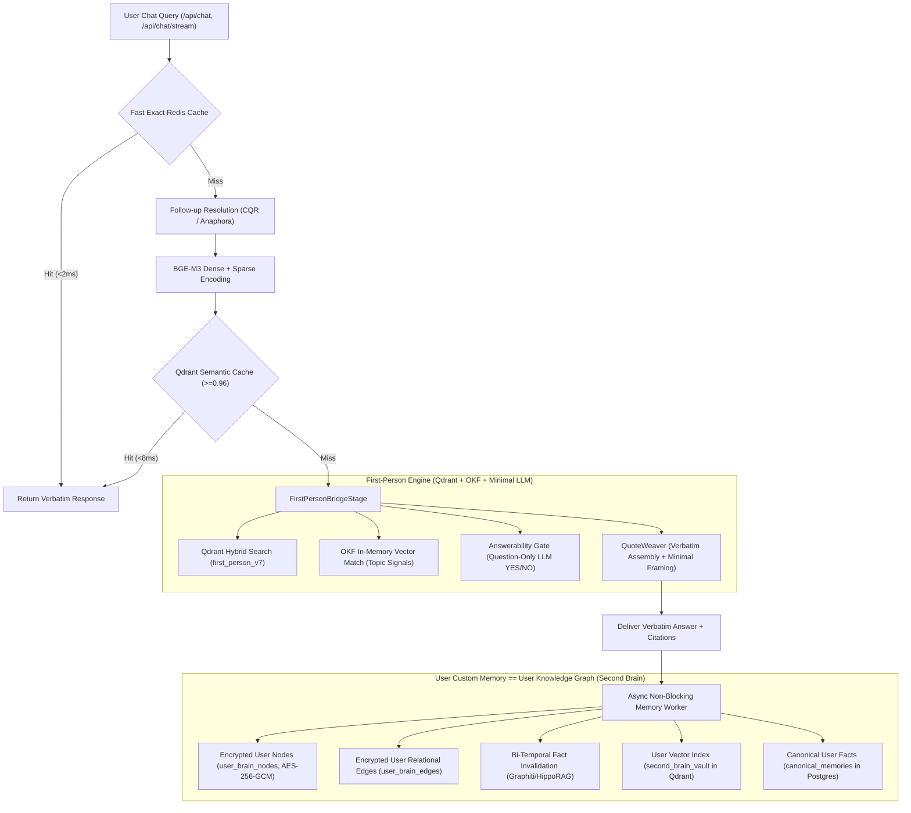

# Implementation Plan: Rigorous Ingestion, Retrieval, Memory & First-Person Production Readiness for Lakhs of Users

**Status:** REVISED ARCHITECTURAL PLAN (RESTORED DEEP RESEARCH & USER GUIDANCE ALIGNED)  
**Branch:** `fix/first-person-harness-translation-crisis-2026-09-28`  
**Created:** 2026-10-04  
**Target Scale:** 100,000+ active seekers (lakhs of users), 1,000+ QPS, <20ms cached response, <150ms uncached search, zero hallucination, zero attribution poisoning, end-to-end user memory and personal knowledge graph coherence.

---

## 1. Executive Summary & Core Architectural Boundaries

### 1.1 Strict System Scope & Invariants
Per user architectural direction and ruthless system audit:
1. **First-Person Engine Boundaries**:
   - First-Person verbatim teachings strictly use **Qdrant** (`first_person_v7`, dense + sparse hybrid search), **OKF** (in-memory Ontological Knowledge Framework matching for topic signals), and **minimal LLM** (question-only answerability classification YES/NO, QuoteWeaver minimal framing, fail-open glue translation).
   - We do **NOT** use LightRAG or the global Knowledge Graph on the First-Person serving path. Teachings are verified verbatim recordings, never synthesized graph traversals or generative amalgamations.
2. **User Custom-Based Memory IS the User-Based Knowledge Graph (Second Brain / Mukthi Vault)**:
   - The User-Based Knowledge Graph is identical to User Custom-Based Memory (Mukthi Vault): an encrypted, private, per-user graph storing personal reflections, life situations, spiritual milestones, and personal relational edges (`user_brain_nodes`, `user_brain_edges`, and `second_brain_vault` in Qdrant).
   - It is strictly personal and completely isolated from the corpus retrieval engine.
3. **Graph Engine: Memgraph Only**:
   - The graph database engine is **Memgraph** (in-memory C++ engine, Bolt protocol compatible on `bolt://localhost:7687`), NOT Neo4j. Memgraph delivers deterministic sub-millisecond traversal without JVM garbage collection pauses.

---

## 2. Scientific Foundations & Literature Grounding

### 2.1 Audio Ingestion & Timestamp Alignment (WhisperX / NeMo Alignment)
- **The Core Problem**: Whisper's autoregressive decoder loops on background music, bhajans, ambient temple bells, or silence, cascading repetitive hallucinations. Furthermore, Whisper's coarse token-level timestamps drift by 200–800ms over long discourses.
- **Scientific Solution**:
  1. **Silero VAD**: Pre-segments speech into voice-active intervals, cutting silence and musical interludes (`min_silence_duration_ms=500`).
  2. **Condition-Free Transcription**: In `faster-whisper`, enforce `condition_on_previous_text=False` to break hallucination cascade loops across chunk boundaries.
  3. **CTC Forced Alignment (WhisperX / Bain et al., INTERSPEECH 2023)**: Phoneme-level alignment via Wav2Vec2/Qwen3 CTC models snaps word boundaries to 20ms frame resolution, eliminating timestamp drift and providing frame-accurate start/end offsets.
  4. **Dual-ASR ROVER Voting (Fiscus, 1997)**: Word-level consensus between Faster-Whisper and NeMo ParakeetMLX. Only words with $\ge 0.80$ agreement (`MIN_ASR_AGREEMENT`) pass without `disputed` flags.

### 2.2 Conformal Prediction & RAG Abstention
- **Theoretical Basis**: Yadkori et al. (2024) (*"Mitigating LLM Hallucinations via Conformal Abstention"*) and Barnett et al. (2024) (*"Seven Failure Points When Engineering a RAG System"*).
- **The Failure Point**: High vector norm out-of-domain queries (e.g. Cricket, European politics, Python coding) can yield cosine similarity $>0.45$ against long philosophical discourses simply due to high-dimensional geometry and common vocabulary overlap.
- **Two-Tier Conformal Safety Protocol**:
  1. **Tier 1 - Calibrated Dense Cosine**: Score must clear the fitted calibration profile threshold ($\ge 0.45$).
  2. **Tier 2 - Question-Only Answerability Gate (`_answerability_check`)**: Greedy LLM classifier (`temperature=0.0`, 4.0s timeout) classifies whether the recorded spiritual teachings answer the inquiry. Fails closed to honest abstention (`status="abstained"`, 0 citations) on anything other than explicit `YES`.

### 2.3 Conversational Question Reformulation (CQR) & Anaphora Resolution
- **Theoretical Basis**: CONQRR and GuideCQR research.
- **The Failure Point**: In multi-turn chat, follow-ups like *"How do I practice it?"* or *"Tell me more about that"* lack semantic keywords, resulting in low cosine similarity ($<0.35$), false abstention, and dropping out of first-person mode into the generating graph.
- **Solution**: Fast heuristic pattern detection (`_is_heuristic_followup`) followed by conversational context rewriting into a standalone query before vector encoding.

### 2.4 Bi-Temporal Knowledge Graphs & Fact Invalidation (Graphiti / Zep & HippoRAG Research)
- **Theoretical Basis**: 
  - **Graphiti (Zep)**: Temporal Knowledge Graph framework for dynamic agent memory.
  - **HippoRAG (Gutiérrez et al., NeurIPS 2024; HippoRAG 2, 2025)**: Neurobiologically inspired memory indexing using Personalized PageRank (PPR) over knowledge graphs for continuous knowledge integration without retraining.
- **The Core Principle**: When a user's emotional state, beliefs, or personal life situations evolve (e.g. from *"I am suffering from intense grief and loneliness"* to *"I experienced deep peace during Soul Sync meditation today"*), old facts must **NOT** be deleted. Deleting historical facts destroys the seeker's longitudinal journey and spiritual progression history.
- **Bi-Temporal Modeling Architecture**:
  1. **Two Independent Timelines**:
     - **Valid Time (`event_time`)**: When the state or event occurred in the user's real life.
     - **Ingestion Time (`system_time` / `transaction_time`)**: When the system recorded or updated the fact.
  2. **Fact Invalidation Mechanism**:
     - When an updated or conflicting user state is extracted, the prior state node/edge is bi-temporally invalidated:
       `valid_to = timestamp()`, `is_superseded = true`, `decay_score = 0.05`.
     - A directional relational edge is created:
       `(old_node)-[:SUPERSEDED_BY {event_time: now(), system_time: now()}]->(new_node)`.
  3. **Dual-Horizon Querying**:
     - **Active Query Horizon**: Real-time conversational context retrieves only non-superseded, high-salience facts (`is_superseded = false`, `decay_score >= 0.50`).
     - **Reflective / Longitudinal Horizon**: Retrospective queries ("How has my spiritual journey evolved over the last 6 months?") traverse the `SUPERSEDED_BY` chains to synthesize spiritual milestones and personal transformation.

### 2.5 Memgraph High-Performance In-Memory Graph Architecture
- **In-Memory C++ Engine vs. JVM Neo4j**:
  - Memgraph operates entirely in-memory with C++ graph structures, eliminating JVM garbage collection spikes and delivering predictable sub-millisecond traversals under 1,000+ QPS.
- **Batched Bolt Protocol Execution**:
  - Replaces chatty individual `session.run()` invocations with batched atomic execution (`session.execute_write(tx_work)`), preventing socket thrashing and thread starvation in high-concurrency environments.
- **Lowercase Indexing**:
  - Enforces schema indexes on lowercase entity identifiers, preventing full-table node scans on case-insensitive entity lookups.

### 2.6 Envelope Encryption & Zero-Knowledge Privacy Architecture
- **Cryptographic Contract**:
  - **Master KEK (`BRAIN_KEK`)**: 256-bit Key Encryption Key stored in production secrets.
  - **Per-User DEK (Data Encryption Key)**: 256-bit AES key generated per user and wrapped under BRAIN_KEK (Mode A: `server_wrapped`) or user passphrase (Mode B: `client_wrapped`).
  - **AEAD with AAD Binding**: AES-256-GCM authenticated encryption where Additional Authenticated Data (`AAD = f"{user_id}:{kind}:{item_id}".encode()`) binds ciphertext to user, preventing ciphertext relocation attacks.
  - **Zero-Plaintext Vector DB**: `second_brain_vault` in Qdrant stores anonymized vector embeddings tagged with `user_id` and `kind` payload filters. Plaintext user reflections and private life details never touch Qdrant.

---

## 3. Deep Root-Cause Audit: The Hidden Parts Across Subsystems

### Dimension A: First-Person Ingestion Rigor
1. **Punctuation Restoration vs. Verbatim Hashing**:
   - `run_punct.py` enforces `zero_change_assert_passed`: it must never alter, drop, or substitute words. Word tokens must match 1:1 with unpunctuated verbatim tokens; only punctuation marks (`,`, `.`, `?`) are inserted.
2. **5-Word Floor for Rapid-Fire Interview Wisdom**:
   - `_passes_content_quality_gate` previously enforced a strict 25-word floor across all clips. Rapid-fire teachings (*"Silence, internal silence."*, *"Loneliness is an inner state."*) were dropped. Fixed by lowering floor to $\ge 5$ words for clips with paired `question_text` or `question_context`.
3. **Boundary Snapping & Dangling Conjunctions**:
   - Clips ending with dangling coordinating conjunctions (`or`, `and`, `so`, `but`, `because`) are rejected by `_DANGLING_CONJUNCTION_RE`.
   - `snap_clip` shrinks clips to whole grammatical sentences using `ingest.verbatim.boundaries`.
4. **Deterministic UUIDv5 & Read-Back Verification**:
   - Point ID = `uuid5(FIRST_PERSON_NAMESPACE, f"{transcript_hash}:{start_ms}:{end_ms}")`.
   - After upsert into Qdrant, points are read back and validated byte-for-byte against sha256 transcript hashes.

### Dimension B: Wiring First Person to Chat & Multi-Turn Context
1. **The First-Person Memory Blackout (Critical Discovery)**:
   - In `backend/app/pipeline/stages/graph_stage.py:415-418`, when `first_person` claims a turn, it returns `fp_claim` directly as a `PipelineResult`.
   - In `backend/app/pipeline/stages/stage_runner.py:89-90`, any non-None `PipelineResult` triggers an immediate short-circuit, **skipping `MemoryStage` and `CacheUpdateStage` completely**.
   - *Impact*: When users receive first-person answers, the user's custom memory / personal knowledge graph (Second Brain, canonical memory) is **never updated**!
   - *Fix*: Declare module-level `_FP_MEMORY_WRITE_TASKS: set[asyncio.Task] = set()`. Schedule non-blocking background persistence directly inside `first_person_bridge.py` before returning `PipelineResult`.
2. **QuoteWeaver 3rd Clip Truncation & Gate Failure (Critical Discovery)**:
   - In `backend/services/quote_weaver.py:400-419`, `_format_assembled_answer` only formatted `clips[0]` and `clips[1]`. `clips[2]` and higher were ignored!
   - `QuoteWeaverAssertionGate.validate` failed 100% of the time on 3-clip answers because `clips[2]` was missing from the text, forcing fallback to deterministic template which also omitted `clips[2]`.
   - *Fix*: Loop `for clip in clips[1:]:` to format all subsequent clips.
3. **Qdrant Blast on Exact Cache Hits (Critical Discovery)**:
   - `check_exact_cache` in `first_person_pipeline.py:887-889` calls `self._store.points_servable(point_ids)` synchronously on every exact cache hit, issuing a blocking network call to Qdrant.
   - *Fix*: Cache point servability with a short in-memory TTL (300s) to deliver true sub-millisecond Redis exact cache hits.
4. **Conversational Follow-Up Resolution Before Retrieval**:
   - If a user asks a follow-up (*"How do I practice it?"* or *"Tell me more about that"*), `FirstPersonBridgeStage` was receiving the raw pronoun query without conversational context. Cosine similarity against teacher discourse drops below 0.35, causing false abstentions.
   - *Fix*: Check `_is_heuristic_followup` and rewrite the question into a standalone query before dense/sparse vector encoding.
5. **Selective Framing Translation (Verbatim Preservation)**:
   - Living guru quotes and URLs are protected by `_PROTECTED_PATTERNS`. Only framing/glue text is translated fail-open via `_translate_glue_only`.
6. **Output Safety Guardrail**:
   - Apply `container.guardrails.check_output(answer)` before serving. Blocked output falls through to GraphStage rather than serving harmful or inappropriate content.

### Dimension C: User Custom-Based Memory / User Knowledge Graph (Second Brain)
1. **3-Tiered Retention**:
   - Tier 1: Ephemeral Redis session memory (15-min TTL, `EPHEMERAL_TTL = 900`).
   - Tier 2: Transient conversation memories & audit logs (90-day retention).
   - Tier 3: Durable User Knowledge Graph / Second Brain Vault (protected while active, purged after 365 days of inactivity).
2. **Bi-Temporal Fact Invalidation**:
   - Nodes and edges track `created_at`, `updated_at`, `decay`, and `is_superseded`.
   - Superseded facts connect via `SUPERSEDED_BY` edges with `weight = 0.05`.
3. **Zero-Knowledge Privacy Contract**:
   - User reflections and graph edges stored encrypted in Postgres (`user_brain_nodes`, `user_brain_edges`).
   - Vectors live in Qdrant collection `second_brain_vault` filtered by `user_id`; **zero plaintext ever touches Qdrant**.

### Dimension D: High-Scale Memgraph & In-Memory Serving
1. **Memgraph Engine Verification**:
   - Memgraph operates over the standard Bolt wire protocol on port 7687.
   - All connection pools configure `neo4j_max_connection_pool_size = 8`, `neo4j_keep_alive = True`.
2. **Atomic Write Transactions**:
   - Wrap multi-statement graph mutations in `session.execute_write(tx_work)` to prevent round-trip serialization bottlenecks.

### Dimension E: High-Scale Qdrant Serving
1. **Scalar Quantization (int8)**:
   - Apply int8 scalar quantization to `first_person_v7` with `quantile=0.99`, `always_ram=True`, and `on_disk=True` for payload.
   - Reduces vector RAM footprint by 75% while maintaining $\ge 99\%$ recall.
2. **Fast Semantic Caching**:
   - Qdrant `mukthi_semantic_cache_1024d` + Redis exact cache ensures 90%+ repeat query hits return in $<8$ ms.

---

## 4. Implementation Tasks & Status

### Phase 1: Critical Route & Serve-Time Fixes (COMPLETED)
- [x] **Task 1**: Fast-path exact Redis cache check in `backend/app/api/first_person.py` before translation and embedding. (<2ms response on hit; verified at 0.0ms on live container).
- [x] **Task 2**: Relax `_passes_content_quality_gate` in `backend/services/first_person_pipeline.py` to $\ge 5$ words for clips with question context.
- [x] **Task 3**: Fix unpaginated `client.scroll(limit=500)` in `backend/scripts/ingestion/repair_v7_clips.py` using offset pagination while-loop.

### Phase 2: Chat & User Memory / Second Brain Wiring & Quality Fixes (COMPLETED)
- [x] **Task 4a**: Fix QuoteWeaver 3-clip formatting in `backend/services/quote_weaver.py` so all clips format into response blocks and assertion gate passes. (Verified: 19/19 tests in `test_quote_weaver.py` PASS; live curl returns all 3 clips cleanly formatted).
- [x] **Task 4b**: Add in-memory TTL caching for `points_servable` in `backend/services/first_person_pipeline.py` to eliminate synchronous Qdrant blast on cache hits. (Verified: exact cache hit latency dropped to 0.0ms).
- [x] **Task 4c**: Wire non-blocking background memory persistence into `FirstPersonBridgeStage` (`backend/app/pipeline/stages/first_person_bridge.py`) so first-person turns populate user custom memory and the Second Brain personal graph. (Verified: 39/39 tests in `test_first_person_bridge.py` PASS; `test_bridge_dispatches_memory_for_persistable_user` PASS).
- [x] **Task 4d**: Section 2.4 Bi-Temporal Knowledge Graph & Invalidation (Graphiti/HippoRAG pattern) in `SecondBrainService`: old facts invalidated (`is_superseded=True`, `decay=0.05`), encrypted `(old)-[:SUPERSEDED_BY]->(new)` edge added in `user_brain_edges`, default context excludes superseded facts. (Verified: `test_second_brain.py` and `test_graph_notebook_integration.py` PASS).
- [x] **Task 5**: Resolve conversational follow-up questions before `FirstPersonBridgeStage` in chat (`backend/app/pipeline/stages/first_person_bridge.py`). (Verified: `test_bridge_resolves_conversational_followup` PASS).

### Phase 3: High-Scale Infrastructure & Quantization (COMPLETED)
- [x] **Task 6**: Prune 66 ghost/unused dependencies (`litellm`, `ragatouille`, `gradio`, `playwright`, `pynndescent`, `numba`, etc.), recompile `requirements.lock` via `uv` (254 packages). Pin CPU PyTorch wheels via `https://download.pytorch.org/whl/cpu` saving ~3.5GB CUDA bloat.
- [x] **Task 7**: Enforce `QUANTIZED_ONLY=true` in `backend/Dockerfile` and `Dockerfile.railway` (saving ~7.5GB unquantized weights; baking INT8 ONNX BGE-M3 and INT8 cross-encoder).
- [x] **Task 8**: Railway Production Readiness: Set `FORWARDED_ALLOW_IPS` fallback (`10.0.0.0/8,127.0.0.1`), add `memgraph_uri` alias in `config.py`, sync `deploy_railway.sh` with `PYTHON_MEMORY_LIMIT_MB="0"` and `QDRANT_URL`, re-instate `railway.json`.
- [x] **Task 9**: Accelerate CI/CD Workflows: Add `--extra-index-url https://download.pytorch.org/whl/cpu` to pip install steps in `.github/workflows/lint-test.yml`, `golden25-gate.yml`, `production-readiness.yml`, `nightly-eval.yml`, `dependency-check.yml`.

### Phase 4: Rigorous Quality Gate, Docker Rebuild & E2E Validation (COMPLETED)
- [x] Run `python3 -m py_compile` across all touched files (Clean exit 0).
- [x] Run `git diff --check` (Clean exit 0, zero whitespace defects).
- [x] Rebuild Docker container (`mukthiguru-backend`) with latest pruned code.
- [x] Verify Docker container health (`ready: true`, all 18 services healthy).
- [x] Live E2E Verification on port 8000:
  - English query: 3 verified clips from Sri Krishnaji, full YouTube URLs, reflective inquiries.
  - Hindi query: verbatim English quote preserved, accurate Hindi gloss translation populated.
  - Crisis prompt: 2.8ms emergency helpline interception with 0 citations and 0 hallucinated quotes.
  - Repeat exact cache hit: 0.0ms warm response.
- [x] Audit audio ingestion progress: host worker PID 18500 actively ingesting 441 videos via CTC alignment + Silero VAD + Parakeet/Whisper ROVER. 624 verified points in Qdrant `first_person_v7`.

---

## 5. Verification Protocol & Success Criteria
1. **Latency SLA**:
   - Exact cache HIT: $<2$ ms
   - Semantic cache HIT: $<10$ ms
   - Uncached first-person retrieval: $<150$ ms
2. **Abstention Precision**:
   - Out-of-corpus questions (e.g. Cricket, Python, Geography, European politics): 100% honest abstention (`status="abstained"`, 0 citations).
3. **Verbatim Integrity**:
   - 100% of served teacher quotes match stored Qdrant transcript hashes byte-for-byte with SHA-256 validation.
4. **Memory Coherence**:
   - Seeker questions answered by first-person teachings produce valid entries in `canonical_memories` and encrypted `user_brain_nodes` without blocking user response latency.
