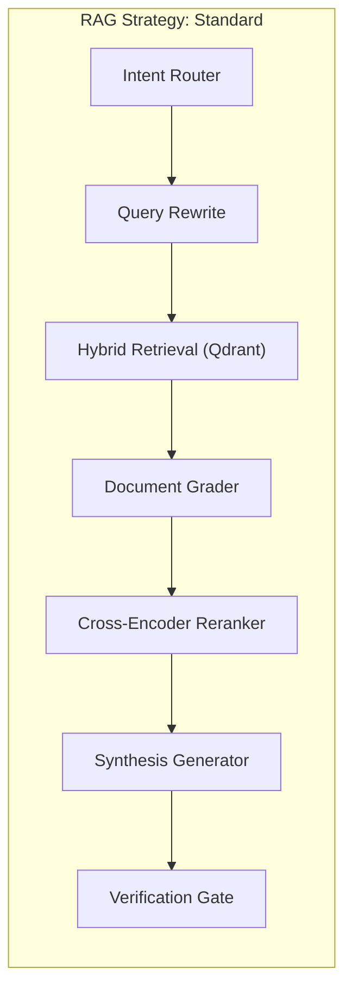

# Admin Portal & Operator's Guide

The **AskMukthiGuru Admin Portal** provides administrators, spiritual content curators, and ML engineers with a unified control plane for corpus ingestion, spiritual doctrine curation (OKF), RAG execution tracing, safety observability, and system configuration.

---

## 1. Portal Architecture & Navigation

The admin interface is built as a protected single-page application within the React frontend, hosted under the `/admin` route namespace (`src/admin/`).

```mermaid
graph TD
    subgraph Admin Portal (/admin)
        A["Admin Shell & Topbar<br/>(AdminShell.tsx / AdminTopbar.tsx)"]

        A --> B["1. Overview (/admin)<br/>KPI Telemetry, Charts, Live Feed"]
        A --> C["2. Ingestion (/admin/ingestion)<br/>Jobs Queue, Attribution, Video Approval, Cache"]
        A --> D["3. Content (/admin/content)<br/>OKF Manager, Daily Teachings, Tips, Topics"]
        A --> E["4. Queries & Tracing (/admin/queries)<br/>Insights, Retrieval, Quality, Span Waterfall"]
        A --> F["5. RAG Flow (/admin/rag-flow)<br/>Interactive ReactFlow Pipeline Simulator"]
        A --> G["6. System & RBAC (/admin/admins, /admin/settings)<br/>User Roles, Guardrails, Global Config"]
    end
```

### Safety & Crash Isolation Invariants

- **Runtime Feature Flag**: The portal is gated at runtime via `VITE_ADMIN_PORTAL_ENABLED`. In public production deployments where this is disabled, admin chunks remain unmounted and unreachable.
- **Route-Level Suspense & Error Boundaries**: Per repository pattern `P1-AI-19`, each admin child route is wrapped in an individual `<Suspense>` boundary and `<AdminErrorBoundary>`. A rendering failure in a complex chart or telemetry waterfall isolates locally and never crashes the entire admin shell.

---

## 2. Overview Telemetry (`/admin`)

The **Overview Dashboard** (`src/admin/pages/OverviewPage.tsx`) provides high-level system health metrics, real-time query throughput, and cost analytics.

### Key Performance Indicators (KPIs)

- **Active Sessions & User Queries**: Rolling 24-hour and 7-day query volumes.
- **Latency (p50 / p95 / p99)**: End-to-end response times segmented by pipeline stage (Retrieval, Rerank, Generation).
- **Faithfulness & Grounding Rate**: Percentage of answers passing factual grounding checks without hallucination.
- **Token Expenditure & Cost**: Real-time spending across LLM providers (Sarvam, OpenRouter, NIM, Anthropic).
- **Crisis Triage Volume**: Real-time count of queries preempted by the **Serene Mind** safety rail and routed to **Tele-MANAS (14416)**.

### Live Telemetry Tools

- **Timeseries Charts (`TimeseriesChart.tsx`)**: Visual trends for cache hit ratios, error rates, and token consumption.
- **Real-Time Feed (`LiveFeed.tsx`)**: Live query stream showing anonymized user intents, pipeline strategy used (`standard`, `fast`, `deep`), response latencies, and output verification scores.

---

## 3. Ingestion Staging & Review Queues (`/admin/ingestion`)

The Ingestion section coordinates data pipeline workflows across four dedicated tabs:

### 1. Ingestion Queue (`Queue` Tab / `JobsPage.tsx`)
- Displays real-time Celery background tasks running audio transcription, chunking, and embedding.
- Tracks task status (`pending`, `processing`, `succeeded`, `failed`, `retrying`).
- Enables manual job re-triggering and detailed worker trace inspection.

### 2. Speaker Attribution (`Attribution` Tab / `SpeakerAttributionPage.tsx`)
- **Voiceprint Clustering Viewer**: Displays audio windows clustered by ECAPA-TDNN acoustic embeddings.
- **Speaker Assignment**: Identifies segments spoken by Sri Preethaji, Sri Krishnaji, or dialogue guests.
- **Verification Controls**: Allows curators to promote unverified segments or flag acoustic conflicts for quarantine in `deterministic_id_collision_quarantine`.

### 3. Video Approval (`Video Approval` Tab / `VideoApprovalPage.tsx`)
- **Rights Verification**: Inspects videos against the curated rights register (`docs/rights/CONTENT-RIGHTS.md`).
- **Transcript Preview & Boundary Check**: Displays ASR output alongside YouTube video playback to verify timestamp slice alignment (`audio_start_ms`, `audio_end_ms`).
- **Release Gating**: Approves content for promotion from staging into the active serving collection.

### 4. Cache Management (`Cache` Tab / `CachePage.tsx`)
- Monitors Redis exact match cache and semantic vector cache.
- Displays cache hit rates and memory utilization per namespace.
- Provides granular invalidation controls (invalidate by video ID, doctrine term, or collection).

---

## 4. OKF Manager (`/admin/content?tab=okf`)

The **OKF Manager** (`src/admin/pages/OkfManager.tsx`) oversees the **Ontological Knowledge Framework** (`memory/okf/`), serving as the gatekeeper for spiritual doctrine.

```text
┌────────────────────────────────────────────────────────────────────────┐
│                          OKF MANAGER INTERFACE                         │
├────────────────────────────────────────────────────────────────────────┤
│ [Active Concepts (820)]   [Review Queue (14)]   [Recompile OKF Bundle] │
├────────────────────────────────────────────────────────────────────────┤
│ Title: Ahankara And Identification            Type: teaching           │
│ Teacher: Sri Preethaji & Sri Krishnaji        Status: [✓ human:editor] │
│ Source: https://www.youtube.com/watch?v=ehkqJ54DIC0                    │
├────────────────────────────────────────────────────────────────────────┤
│ Verbatim Excerpt:                                                      │
│ "The second layer in this matrix of the mind is ahankara, sense of     │
│ ego itself, whose primary purpose is to identify..."                   │
├────────────────────────────────────────────────────────────────────────┤
│ Actions: [Edit Markdown]  [Compare to Transcript]  [Promote / Reject] │
└────────────────────────────────────────────────────────────────────────┘
```

### Review Queue Workflow

1. **Candidate Ingestion**: LLM-extracted concepts land in `memory/okf/staging/`.
2. **Transcript Verification**: Reviewers click *Compare to Transcript* to view side-by-side diffs between the excerpt and the original ASR transcript.
3. **Attribution Audit**: Confirms quotes originate from Sri Preethaji or Sri Krishnaji, not student questions.
4. **Verified Badges**:
   - `✓ human:<name>`: Human-verified and approved for production.
   - `● machine:<name>`: Staged automated extraction (never loaded in production).
   - `unverified`: Flagged for review or re-verification after the 180-day SLA window.
5. **Recompile OKF Bundle**: Triggers `compile_okf()` to deterministically regenerate `memory/okf/compiled.json`.

---

## 5. Daily Teachings, Tips & Topics (`/admin/content`)

- **Daily Teaching (`DailyTeachingPage.tsx`)**: Schedule and publish the featured *Daily Contemplation* displayed on the seeker home interface. Links daily teachings to verbatim audio clips.
- **Teaching Tips (`TeachingTipsPage.tsx`)**: Manage micro-practices and mindfulness reminders categorized by life situation (stress, relationships, decision-making).
- **Topics Hierarchy (`TopicsPage.tsx`)**: Maintain the spiritual taxonomy and semantic anchors mapping user life struggles to Ekam doctrine.

---

## 6. Queries, Tracing & Quality (`/admin/queries`)

The **Query Insights** suite gives deep observability into every seeker interaction.

### 1. Query Table & Insights
- Filter queries by date, latency, user sentiment, intent (`DISTRESS`, `PHILOSOPHICAL`, `MEDITATION`, `CASUAL`), and grounding state.
- Quickly identify slow queries (p95 > 2500ms) or low-confidence answers.

### 2. Retrieval & Reranking Inspection (`RetrievalPage.tsx`)
- Inspect top-K retrieved points from Qdrant dense vector search alongside sparse BM25 scores.
- View Reciprocal Rank Fusion (RRF) scoring and Cross-Encoder reranking rank shifts.

### 3. Quality & Faithfulness (`QualityPage.tsx`)
- **Hallucination Badges (`HallucinationBadge.tsx`)**: Highlights responses where claims lacked citation support.
- **RAGAS Metric Heatmap (`RagasHeatmap.tsx`)**: Displays aggregate faithfulness, answer relevance, and context recall over time.

### 4. Trace Drawer & Span Waterfall (`TraceDrawer.tsx`, `SpanWaterfall.tsx`)
Clicking any query opens the **Trace Drawer**, rendering an interactive execution waterfall:

```text
[0ms] ─── InputGuardrailStage (12ms)
[14ms] ─── IntentRouter (45ms) ➔ INTENT: SPIRITUAL_PRACTICE
[62ms] ─── MultiQueryExpansion (180ms) ➔ 3 sub-queries generated
[245ms] ── QdrantDenseRetrieval (38ms) ➔ 15 chunks retrieved
[286ms] ── DocumentGraderNode (110ms) ➔ 11 chunks relevant, 4 discarded
[398ms] ── CrossEncoderReranker (85ms) ➔ Top 5 chunks ranked
[485ms] ── LLMSynthesis (Sarvam-105b) (840ms) ➔ Streaming response
[1328ms] ─ OutputVerificationStage (28ms) ➔ Passed Faithfulness: 0.98
[Total Turn Latency: 1356ms]
```

---

## 7. RAG Flow Simulator (`/admin/rag-flow`)

The **RAG Flow Simulator** (`src/admin/pages/RAGFlowPage.tsx`) provides an interactive ReactFlow canvas (`@xyflow/react`) mapping AskMukthiGuru's 12-layer LangGraph orchestration pipeline.



### Operator Capabilities

- **Strategy Switching**: Toggle between `standard` (full multi-stage verification), `fast` (low-latency streaming), and `deep` (multi-hop graph synthesis).
- **Node Inspection**: Click any node to inspect real-time p50/p95 latency metrics, failure counts, and detailed algorithmic responsibilities.
- **Live Dry-Run**: Enter custom test prompts to observe branch traversal, CRAG rewrite loops, and fallback pathways in a sandboxed execution session.

---

## 8. Security, RBAC & Configuration (`/admin/admins`, `/admin/settings`)

### Role-Based Access Control (RBAC)

The portal implements three administrative tiers managed in `AdminsPage.tsx`:

| Role | Privileges | Target Users |
|:---|:---|:---|
| **Super Admin** | Full access: User management, API key rotation, global configuration, database reindexing, and cache flushing. | Lead DevOps & Engineering Owners |
| **Curator / Reviewer** | Content approval: OKF review queue, video transcript approval, daily teaching scheduling, and quality auditing. | Monastic Editors & Content Curators |
| **Operator / Auditor** | Read-only access: Query telemetry, trace waterfall inspection, and evaluation reports. | QA Engineers & Support Team |

### Security Controls

- **Supabase Authentication**: Admin logins require multi-factor authenticated Supabase service accounts.
- **Row-Level Security (RLS)**: Enforced via `scripts/verify_rls_policies.py` ensuring admin mutations require valid JWT admin claims.
- **Audit Logging**: Every content approval, rejection, prompt update, and cache flush is written to `admin_audit_logs` with admin email, timestamp, and IP address.

---

## 9. Related Documentation & Runbooks

- [Architecture Overview](file:///Users/harshodaikolluru/Public/askmukthiguru-8119b0e8/docs/wiki/architecture/index.md)
- [Ingestion Architecture](file:///Users/harshodaikolluru/Public/askmukthiguru-8119b0e8/docs/wiki/architecture/ingestion.md)
- [OKF Teachings & Doctrine](file:///Users/harshodaikolluru/Public/askmukthiguru-8119b0e8/docs/wiki/domain/teachings-and-okf.md)
- [Deployment & CI Operations](file:///Users/harshodaikolluru/Public/askmukthiguru-8119b0e8/docs/wiki/operations/deployment-and-ci.md)
- [On-Call Guide](file:///Users/harshodaikolluru/Public/askmukthiguru-8119b0e8/docs/runbooks/ONCALL.md)
