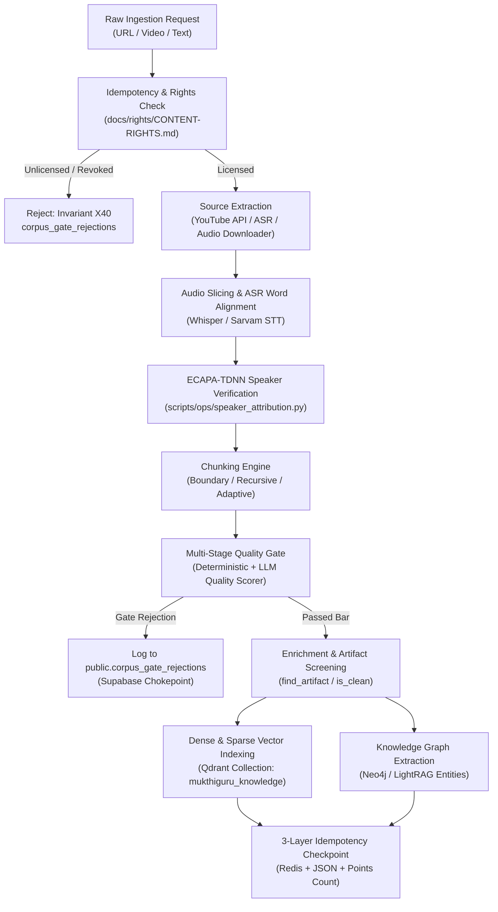
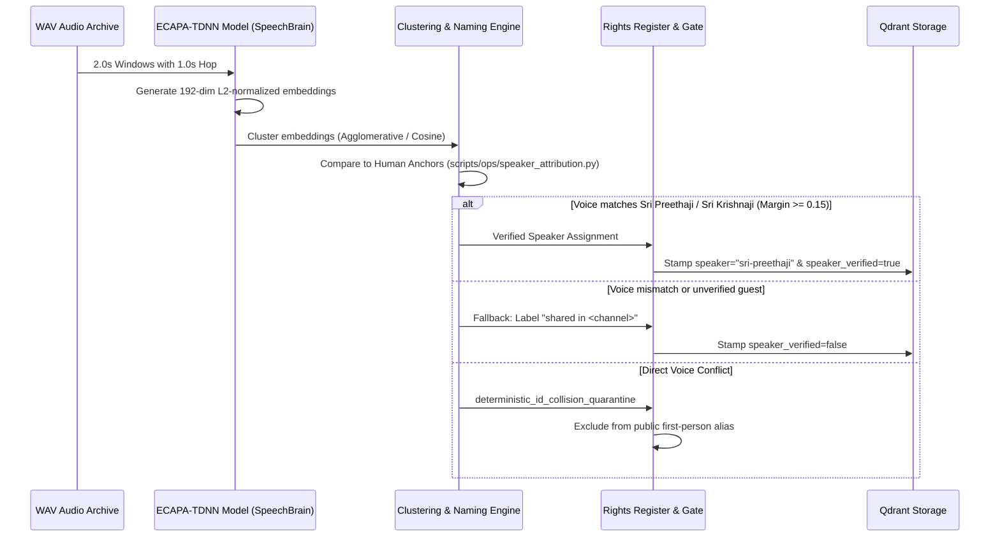

# Corpus Ingestion & Verification Architecture

The **AskMukthiGuru Ingestion Pipeline** processes multi-modal discourse—principally YouTube spiritual discourses, interviews, sacred audio, and long-form texts—into verified, deterministic, and queryable vector and knowledge graph embeddings.

The pipeline transitions raw, unstructured audiovisual streams into grounded, attributed, and quality-vetted points within **Qdrant** and **Neo4j / LightRAG**. It enforces strict repository invariants regarding copyright licensing, speaker verification, chunking grammars, and LLM text quality.

---

## 1. End-to-End Pipeline Overview

Ingestion is executed either asynchronously via **Celery distributed task queues** (`backend/tasks/ingest_tasks.py`) or through deterministic batch execution scripts (`backend/ingest/pipeline.py`, `backend/ingest/video_pipeline.py`).



### Key Components

- **`backend/app/api/ingest.py`**: FastAPI endpoints (`POST /api/ingest`, `/api/ingest/batch`, `/api/ingest/staging`) for initiating and monitoring ingestion jobs.
- **`backend/tasks/ingest_tasks.py`**: Distributed Celery tasks handling long-running audio downloading, Whisper/Sarvam transcription, and indexing off the main HTTP thread.
- **`backend/ingest/pipeline.py` (`IngestionPipeline`)**: Central orchestrator coordinating source loaders, chunkers, cleaners, quality gates, and storage dispatchers.
- **`backend/ingest/quality_gate.py` (`DataQualityGate`)**: Deterministic and LLM-assisted filtration protecting vector stores from low-signal or defective text.
- **`backend/ingest/verbatim/speaker_verify.py`**: Voiceprint attribution linking spoken audio frames to specific teachers using speech embeddings.

---

## 2. YouTube Transcription & ASR Alignment

Spiritual discourses from **Sri Preethaji** and **Sri Krishnaji** frequently feature dialogue, audience Q&A, and bilingual transitions between English, Hindi, Telugu, and Tamil. Accurate transcription requires precise word-level time alignment.

### Audio Acquisition & Alignment Flow

1. **Audio Extraction**: Audio tracks are extracted in 16 kHz mono WAV format and archived in `audio_archive/wavs/` keyed by video ID.
   > [!WARNING]
   > Under repository invariant **X21**, audio slicing for speaker attribution must **never** pull from `<asr_root>/audio/` where stub files may exist, but directly from verified PCM archives in `audio_archive/wavs/`.

2. **ASR Processing**: Primary transcription runs through **Whisper (large-v3)** or **Sarvam STT** for Indic language accuracy, producing word-level timestamps (`t_start`, `t_end`, `word`, `confidence`).

3. **Audio Coordinate Schema (`first-person-speaker-conflict-v2`)**:
   Under invariant **X7**, `audio_duration_ms` is permanently retired. Payloads strictly store:
   - `audio_file_duration_ms`: Total media length in milliseconds.
   - `audio_slice_duration_ms`: Exact duration of the extracted segment.
   - `audio_start_ms`: Word-aligned onset boundary.
   - `audio_end_ms`: Word-aligned offset boundary.

---

## 3. Chunking Strategies & Contract Grammars

AskMukthiGuru implements modular chunkers implementing the `ChunkerProtocol` interface (`backend/ingest/chunker_protocol.py`).

### Supported Chunking Strategies

1. **Boundary-Aware Text Chunker (`backend/ingest/boundary_chunker.py`)**:
   - Primary strategy for spoken transcripts and discourses.
   - Splits on discourse and paragraph boundaries (two or more newlines `\n\n+`).
   - If a paragraph exceeds maximum size (default 800–1200 characters), it splits along punctuation sentence boundaries (`[.!?]`).
   - For raw, punctuation-free ASR streams, it utilizes `_slice_on_word_boundary()` to look back up to 50 characters to break cleanly on whitespace rather than splitting words.
   - **Sentence Overlap**: Overlap is measured strictly in complete grammatical sentences rather than arbitrary character slices.

2. **Recursive Character Splitter (`RecursiveCharacterTextSplitter`)**:
   - Secondary chunker used for structured texts, books, and articles.
   - Recursively breaks along separators `["\n\n", "\n", " ", ""]` maintaining target chunk size (default 750 tokens) with fixed character overlap.

3. **Adaptive & Semantic Chunking (`adaptive_chunking.py`, `semantic_chunker.py`)**:
   - Dynamic boundary adjustment based on embedding cosine similarity drops between sequential sentence pairs, isolating topic shifts.

### Chunker Grammar & Version Invariants (X40)

To guarantee reproducible retrieval and unambiguous scoring:
- **`chunker_version` Attribute**: Every Qdrant payload must explicitly declare its generator grammar:
  - `boundary_v1:<hash>` (e.g., `boundary_v1:c1000_o150`)
  - `recursive_v1:<hash>`
  - `adaptive_v1`
  - `semantic_v1`
  - `unknown_legacy`: Assigned to historical legacy points where the algorithm cannot be mathematically proven. Synthetic backfilling of chunker names is forbidden.
- **Proposition Chunking Retired**: Per ADR 0002–0005, atomic proposition chunking is permanently decommissioned due to context distortion and loss of teaching rhythm.

---

## 4. Speaker Attribution & ECAPA-TDNN Verification

In spiritual discourse, misattributing a student's question or a host's introduction as a guru's teaching is a P0 defect. The ingestion pipeline runs biometric acoustic speaker verification before tagging any chunk with a guru identity.

### Architecture of Speaker Verification



### Voiceprint Invariants & Verification Rules

1. **Pinned Model Revision (X18)**:
   The voice embedding model uses SpeechBrain's ECAPA-TDNN (`speechbrain/spkrec-ecapa-voxceleb`) loaded with a strictly pinned Git commit hash. Heavy ML dependencies (`speechbrain`, `torch`) are loaded lazily behind the `Embedder` protocol.

2. **Anchor Moments & Clustering**:
   Reference voiceprints are established from human-verified anchor timestamps in `backend/scripts/ops/speaker_attribution.py::ANCHORS`:
   - Analysis window: `WIN_S = 2.0` seconds.
   - Window hop: `hop = 1.0` second.
   - Enrollment threshold: `ENROLL_MIN = 0.75`.
   - Identification threshold: `ANCHOR_LABEL_MIN = 0.55`.
   - Separation margin: `ANCHOR_MARGIN = 0.15`.
   - Word alignment snapping radius: `_SNAP_RADIUS_S = 1.5` seconds.

3. **Attribution Hypothesis vs. Evidence (X18, X31)**:
   - A video title, description, or transcript label claiming a guru is speaking is treated as a **claim under test**, never as evidence.
   - If the acoustic vector does not verify against the guru's voiceprint, the segment is labelled `"shared in <channel>"` or quarantined.
   - Missing verification never defaults to `speaker_verified=true` (Invariant X23).

---

## 5. Quality Gate Rejections & Storage Chokepoints

Every chunk generated must pass through the **Data Quality Gate** (`backend/ingest/quality_gate.py`) before indexing.

### The Storage Chokepoint: `public.corpus_gate_rejections`

Rejected chunks are persisted to Supabase table `public.corpus_gate_rejections` (Migration `20261028000001_corpus_gate_rejections.sql`) to ensure total visibility into pipeline attrition and gate accuracy:

```sql
CREATE TABLE IF NOT EXISTS public.corpus_gate_rejections (
    id UUID PRIMARY KEY DEFAULT gen_random_uuid(),
    source_url TEXT NOT NULL,
    chunk_index INT,
    gate_layer TEXT NOT NULL,        -- 'deterministic' | 'llm_scorer' | 'rights_filter'
    reason TEXT NOT NULL,            -- e.g. 'cot_leak', 'graceful_degradation', 'unlicensed'
    matched_span TEXT,               -- offending text substring
    point_id TEXT,
    gate_verdict TEXT,
    gate_reason TEXT,
    created_at TIMESTAMPTZ DEFAULT now()
);
```

### Ingestion Safety Invariants (Ingestion Safety 1–4)

1. **Mandatory `find_artifact()` Gate**:
   Every LLM output (`.generate()`) destined for Qdrant must pass `services.text_quality_filter.find_artifact()`. This catches:
   - **CoT Reasoning Leaks**: `<think>`, `Thinking Process:`, or internal monologue leaks from reasoning models (DeepSeek-R1, Sarvam-105b).
   - **Provider Graceful Degradation Strings**: Canned strings (e.g., *"I am currently experiencing a temporary connection issue..."*) from OpenRouter, Ollama, or NIM that return `200 OK` with error text instead of raising an HTTP exception.
   - **ASR Decoder Repetition Loops**: Hallucinatory phrase repetitions produced by Whisper when encountering silence or background music.

2. **Idempotency Cross-Validation**:
   Ingestion employs a 3-tier checkpoint architecture:
   - **Tier 1 (Redis)**: `IngestionCheckpoint` keyed by URL and content SHA-256 hash.
   - **Tier 2 (Disk)**: Local `ingestion_state.json` recording checkpoint completions.
   - **Tier 3 (Qdrant)**: Real-time validation of Qdrant collection `points_count`. If checkpoints report completion but `points_count == 0`, stale checkpoints are cleared and reindexing is triggered automatically.

3. **Content Rights Register Enforce (X40)**:
   - Rights status originates strictly from `docs/rights/CONTENT-RIGHTS.md` and `source_releases`.
   - Ingestion stamps `domain_rights_status == "licensed"` onto Qdrant payloads.
   - Retrieval paths filter out any point where `domain_rights_status != "licensed"`. Missing rights never default to licensed.

---

## 6. Related Documentation & Runbooks

- [Architecture Overview](file:///Users/harshodaikolluru/Public/askmukthiguru-8119b0e8/docs/wiki/architecture/index.md)
- [Teachings & OKF Knowledge Framework](file:///Users/harshodaikolluru/Public/askmukthiguru-8119b0e8/docs/wiki/domain/teachings-and-okf.md)
- [Admin Portal Guide](file:///Users/harshodaikolluru/Public/askmukthiguru-8119b0e8/docs/wiki/admin/portal-guide.md)
- [Reindexing Runbook](file:///Users/harshodaikolluru/Public/askmukthiguru-8119b0e8/docs/runbooks/reindex.md)
- [Purge Source Runbook](file:///Users/harshodaikolluru/Public/askmukthiguru-8119b0e8/docs/runbooks/purge-source.md)
- [Ingestion Safety Guide](file:///Users/harshodaikolluru/Public/askmukthiguru-8119b0e8/backend/docs/INGESTION_SAFETY.md)
