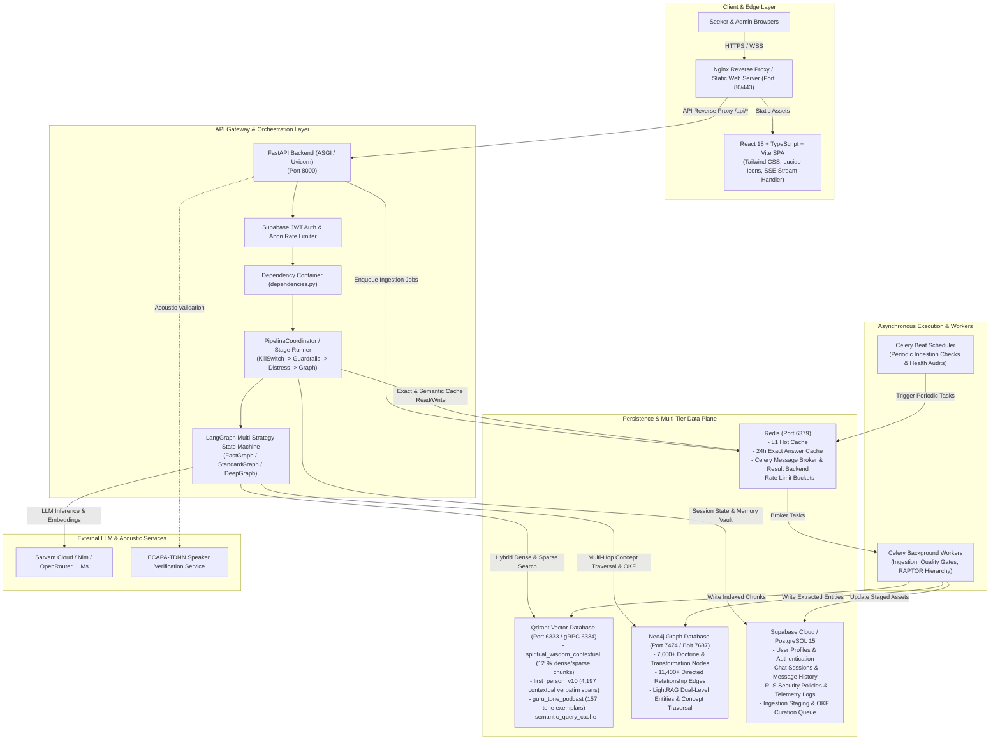
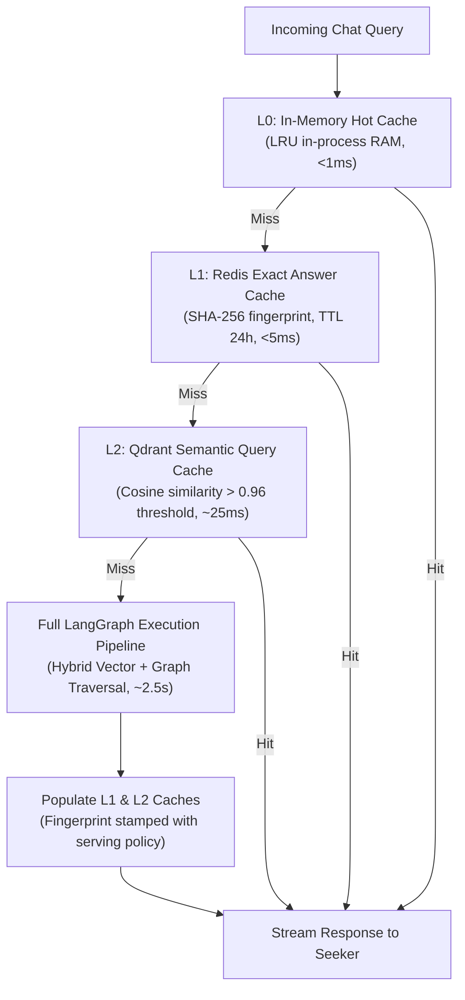

# System Architecture Overview

AskMukthiGuru is an enterprise-grade AI spiritual guidance platform grounded strictly in the teachings of **Sri Preethaji and Sri Krishnaji**. The system integrates a modern single-page application (SPA) frontend, an asynchronous FastAPI backend gateway, a Celery-distributed background ingestion worker pool, and a multi-model data plane consisting of vector, graph, relational, and memory caches.

---

## 1. High-Level Component Topology



---

## 2. Core System Components

### 2.1 Frontend Single Page Application (SPA)
* **Stack**: React 18, TypeScript, Vite, Tailwind CSS, Lucide icons, KaTeX math rendering.
* **Serving**: Packaged into static assets and served behind an Nginx HTTP/2 reverse proxy on Port 80/443.
* **Surfaces**:
  1. **Seeker Experience**: Chat interface with real-time Server-Sent Events (SSE) streaming, spiritual practice timers (Serene Mind), audio meditation player, notebook, and user profile management.
  2. **Admin Experience**: Control center for ingestion job management, transcription quality audits, Ontological Knowledge Framework (OKF) staging review, retrieval telemetry, and latency benchmarking.
* **Communication**: SSE streams (`/api/chat` with `stream=true`) for token-by-token text delivery, citation marker chips (`[[CITE:N]]`), and status metadata.

### 2.2 FastAPI Backend Gateway (`backend/app/main.py`)
* **Framework**: Asynchronous Python (FastAPI / Starlette) running under Uvicorn with multi-worker concurrency.
* **Security & Middleware Stack**:
  * **CORS Middleware**: Explicitly validates origins against `settings.cors_origins`.
  * **Security Headers**: Injects HSTS, CSP, X-Frame-Options (`DENY`), and X-Content-Type-Options (`nosniff`).
  * **Rate Limiting Middleware**: Redis sliding-window token bucket enforcement (e.g., 20 requests/minute on `/api/chat`).
  * **Authentication**: Decodes Supabase JWT tokens via `get_current_user_from_supabase` in `backend/app/dependencies.py` to establish user identity and tenant context.
* **Service Container**: Centralized dependency injection container in `dependencies.py` providing thread-safe, singleton access to database clients, cache pools, embedding models, and pipeline coordinators.

### 2.3 Worker Pool & Celery Background Tasks (`backend/celery_config.py`)
* **Broker & Backend**: Redis 7.x (`redis://redis:6379/0` for broker, `redis://redis:6379/1` for results).
* **Task Modules**:
  * `ingest_tasks.py`: Asynchronous YouTube download, Whisper/Sarvam transcription, audio slicing, and content chunking.
  * `quality_tasks.py`: Evaluates staged ingestion assets against transcript quality gates and contamination filters (`find_artifact`).
  * `raptor_tasks.py`: Recursive summarization and tree construction for hierarchical multi-level retrieval.

### 2.4 Multi-Model Data Plane
AskMukthiGuru separates concerns across specialized persistence engines:

| Engine | Primary Container / Port | Role in Architecture | Key Data Held |
|---|---|---|---|
| **Redis** | `redis:6379` | High-speed cache, queue, and rate limiting | L1 prompt hash cache, 24h exact answer cache, Celery job queues, ephemeral session states |
| **Qdrant** | `qdrant:6333` / gRPC `6334` | Dense & sparse hybrid vector search engine | `spiritual_wisdom_contextual` (12.9k chunks), `first_person_v10` (4,197 context spans), `guru_tone_podcast` |
| **Neo4j** | `neo4j:7474` / Bolt `7687` | Knowledge graph & relational doctrine store | 7,600+ doctrine nodes, 11,400+ relationship edges, OKF 5-node arcs, LightRAG dual-level graph |
| **Supabase (PostgreSQL 15)** | Cloud / Local `5432` | Relational authority & authorization | User accounts, chat histories, RLS security policies, ingestion checkpoints, audit telemetry |

---

## 3. End-to-End Request Lifecycle

When a seeker submits a question via `POST /api/chat`, the request traverses four distinct boundaries:

### Step 1: Ingress, Auth & Security Guard
1. **Network Entry**: Client issues a `POST /api/chat` request with JSON payload (`message`, `conversation_id`, `language`, `stream`).
2. **Identity Extraction**: `dependencies.py` validates the Supabase JWT. For anonymous sessions, `resolve_anon_identity` mints or recovers an ephemeral identifier subject to quota caps.
3. **Pipeline Initialization**: `PipelineCoordinator.execute()` in `backend/app/pipeline/pipeline_coordinator.py` initializes the request context `StageContext`.

### Step 2: The Linear Stage Safety Pipeline
Before invoking LLM execution or complex vector searches, the request sequentially passes through strict deterministic safety stages:
```text
KillSwitchStage
  └──> CacheCheckStage (exact & semantic hash lookup)
        └──> RequestStateStage (tenant context & language setup)
              └──> InputGuardrailStage (regex & topic safety rails)
                    └──> DistressStage (acute crisis assessment)
                          └──> CircuitBreakerStage (LLM provider health check)
                                └──> CasualShortCircuitStage (greeting shortcuts)
```
* **KillSwitch**: Evaluates global and teacher-specific kill switches. If active, execution halts immediately without hitting caches or LLMs.
* **Distress Detection**: Identifies severe emotional trauma or acute self-harm triggers. If matched, the pipeline routes directly to crisis mitigation and the Serene Mind practice flow, bypassing general generation.

### Step 3: Graph Execution & RAG Orchestration
If no short-circuit occurs, control enters `GraphStage`:
1. **Strategy Selection**: The query router inspects intent, complexity, and historical context to select one of three LangGraph strategies:
   * **FastGraphStrategy**: Low-latency path (<500ms) for simple direct inquiries.
   * **StandardGraphStrategy**: Default balanced path (~2.5s) using hybrid retrieval, cross-encoder reranking, and verification.
   * **DeepGraphStrategy**: High-reasoning path (~6s) utilizing query decomposition, HyDE, and 3-hop Neo4j graph traversal.
2. **Context Retrieval**: Hybrid queries hit Qdrant (`spiritual_wisdom_contextual`) for BGE-M3 dense/sparse vectors and Neo4j for OKF conceptual pathways.
3. **Grounded Generation & Verification**:
   * **Pass 1**: Strict factual drafting bounded exclusively by retrieved doctrine with `[[CITE:N]]` tags.
   * **Pass 2**: Post-generation quote verification ensuring zero hallucination.
   * **Pass 3**: Guru-voice tone adaptation honoring Sri Preethaji & Sri Krishnaji's authentic discourse persona.

### Step 4: Egress, Persistence & Telemetry
1. **Output Guardrails**: Validates final draft against PII leaks, brand-safety policies, and ethical boundaries.
2. **Memory Persistence**: Asynchronously stores conversation turns and episodic memories in Supabase and Redis.
3. **Telemetry & Caching**: Emits OpenTelemetry metrics, latency timers, and cost logs; updates the 24-hour exact answer cache.
4. **SSE Egress**: Streams formatted tokens, citation chips, and audio recommendations back to the client browser.

---

## 4. Multi-Tier Cache Hierarchy

To achieve sub-second TTFT (Time To First Token) for common queries while maintaining absolute factual accuracy, AskMukthiGuru operates a three-tier caching hierarchy:



* **L0 Hot Cache**: In-process Python `cachetools.TTLCache` holding high-frequency greeting patterns and doctrine shortcuts.
* **L1 Redis Cache**: Distributed Redis hash storing exact responses keyed by normalized query, guru identity, language, and the mandatory **B4 cache fingerprint**:
  $$\text{Key} = \text{SHA256}(\text{query} + \text{guru\_id} + \text{lang} + \text{collection} + \text{schema} + \text{corpus\_version} + \text{evidence\_policy})$$
* **L2 Semantic Cache**: Qdrant vector collection (`semantic_query_cache`) comparing query embeddings at a tight cosine distance threshold ($\ge 0.96$). DISTRESS queries and incognito sessions are permanently excluded from writing to or reading from this cache.

---

## 5. Architectural Invariants

Every subsystem in AskMukthiGuru enforces strict invariants documented across repository contracts:

1. **Safety Precedes Caching & Providers**: Input guardrails and distress evaluation run *before* doctrine cache lookups and provider circuit breakers (`L-STAGE-ORDER-1`). A distressed user must never receive a cached answer.
2. **Zero-Hallucination & Verbatim Citation**: Spiritual teachings are evidence, never generated fiction. All factual claims must resolve to authentic transcript chunks (`L-GROUNDING-1`).
3. **B4 Serving Isolation**: Legacy clip collections (`first_person_v1..v9`) and context collections (`first_person_v10..v11`) operate on incompatible schemas and must never share collection pointers or pipeline paths.
4. **No Unaudited Ingestion**: Ingested content must pass the automated quality gate (`quality_gate.py`), contamination checks (`find_artifact`), and rights clearing before persisting into durable vector indexes.

---

## 6. Related Wiki Documentation

* [12-Layer RAG Pipeline Architecture](rag-pipeline.md) — Deep dive into LangGraph states, query decomposition, HyDE, hybrid retrieval, and verification.
* [First-Person Serving Architecture](first-person-serving.md) — Verbatim context serving, B4 isolation contract, acoustic verification, and quarantine policies.
* [Qdrant Vector Database Reference](../data/qdrant.md) — Collection schemas, BGE-M3 multi-vector representation, HNSW settings, and scalar quantization.
* [Neo4j Knowledge Graph & OKF](../data/neo4j-graph.md) — 5-Node transformation ontology, LightRAG dual-level extraction, and graph traversal.
