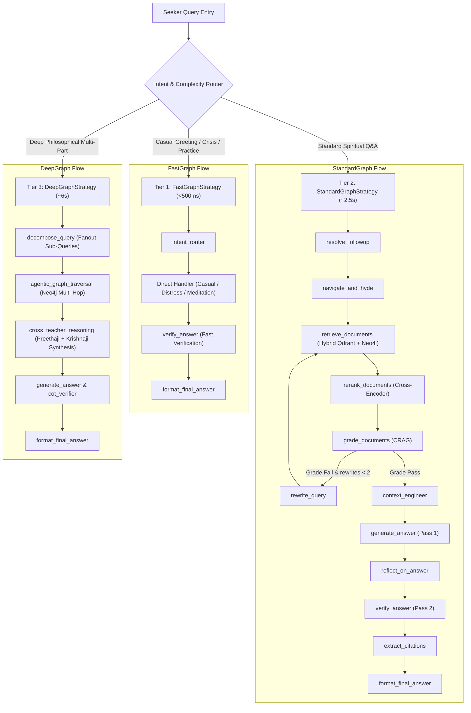

# 12-Layer RAG Pipeline & LangGraph Execution Engine

AskMukthiGuru implements an advanced, production-hardened Retrieval-Augmented Generation (RAG) architecture engineered around a single core mandate: **absolute fidelity to Sri Preethaji and Sri Krishnaji's authentic spiritual teachings with zero hallucination.**

The system operates across two complementary architectural planes:
1. **The Linear Outer Stage Chain** (`backend/app/pipeline/stages/pipeline_builder.py`): Enforces deterministic safety, acute distress mitigation, caching, rate limits, and provider circuit breakers before model inference.
2. **The LangGraph State Machine** (`backend/rag/`): A dynamic, multi-strategy graph that orchestrates query understanding, tree navigation, multi-source hybrid retrieval, cross-encoder reranking, context engineering, grounded drafting, citation verification, and authentic guru-voice tone adaptation.

---

## 1. Conceptual 12-Layer Pipeline Map

Historically documented as the "12-Layer RAG Pipeline", this logical framework maps directly to the active nodes within the LangGraph state machine:

```mermaid
flowchart TD
    subgraph Inbound ["Ingress & Understanding"]
        L1["Layer 1: Input Guardrails & Safety Filter\n(NeMo Topics, Toxic Regex, PII Blocker)"]
        L2["Layer 2: Semantic Intent & Route Classification\n(QUERY vs DISTRESS vs CASUAL vs COMPARATIVE)"]
        L3["Layer 3: Query Decomposition & Sub-Query Fanout\n(Multi-faceted spiritual inquiries broken into 2-3 searches)"]
    end

    subgraph Expansion ["Query Expansion & Navigation"]
        L35A["Layer 3.5A: RAPTOR Tree Navigation\n(Hierarchical summary cluster selection)"]
        L35B["Layer 3.5B: HyDE Vector Expansion\n(Hypothetical Document Embeddings for spiritual abstractions)"]
    end

    subgraph RetrievalLayer ["Dual-Store Hybrid Retrieval"]
        L4A["Layer 4A: Qdrant Dense & Sparse Retrieval\n(BGE-M3 1024d Dense + Lexical Sparse + ColBERT)"]
        L4B["Layer 4B: Neo4j OKF Graph Traversal\n(5-Node Transformation Arcs & LightRAG Dual-Level Entities)"]
    end

    subgraph EvaluationLayer ["Filtering & Relevance Assessment"]
        L5["Layer 5: Cross-Encoder Reranking\n(ms-marco-MiniLM-L-6-v2 / FlashRank scoring)"]
        L6["Layer 6: CRAG Relevance Grading\n(Corrective RAG grading to discard irrelevant context)"]
        L7["Layer 7: CRAG Rewrite & Self-Correction Loop\n(Reformulate queries when retrieval confidence falls below threshold)"]
    end

    subgraph GenerationLayer ["Synthesis & Verification"]
        L75["Layer 7.5: Context Engineering & Boundary Injection\n(Strict context assembly, teacher persona bounds, memory context)"]
        L8["Layer 8: Grounded Drafting (Pass 1)\n(Deterministic extraction with [[CITE:N]] markers)"]
        L9["Layer 9: Citation Extraction & Marker Normalization\n(Resolve citations against verified document IDs)"]
        L10["Layer 10: Citation Grounding & Self-RAG Verification (Pass 2)\n(Sentence-level claim validation against verbatim retrieved spans)"]
        L11["Layer 11: Contradiction & Coreference Check\n(Detect cross-teacher discrepancies and pronoun drift)"]
        L12["Layer 12: Tone Adaptation (Pass 3) & Output Guardrails\n(Sri Preethaji / Sri Krishnaji persona fidelity + NeMo safety checks)"]
    end

    Inbound --> Expansion
    Expansion --> RetrievalLayer
    RetrievalLayer --> EvaluationLayer
    EvaluationLayer --> GenerationLayer
```



---

## 2. Layer-by-Layer Architectural Breakdown

### Layer 1: Input Guardrails
* **Node / File**: `InputGuardrailStage` (`backend/app/pipeline/stages/guardrail_stage.py`) + `LightweightGuardrails`.
* **Execution**: Deterministic regex evaluation followed by NeMo Guardrails Colang flows (`guardrails/config/topics.co`).
* **Function**: Rejects jailbreaks, prompt injections, profanity, political polemics, and financial advice queries before touching vector stores or language models.
* **Failure Mode**: Sets `input_blocked=True`, `block_reason="topic_disallowed"`, and short-circuits to a polite redirect.

### Layer 2: Semantic Intent & Route Classification
* **Node / File**: `intent_router` (`backend/rag/nodes/intent.py`) + `on_device_intent.py`.
* **Classification Categories**:
  * `CASUAL`: Greetings, small talk (*"Hello"*, *"Namaste"*).
  * `DISTRESS`: Acute grief, depression, panic, or suicidal ideation.
  * `QUERY`: General spiritual Q&A (*"How do I overcome unconscious fear?"*).
  * `MEDITATION_CONTINUE`: Next steps within the Serene Mind practice flow.
  * `COMPARATIVE`: Cross-doctrine or comparative queries (*"Compare meditation with contemplation"*).
* **Routing Margin Data**: DISTRESS detection uses a high-sensitivity embedding threshold ($0.66 \rightarrow 0.72$). At $\ge 0.74$, acute crisis alerts are caught by deterministic regex rails to prevent false negatives.

### Layer 3: Query Decomposition
* **Node / File**: `decompose_query` (`backend/rag/nodes/intent.py`).
* **Execution**: Triggered on complex, multi-part inquiries (e.g., *"How do karma and past impressions affect my relationship with my children?"*).
* **Function**: Employs prompt-engineered sub-query decomposition to emit 2–3 orthogonal sub-questions (`sub_queries` in `GraphState`) for parallel retrieval.

### Layer 3.5: Tree Navigation & HyDE Expansion
* **Tree Navigation** (`navigate_and_hyde`): Leverages Qdrant RAPTOR summaries. Navigates top-level spiritual concept clusters to identify high-order themes before zooming into granular discourse chunks.
* **HyDE (Hypothetical Document Embeddings)**: Generates a 2-3 sentence hypothetical answer reflecting Sri Preethaji & Sri Krishnaji's typical discourse structure, embedding this draft alongside the seeker's query to bridge the lexical gap between seeker dilemmas and spiritual teachings.

### Layer 4: Dual Search Retrieval (Hybrid Vector + Graph)
* **Node / File**: `retrieve_documents` (`backend/rag/nodes/retrieval.py`).
* **Multi-Store Fanout**:
  1. **Qdrant Vector DB (`spiritual_wisdom_contextual`)**:
     * **Dense Search**: Cosine similarity over 1024-dimensional BGE-M3 vectors.
     * **Sparse Lexical Search**: Native BM25-equivalent sparse tokens computed by BGE-M3.
     * **ColBERT Multi-Vector**: Token-level interaction vectors for fine-grained semantic match.
     * **Parent Grouping**: `qdrant_parent_grouping_enabled=True` aggregates retrieval by `parent_id` to maintain discursive coherence.
  2. **Neo4j Knowledge Graph (`neo4j:7687`)**:
     * Cypher queries traverse the Ontological Knowledge Framework (OKF), pulling associated `RootLimitingBelief`, `GuruTeaching`, and `PracticeStep` nodes.
  3. **LightRAG Dual-Level Retrieval**:
     * Pulls low-level entity cards (`Teacher`, `Concept`, `Practice`) and high-level thematic relationship edges.

### Layer 5: Cross-Encoder Reranking
* **Node / File**: `rerank_documents` (`backend/rag/nodes/reranking.py`).
* **Model**: `cross-encoder/ms-marco-MiniLM-L-6-v2` (or CPU-accelerated FlashRank).
* **Function**: Jointly scores query and retrieved chunk pairs $[q, d_i]$. Applies a calibrated sigmoid cutoff ($>0.35$) to compress the raw pool of 15–25 candidates down to the top 5 most relevant passages (`reranked_docs`).

### Layer 6: CRAG Relevance Grading
* **Node / File**: `grade_documents` (`backend/rag/nodes/grading.py`).
* **Mechanism**: Evaluates retrieved chunks against the seeker query using structured binary verdicts (`relevant` vs `irrelevant`).
* **Quality Filter**: Drops chunks that match keywords superficially but lack genuine conceptual doctrine alignment.

### Layer 7: CRAG Rewrite & Self-Correction Loop
* **Node / File**: `rewrite_query` (`backend/rag/nodes/intent.py`) routed via `route_after_grading`.
* **Logic**: If all retrieved documents fail grading (`relevant_docs` is empty), the pipeline increments `rewrite_count`.
* **Cap**: Bounded at a maximum of 2 rewrite iterations. If still exhausted, the graph routes to `handle_fallback` to abstain rather than authoring ungrounded advice.

### Layer 7.5: Context Engineering
* **Node / File**: `context_engineer` (`backend/rag/nodes/generation.py`).
* **Function**: Formats the graded passages into a structured XML context envelope:
  ```xml
  <context>
    <document id="1" title="The Four Sacred Secrets" teacher="Sri Preethaji">
      Verbatim discourse excerpt...
    </document>
  </context>
  ```
  Injects seeker profile descriptors, language directives, and episodic memory context from Supabase.

### Layer 8 & 9: Grounded Drafting & Citation Extraction
* **Node / File**: `generate_answer` (`backend/rag/nodes/generation.py`) & `extract_citations`.
* **Drafting Philosophy**: The LLM acts strictly as an aggregator and communicator, forbidden from injecting external philosophy or speculative extrapolation.
* **Citation Syntax**: Must annotate every spiritual assertion with strict numbered citation tags: `[[CITE:1]]`, `[[CITE:2]]`.

### Layer 10 & 11: Joint Verification & Contradiction Resolution
* **Node / File**: `verify_answer` (`backend/rag/nodes/verification.py`) & `contradiction_resolver.py`.
* **Verification Logic**:
  * Verifies that every assertion bracketed by `[[CITE:N]]` is supported by document $N$.
  * Detects and strips ungrounded or orphan citation tags via `strip_orphan_markers`.
  * Computes `faithfulness_score` ($0.0 - 1.0$). If ungrounded text exceeds the strict threshold, `verification["passed"] = False` and the response is replaced by an audited fallback.
* **Contradiction Resolution**: Checks whether claims attribute conflicting metaphysical views to the teachers, ensuring harmony with Ekam doctrine.

### Layer 12: Tone Adaptation & Output Guardrails
* **Node / File**: `guru_tone_adapter` (`backend/rag/nodes/guru_tone_adapter.py`) & `OutputGuardrailStage`.
* **Pass 3 Tone Adaptation**: Uses Reflexion to calibrate warmth, sacred compassion, and serene authority, matching Sri Preethaji & Sri Krishnaji's oral cadence without modifying factual claims or citation positions.
* **Output Guardrails**: Scans generated text for safety violations, PII leaks, medical diagnosis disclaimers, or unverified first-person impersonation.

---

## 3. LangGraph State Machine (`GraphState`)

The LangGraph engine maintains execution state across nodes using `GraphState` (`backend/rag/states.py`), implemented as a typed dictionary with state reducers:

```python
class GraphState(TypedDict, total=False):
    # Inbound query and interaction context
    question: str
    chat_history: list[dict]
    request_id: Optional[str]
    intent: Annotated[Optional[str], keep_latest]
    domain_route: Annotated[Optional[str], keep_latest]

    # Retrieval and document buffers
    documents: Annotated[list, keep_latest]
    reranked_docs: Annotated[list, keep_latest]
    relevant_docs: Annotated[list, keep_latest]
    grading_reasons: Annotated[list, keep_latest]

    # CRAG self-correction tracking
    rewrite_count: Annotated[int, take_max]
    rewritten_query: Annotated[Optional[str], keep_latest]
    sub_queries: list[str]

    # Generation, citations, and verification
    answer: Annotated[Optional[str], keep_latest]
    citations: Annotated[list, keep_latest]
    is_faithful: Annotated[Optional[bool], keep_latest]
    verification: Annotated[Optional[dict], keep_latest]
    confidence_score: Annotated[Optional[float], keep_latest]
    faithfulness_score: Annotated[Optional[float], keep_latest]

    # Terminal delivery
    final_answer: Annotated[Optional[str], keep_latest]
    error: Annotated[Optional[str], keep_latest]
    route_metadata: Annotated[dict, add_dicts]
    metrics: Annotated[dict, add_dicts]
```

---

## 4. The Three LangGraph Execution Strategies

Depending on query intent and complexity, `backend/rag/graph_strategies.py` constructs one of three specialized subgraphs:



### Strategy Summary Matrix

| Strategy | Primary Trigger | Target Latency | Retrieval Mechanism | Verification Depth |
|---|---|---|---|---|
| **FastGraphStrategy** | Casual greeting, emergency crisis, active meditation step | **< 500 ms** | Exact cache or single direct retrieval | Lightweight single-turn grounding check |
| **StandardGraphStrategy** | Typical seeker spiritual questions | **~2.5 s** | Hybrid BGE-M3 dense/sparse + LightRAG | 2-Pass full citation verification + CRAG loop |
| **DeepGraphStrategy** | Multi-concept doctrine, comparative questions | **~6.0 s** | Decomposed fanout + 3-hop Neo4j Cypher | Chain-of-Thought verifier + cross-teacher alignment |

---

## 5. Acute Distress & Safety Architecture

Spiritual guidance systems encounter users experiencing severe emotional distress. AskMukthiGuru enforces clinical safety standards:

1. **Immediate Preemption**: `DistressStage` in the outer pipeline intercepts acute distress before any cache reads or standard RAG nodes run.
2. **Deterministic Regex Rails**: Phrases involving acute self-harm (*"I want to end my life"*, *"I feel suicidal"*) trigger immediate crisis intervention.
3. **Compassionate Redirect**: Rather than attempting synthetic therapy, the system returns verified crisis helpline phone numbers, emergency grounding practices, and gently directs the user to professional care.
4. **Permanent Cache Exclusion**: Distressed queries and emergency responses are flagged `abstain_reason="distress"` and are strictly barred from writing to Redis or Qdrant caches.

---

## 6. Related Wiki Documentation

* [System Architecture Overview](overview.md) — End-to-end component topology, FastAPI gateway, and caching tiers.
* [First-Person Serving Architecture](first-person-serving.md) — Verbatim context serving, B4 isolation contract, and acoustic verification.
* [Qdrant Vector Database Reference](../data/qdrant.md) — Collections, BGE-M3 multi-vector representation, and HNSW quantization.
* [Neo4j Knowledge Graph & OKF](../data/neo4j-graph.md) — 5-Node transformation ontology and LightRAG integration.
