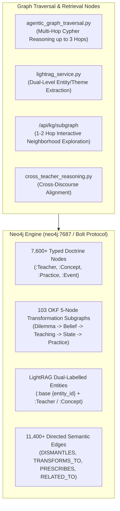
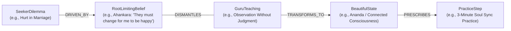

# Neo4j Knowledge Graph & Ontological Knowledge Framework (OKF)

AskMukthiGuru integrates **Neo4j 5.x** alongside Qdrant to form a **Hybrid GraphRAG** data plane. While Qdrant delivers high-dimensional vector search across speech fragments, Neo4j models the structured theological ontology, multi-hop spiritual transformations, and conceptual relationships across the teachings of **Sri Preethaji, Sri Krishnaji, and Sri Amma Bhagavan**.

---

## 1. Graph Role & Architecture in GraphRAG



Neo4j serves three concrete capabilities:
1. **Multi-Hop Spiritual Transformation**: Guides seekers through root cognitive reframings (from suffering states to *Beautiful States*).
2. **Dual-Level Entity Retrieval (LightRAG)**: Bridges granular entity mentions (*"Soul Circle"*, *"Deeksha"*) with overarching macro-themes (*"Oneness Consciousness"*).
3. **Interactive Knowledge Visualization**: Powers the frontend admin and seeker visual graph explorer (`GET /api/kg/subgraph`).

---

## 2. Graph Schema & Node Typing

### 2.1 Primary Node Labels
Configured via `backend/app/db/seed_ontology.py` and `backend/services/lightrag_service.py`:

| Label | Description | Example Entities |
|---|---|---|
| `:Teacher` | Spoken authority or wisdom master | Sri Preethaji, Sri Krishnaji, Sri Amma Bhagavan |
| `:Concept` | Core spiritual doctrine, cognitive state, or law | Ahankara (Ego), Suffering State, Beautiful State, Karma |
| `:Practice` | Experiential meditation, breathwork, or ritual | Serene Mind, Soul Sync, Deeksha, 3-Minute Breathing |
| `:Event` | Gatherings, festivals, or spiritual discourses | Ekam World Peace Festival, Field of Awakening |
| `:Organization` | Spiritual campus, academy, or movement | Ekam (Oneness), O&O Academy |
| `:base` | LightRAG bridge label holding `entity_id` | Universal dual-label applied for cross-model indexing |

### 2.2 Schema Constraints & Uniqueness
To prevent duplicate doctrine entries and race conditions during mass ingestion, Neo4j enforces strict schema constraints:
```cypher
CREATE CONSTRAINT teacher_name_unique IF NOT EXISTS
FOR (t:Teacher) REQUIRE t.name IS UNIQUE;

CREATE CONSTRAINT concept_name_unique IF NOT EXISTS
FOR (c:Concept) REQUIRE c.name IS UNIQUE;

CREATE CONSTRAINT practice_name_unique IF NOT EXISTS
FOR (p:Practice) REQUIRE p.name IS UNIQUE;
```

### 2.3 Canonical Teacher Entity Mapping
Spoken discourses and transcript variations refer to the teachers through numerous aliases. `backend/services/lightrag_service.py` canonicalizes these aliases prior to graph indexing:

```python
TEACHER_CANONICAL_MAP: dict[str, str] = {
    # Sri Amma Bhagavan
    "sri bhagavan": "Sri Amma Bhagavan",
    "kalki bhagavan": "Sri Amma Bhagavan",
    "bhagavan": "Sri Amma Bhagavan",
    "amma bhagavan": "Sri Amma Bhagavan",
    "sri amma bhagavan": "Sri Amma Bhagavan",

    # Sri Preethaji
    "preethaji": "Sri Preethaji",
    "preetha ji": "Sri Preethaji",
    "sri preethaji": "Sri Preethaji",
    "shri preethaji": "Sri Preethaji",

    # Sri Krishnaji
    "krishnaji": "Sri Krishnaji",
    "krishna ji": "Sri Krishnaji",
    "sri krishnaji": "Sri Krishnaji"
}
```

---

## 3. Ontological Knowledge Framework (OKF)

The **Ontological Knowledge Framework** (OKF) formalizes Sri Preethaji & Sri Krishnaji's teachings into a deterministic spiritual ontology based on Google Cloud's Open Knowledge Format v0.1.

### 3.1 The 20 OKF 5-Node Transformation Arcs
Rather than treating spiritual questions as generic text passages, OKF structures spiritual progress into a **5-Node Transformation Arc**:



1. **`SeekerDilemma`**: The real-world friction, emotional wound, or anxiety presented by the seeker.
2. **`RootLimitingBelief`**: The unconscious cognitive loop, ego identification (*Ahankara*), or childhood hurt driving the dilemma.
3. **`GuruTeaching`**: The verbatim philosophical insight from Sri Preethaji or Sri Krishnaji that directly deconstructs the limiting belief.
4. **`BeautifulState`**: The liberated inner state of consciousness achieved once the suffering state is seen and dissolved.
5. **`PracticeStep`**: Concrete meditation, breathwork, or contemplative step prescribed to anchor the transformation.

### 3.2 OKF Bundle Structure on Disk (`memory/okf/`)
OKF entries are authored as markdown documents with YAML frontmatter:
* **Directory**: `memory/okf/` (contains 680+ verified concept files).
* **Compiled Store**: `memory/okf/compiled.json` (10.4 MB compiled artifact read at runtime).
* **Staging Queue**: `memory/okf/staging/` holds candidate entries awaiting human curation.

#### Sample Entry Frontmatter (`ahankara_and_identification.md`):
```yaml
---
title: Ahankara And Identification
type: teaching
teacher: sri-preethaji-and-sri-krishnaji
source: https://www.youtube.com/watch?v=ehkqJ54DIC0
video_id: ehkqJ54DIC0
tags:
- oneness
- teaching
- mind_matrix
---
```

### 3.3 OKF Quality Filter & Curation SLA
* `backend/services/okf_quality_filter.py` enforces strict formatting and anti-contamination rules.
* **Stripping Fabricated Quotes**: All markdown text runs through `strip_fabricated_quotes` to prevent LLM hallucination from leaking into compiled doctrine.
* **Curation SLA (`CURATION_SLA_2026-10-04.md`)**: New entries ingested into `memory/okf/staging/` must pass human audit for video timestamp accuracy and speaker verification before compiler promotion.

---

## 4. LightRAG Dual-Level Knowledge Integration

AskMukthiGuru incorporates the **LightRAG** dual-level retrieval paradigm:

```
                  Seeker Input Query
                          │
         ┌────────────────┴────────────────┐
         ▼                                 ▼
┌──────────────────┐              ┌──────────────────┐
│  Low-Level Query │              │ High-Level Query │
│ (Entity Focused) │              │ (Thematic Focus) │
└────────┬─────────┘              └────────┬─────────┘
         │                                 │
         ▼                                 ▼
┌──────────────────┐              ┌──────────────────┐
│ Entity Nodes     │              │ Relationship     │
│ (:Teacher, etc.) │              │ Edges & Themes   │
└────────┬─────────┘              └────────┬─────────┘
         │                                 │
         └────────────────┬────────────────┘
                          ▼
            Merged Context Assembly
```

* **Low-Level Entities**: Exact entity nodes retrieved via vector match on entity descriptions (`lightrag_vdb_entities_*`).
* **High-Level Relationships**: Broader thematic relationship edges connecting disparate spiritual domains (`lightrag_vdb_relationships_*`).
* **Co-Schema Dual-Labelling**: LightRAG entity nodes are dual-labelled with native Neo4j ontology types (`:base:Concept`, `:base:Teacher`), allowing Cypher graph algorithms (PageRank, community detection) to run directly on LightRAG data without data synchronization pipelines.

---

## 5. Cross-Concept Graph Traversal & Cypher Execution

### 5.1 Multi-Hop Traversal (`agentic_graph_traversal.py`)
In the DeepGraph RAG strategy, when a seeker asks complex theological questions, the pipeline executes multi-hop Cypher queries up to 3 hops deep:

```cypher
MATCH (start:Concept {name: $concept_name})
MATCH path = (start)-[:DISMANTLES|TRANSFORMS_TO|PRESCRIBES*1..3]-(target)
WHERE NOT target:Deprecated
RETURN path, length(path) AS depth
ORDER BY depth ASC
LIMIT 15;
```

### 5.2 Subgraph Visualization API (`/api/kg/subgraph`)
* **Endpoint**: `GET /api/kg/subgraph?center=<concept>&depth=2`
* **Response**: Returns JSON nodes and links for D3.js / Cytoscape rendering in the admin and seeker dashboards.
* **Security & Performance**: Queries enforce strict path limits (`LIMIT 50`) and timeouts (`node_timeout_main = 20s`) to prevent runaway graph traversals.

---

## 6. Related Wiki Documentation

* [System Architecture Overview](../architecture/overview.md) — Multi-model topology and service container wiring.
* [12-Layer RAG Pipeline](../architecture/rag-pipeline.md) — How Neo4j graph context integrates with Qdrant vector retrieval.
* [First-Person Serving Architecture](../architecture/first-person-serving.md) — Verbatim context serving and rights clearing.
* [Qdrant Vector Database Reference](qdrant.md) — Dense vector store complementary to Neo4j.
