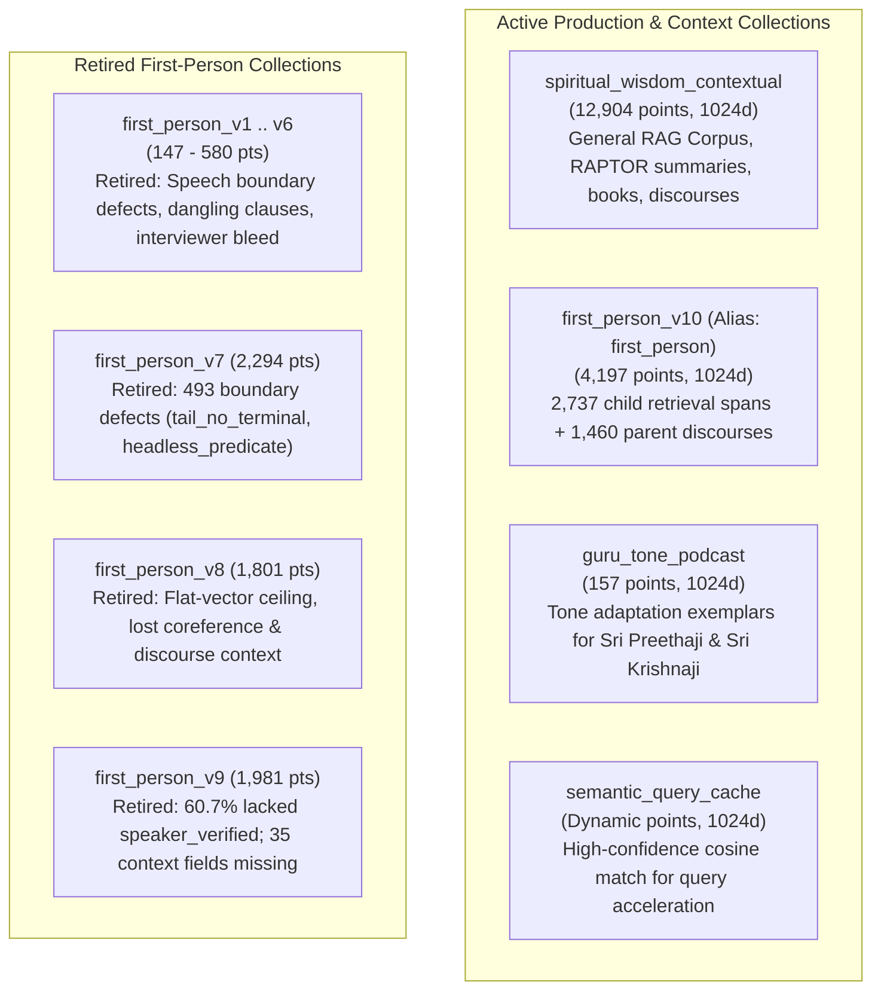

# Qdrant Vector Store Architecture & Collections

AskMukthiGuru leverages **Qdrant** as its primary high-dimensional vector search and hybrid retrieval engine. Qdrant delivers low-latency similarity search across dense embeddings, lexical sparse vectors, and ColBERT multi-vectors, powering both General RAG synthesis and First-Person verbatim wisdom retrieval.

---

## 1. Network Topology & Deployment Configuration

* **Container Service**: Runs as a dedicated container (`qdrant`) in Docker Compose and Kubernetes deployments.
* **Ports**:
  * `6333`: REST HTTP API (used for administrative schema inspection, health probes, and snapshot management).
  * `6334`: High-performance gRPC endpoint (used by `backend/services/qdrant/` client for low-latency batch queries and hybrid vector streaming).
* **Storage Engine**: Persistent on-disk storage backed by memory-mapped files (mmap) with write-ahead logging (WAL).
* **Quantization**: High-density scalar quantization enabled in production to minimize RAM footprint while preserving precision.

---

## 2. Collections Inventory



### 2.1 `spiritual_wisdom_contextual` (General RAG Store)
* **Point Count**: 12,904 points (verified production scale).
* **Content**: The foundational spiritual library, including *The Four Sacred Secrets*, over 450 video discourses, satsangs, lectures, and guided meditations.
* **Vector Configuration**:
  * Dense: 1024 dimensions (`BAAI/bge-m3`, Cosine distance).
  * Sparse: Lexical token weights (native BGE-M3 BM25 representation).
  * Multitenant/Grouping: Partitioned by `parent_id` for hierarchical retrieval.

### 2.2 `first_person_v10` & `first_person_v11` (Verbatim Context Store)
* **Point Count**: 4,197 total points:
  * **2,737 Child Spans**: Fine-grained retrieval units (typically 15–45 seconds of speech) designed for high semantic precision.
  * **1,460 Parent Discourses**: Full spoken discourse units providing antecedent context and pronoun resolution.
* **Schema**: Strict `fp-context-v1`.
* **Public Alias**: `first_person` currently resolves to `first_person_v10`.

### 2.3 `guru_tone_podcast` (Voice & Persona Store)
* **Point Count**: 157 curated audio discourse excerpts.
* **Function**: Serves as the dynamic few-shot exemplar store for Pass 3 Reflexion tone adaptation (`backend/rag/nodes/guru_tone_adapter.py`). Retrieves discourse passages that exhibit the signature warmth, intimacy, and cadence of the teachers.

### 2.4 `semantic_query_cache`
* **Role**: Caches finalized RAG answers indexed by query embeddings.
* **Threshold**: Requires a cosine similarity metric $\ge 0.96$ to trigger a cache hit.
* **Safety Invariant**: Distressed queries, medical terms, and incognito sessions are permanently excluded from this collection.

---

## 3. Payload Schema Specification

### 3.1 Modern Context Payload (`fp-context-v1`)

Every record within `first_person_v10` and `first_person_v11` must adhere to the following schema contract:

```json
{
  "record_type": "child",
  "source_span_id": "sp_ehkqJ54DIC0_0014",
  "parent_unit_id": "pu_ehkqJ54DIC0_0002",
  "guru_id": "sri-preethaji",
  "teacher_id": "sri-preethaji-and-sri-krishnaji",
  "speaker": "Sri Preethaji",
  "speaker_verified": true,
  "rights_cleared": true,
  "domain_rights_status": "licensed",
  "verbatim_text": "When you observe without judgment, fear dissolves into awareness.",
  "source_text_hash": "a1b2c3d4e5f6...",
  "transcript_hash": "f6e5d4c3b2a1...",
  "corpus_version": "fp-context-transcript-v1",
  "chunker_version": "boundary_v1:punct_spacy",
  "audio_file_duration_ms": 3600000,
  "audio_slice_duration_ms": 32000,
  "audio_start_ms": 412000,
  "audio_end_ms": 444000,
  "video_id": "ehkqJ54DIC0",
  "source_url": "https://www.youtube.com/watch?v=ehkqJ54DIC0&t=412s"
}
```

### 3.2 Payload Field Definitions & Invariants

| Field | Type | Description & Invariants |
|---|---|---|
| `record_type` | `string` | Must be `"child"` (retrieval unit) or `"parent"` (discourse context). |
| `source_span_id` | `string` | Unique deterministic identifier for the audio span. |
| `parent_unit_id` | `string` | Links a child span to its parent discourse. Used for parent enrichment windowing. |
| `guru_id` | `string` | Canonical teacher slug (`"sri-preethaji"`, `"sri-krishnaji"`, `"sri-amma-bhagavan"`). |
| `speaker_verified` | `boolean` | `true` only if acoustic ECAPA-TDNN evaluation passed. Never defaults to `true`. |
| `domain_rights_status`| `string` | Curated status from `docs/rights/CONTENT-RIGHTS.md`. Must equal `"licensed"`. |
| `chunker_version` | `string` | Names the exact algorithm (`boundary_v1:...`, `recursive_v1:...`, `adaptive_v1`). Pre-contract records return `"unknown_legacy"`. |
| `audio_start_ms` | `integer` | Start offset in master WAV archive (milliseconds). |
| `audio_end_ms` | `integer` | End offset in master WAV archive (milliseconds). |
| `audio_slice_duration_ms`| `integer` | Duration of the audio excerpt (`audio_end_ms - audio_start_ms`). |
| `audio_file_duration_ms` | `integer` | Total duration of the complete source video (milliseconds). |

---

## 4. Embedding Models & Hybrid Vector Geometry

AskMukthiGuru uses a multi-representation vector strategy powered by **`BAAI/bge-m3`** (`backend/services/embedding_service.py`):

```
                        Input Text / Spoken Span
                                   │
                                   ▼
                       ┌───────────────────────┐
                       │      BAAI/bge-m3      │
                       │   (Embedding Engine)  │
                       └───────────┬───────────┘
                                   │
         ┌─────────────────────────┼─────────────────────────┐
         ▼                         ▼                         ▼
┌──────────────────┐      ┌──────────────────┐      ┌──────────────────┐
│   Dense Vector   │      │  Sparse Weights  │      │  ColBERT Vectors │
│ (1024 Dimensions)│      │  (BM25 Lexical)  │      │ (Multi-Vector)   │
│  Semantic intent │      │  Exact doctrine  │      │ Fine token match │
└──────────────────┘      └──────────────────┘      └──────────────────┘
```

1. **Dense Vector Representation (1024 dims)**: Captures high-level philosophical meaning, emotional states, and multilingual semantic concepts across 100+ languages (including Hindi, Telugu, Tamil, and Sanskrit terminology).
2. **Sparse Lexical Representation**: Produces sparse token weights directly during the encode step. Acts as native BM25 without requiring a secondary Lucene or Elasticsearch service.
3. **ColBERT Multi-Vector**: Preserves token-level interaction vectors, enabling Late Interaction search for nuanced spiritual terminology.

### Reranking Engine
Candidate vectors retrieved from Qdrant are reranked via:
* **Primary**: `cross-encoder/ms-marco-MiniLM-L-6-v2` run locally in a thread pool (`asyncio.to_thread`) to prevent blocking the async event loop.
* **Alternative**: CPU-optimized FlashRank for edge and constrained deployments.

---

## 5. Indexing, Quantization & HNSW Settings

Production Qdrant collections enforce tuned search and memory optimizations configured in `backend/app/config.py`:

```json
{
  "vectors": {
    "dense": {
      "size": 1024,
      "distance": "Cosine",
      "hnsw_config": {
        "m": 16,
        "ef_construct": 100,
        "full_scan_threshold": 1000
      },
      "quantization_config": {
        "scalar": {
          "type": "int8",
          "quantile": 0.99,
          "always_ram": true
        }
      }
    }
  }
}
```

### 5.1 Scalar Quantization (`scalar_int8`)
* Reduces raw vector RAM requirements by **~75%** with negligible recall loss ($<0.5\%$).
* `quantile: 0.99`: Clips extreme outlier dimensions to optimize 8-bit dynamic range.
* `oversampling: 3.0`: Fetches $3\times$ candidates during quantized pre-search before reranking with full precision.

### 5.2 Reciprocal Rank Fusion (RRF) & Hybrid Prefetch
* Queries simultaneously execute dense search and sparse lexical search using Qdrant prefetch blocks:
  $$\text{RRF Score}(d) = \sum_{m \in \{\text{dense}, \text{sparse}\}} \frac{1}{60 + r_m(d)}$$
* Prefetch multipliers: `qdrant_dense_prefetch_multiplier = 3.0`, `qdrant_sparse_prefetch_multiplier = 3.0`.

### 5.3 Parent Document Group Search
* Configured via `qdrant_parent_grouping_enabled = True`.
* Uses Qdrant's native `query_points_groups` API grouped by `group_by = "parent_id"`.
* Limits retrieval to `group_size = 2` chunks per parent discourse, preventing single long videos from dominating top-ranked results while preserving narrative breadth.

---

## 6. Related Wiki Documentation

* [System Architecture Overview](../architecture/overview.md) — End-to-end component topology and persistence layers.
* [12-Layer RAG Pipeline](../architecture/rag-pipeline.md) — How Qdrant interacts with rerankers, grading, and LangGraph.
* [First-Person Serving Architecture](../architecture/first-person-serving.md) — Schema contracts, acoustic verification, and serving isolation.
* [Neo4j Knowledge Graph Reference](neo4j-graph.md) — Relational ontology complementary to Qdrant vector retrieval.
