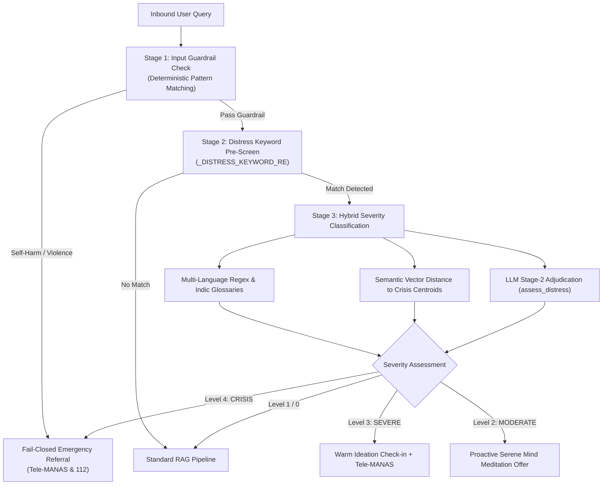
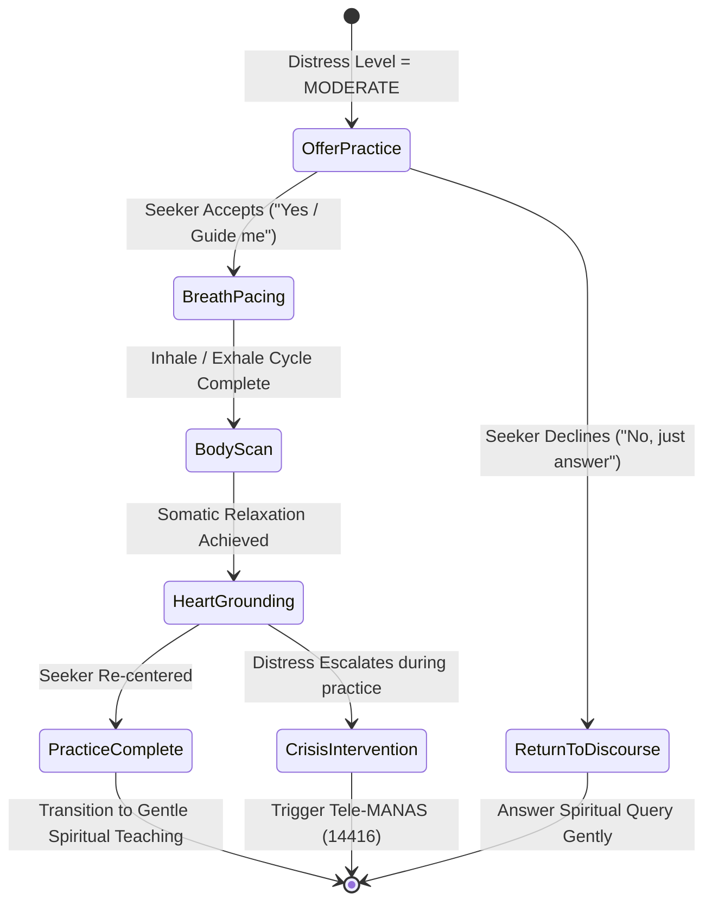

# Serene Mind & Clinical Safety Architecture

The **Serene Mind Engine** (`backend/services/serene_mind_engine.py`) and safety pipeline stages (`backend/app/pipeline/stages/distress_stage.py`, `guardrail_stage.py`) govern AskMukthiGuru's distress detection, clinical risk triage, helpline intervention, and guided emotional stabilization.

---

## 1. Safety Philosophy & Clinical Boundaries

AskMukthiGuru is an AI spiritual guide designed for spiritual wisdom and inner peace. It is **not** a healthcare provider, psychiatric triage tool, crisis hotline, or medical diagnosis system.

### Core Ethical Posture

1. **Immediate Preemption**: When a seeker indicates acute emotional crisis, despair, or self-harm ideation, spiritual philosophy yields entirely. Teaching generation is immediately halted in favor of human crisis referral.
2. **Deterministic Fail-Closed Operation**: Crisis interventions do not rely on probabilistic LLM text generation. Responses are deterministic, pre-scripted, clinician-reviewed strings.
3. **Zero Translation Risk**: Crisis copy is never dynamically machine-translated at runtime. All multi-lingual copy is pre-verified with faculty clinicians across Indian languages.

---

## 2. Graduated Distress Triage Matrix

The engine categorizes seeker input into five standardized levels based on the Columbia-Suicide Severity Rating Scale (C-SSRS) and clinical triage protocols:

| Level | Severity | Seeker State & Trigger Examples | System Action & Intervention |
|:---:|:---:|:---|:---|
| **0** | **NONE** | Philosophical or life inquiries: *"What is the cause of suffering?"* | Standard RAG pipeline; full teaching retrieval and generation. |
| **1** | **MILD** | Daily stress, overwhelm, work pressure: *"I've had a very stressful week at work."* | Gentle empathetic tone; standard answer with subtle grounding. |
| **2** | **MODERATE** | Emotional hurt, sadness, relational conflict: *"I feel heartbroken and unappreciated."* | Compassionate validation; proactive offer of a Serene Mind meditation practice. |
| **3** | **SEVERE** | Deep hopelessness, passive ideation: *"I want to disappear; I can't take this anymore."* | **Immediate preemption**: Spiritual retrieval aborted; warm stabilization check-in + primary **Tele-MANAS** helpline. |
| **4** | **CRISIS** | Active suicidal intent, self-harm, third-party danger: *"I want to end my life."* | **Hard fail-closed interrupt**: Zero AI text; emergency card with **Tele-MANAS (14416)** and **Emergency 112**. |

---

## 3. Multi-Stage Detection Pipeline



### 1. Keyword Pre-Screen (`_DISTRESS_KEYWORD_RE`)
To minimize processing latency, the pipeline executes a rapid regex pre-screen before invoking heavier classifiers.
- **Doctrinal False-Positive Protection (CRIT-5)**: General terms like `suffering` or `pain` were explicitly removed from the primary trigger list because they appear naturally in doctrinal queries (e.g., *"What is the relationship between suffering and consciousness?"*).
- **Indic Script Handling**: Indic scripts (Devanagari, Tamil, Telugu, Bengali) use vowel markers (*matras*) and viramas that do not adhere to ASCII `\b` word boundaries. Indic distress tokens (e.g., `akela`, `kashtam`, `dukh`, `takleef`, `udas`, `tut chuk`) are matched via robust Unicode substrings.

### 2. Stage Ordering Invariant (Repository Invariant X38)
> [!CAUTION]
> **Pipeline Stage Order**: The system must execute `InputGuardrailStage` **before** `CircuitBreakerStage`.
>
> If an LLM provider is down and a circuit breaker trips, safety checks must **not** be bypassed. Deterministic acute self-harm detection must intercept the query and surface emergency helplines before any circuit breaker fallback fires.

---

## 4. Tele-MANAS & Emergency 112 Helpline Shedding Policy

When an interaction triggers **CRISIS** or **SEVERE** distress, the system applies **Teaching Shedding**—completely suppressing quotes, citations, and spiritual advice.

### National Helpline Hierarchy for India

1. **Tele-MANAS (`14416` / `1800-891-4416`)**:
   - The primary National Tele Mental Health Programme of India (launched by the Ministry of Health and Family Welfare).
   - 24/7, toll-free, operating across 51+ regional cells in 36 States and Union Territories.
   - **Ordering Rule**: Tele-MANAS must **always be displayed first** in the Indian resource block.
   - *Note on KIRAN*: The legacy KIRAN helpline (`1800-599-0019`) was merged into Tele-MANAS in February 2024 and is not presented as the primary contact.

2. **National Emergency Services (`112`)**:
   - India's unified emergency number for police, fire, and ambulance services.
   - Surfaced immediately whenever active self-harm, stated overdose, or imminent life peril is detected.

3. **International Support**:
   - Seeker IP/locale detection dynamically surfaces regional crisis services (e.g., **988** in the United States and Canada; **111** in the UK) alongside international directories (Befrienders Worldwide, IASP).

### Authentic Indic Copy Preservation

To prevent dangerous mistranslations, all crisis referrals in Indian languages are hardcoded constants (`INDIC_CRISIS_RESPONSES` and `INDIC_NEXT_STEPS` in `backend/services/serene_mind_engine.py`):

```python
INDIC_CRISIS_RESPONSES = {
    "hi": (
        "आप अकेले नहीं हैं। यदि आप अत्यधिक तनाव या संकट में हैं, तो कृपया तुरंत सहायता लें:\n"
        "• Tele-MANAS (भारत सरकार): 14416 या 1800-891-4416 (24x7 निःशुल्क)\n"
        "• राष्ट्रीय आपातकालीन नंबर: 112"
    ),
    "te": (
        "మీరు ఒంటరిగా లేరు. మీరు తీవ్రమైన మానసిక వేదనలో ఉంటే, దయచేసి వెంటనే సహాయం తీసుకోండి:\n"
        "• టెలి-మానస్ (Tele-MANAS): 14416 లేదా 1800-891-4416 (24x7 ఉచితం)\n"
        "• జాతీయ అత్యవసర నంబర్: 112"
    ),
    # Tamil, Marathi, Bengali implementations follow identical verified phrasing
}
```

---

## 5. Serene Mind Guided Practices

For **MODERATE** distress (Level 2), the engine offers interactive, non-pharmacological stabilization practices (`backend/rag/meditation.py`).

### Supported Micro-Practices

1. **Prana Awareness (Breath Grounding)**:
   - Mindful observation of natural respiration.
   - Focuses attention at the tip of the nostrils or abdomen, slowing sympathetic nervous system arousal.
2. **Heart-Center Connection (Hridaya Dhyana)**:
   - Placing a hand over the chest center; feeling warmth and breathing into the spiritual heart.
   - Dissolves feelings of abandonment and self-criticism through somatic reassurance.
3. **Witnessing the Emotion (Chitta Witnessing)**:
   - Observing emotional charge as pure physical sensation (tightness, heat, pressure) without conceptual labeling or resistance.
   - As taught by Sri Preethaji: *"Whatever you experience fully without judgment turns into peace."*

### Interactive Meditation State Machine



---

## 6. Emotional Intelligence & Longitudinal Safety

- **Session Escalation Tracking**: The engine observes conversation turns. If a seeker's distress level remains at Level 2 or 3 across three consecutive interactions, the system gently escalates to suggest professional human counseling.
- **Safety Telemetry**: Every crisis referral logs an anonymous event (`services.safety_telemetry.log_crisis_referral_shown`) to monitor system triage rates without persisting seeker PII or session text.

---

## 7. Related Documentation

- [Spiritual Teachings & OKF Knowledge Base](file:///Users/harshodaikolluru/Public/askmukthiguru-8119b0e8/docs/wiki/domain/teachings-and-okf.md)
- [Admin Queries & Quality Monitoring](file:///Users/harshodaikolluru/Public/askmukthiguru-8119b0e8/docs/wiki/admin/portal-guide.md#5-queries--tracing)
- [Clinical Safety Dossier](file:///Users/harshodaikolluru/Public/askmukthiguru-8119b0e8/docs/safety/CLINICAL_SAFETY_DOSSIER.md)
- [Faculty Clinician Review Sign-Off](file:///Users/harshodaikolluru/Public/askmukthiguru-8119b0e8/docs/safety/FACULTY_CLINICIAN_REVIEW_SIGN_OFF.md)
