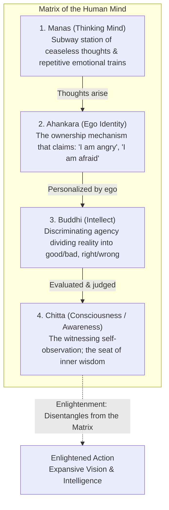

# Spiritual Teachings & Ontological Knowledge Framework (OKF)

This document details the spiritual doctrine of **Sri Preethaji** and **Sri Krishnaji**, the philosophy of **Ekam Oneness**, and the architectural implementation of the **Ontological Knowledge Framework (OKF)**—the curated ground-truth repository powering AskMukthiGuru's retrieval, semantic grounding, and doctrinal alignment.

---

## 1. Spiritual Philosophy of Sri Preethaji & Sri Krishnaji

Sri Preethaji and Sri Krishnaji are modern spiritual philosophers, mystics, and co-founders of **Ekam** (The World Centre for Enlightenment in Southern India) and O&O Academy. Their teachings bridge ancient Vedic wisdom with modern neurobiology, presenting a non-sectarian, experiential pathway to personal liberation and global unity.

### The Two States of Being

At the heart of the teachings is the foundational distinction between two fundamental states of consciousness:

```text
┌────────────────────────────────────────────────────────┐
│               THE TWO INNER STATES                     │
├───────────────────────────┬────────────────────────────┤
│     SUFFERING STATE       │      BEAUTIFUL STATE       │
│      (I-Centric)          │      (Other-Centric)       │
├───────────────────────────┼────────────────────────────┤
│ • Disconnection & Loneliness│ • Connection & Belonging  │
│ • Anxiety, Fear, Restlessness│ • Inner Peace & Stillness │
│ • Anger, Resentment, Blame │ • Compassion & Forgiveness│
│ • Craving & Compulsion    │ • Gratitude & Contentment  │
│ • Judgment & Division     │ • Clarity & Oneness        │
└───────────────────────────┴────────────────────────────┘
```

1. **The Suffering State (Dukha / Asundara Sthiti)**:
   - Driven by the "I-centric" mind, where life is experienced through resistance, division, and anxiety.
   - Any state marked by fear, self-pity, resentment, loneliness, or greed is recognized as suffering—regardless of external achievements.
   - Sri Krishnaji emphasizes: *"Suffering is not a reflection of your circumstances; it is an internal reaction of an isolated self."*

2. **The Beautiful State (Sundara Sthiti)**:
   - An unagitated, expansive state of consciousness characterized by calm, love, joy, and deep interconnectedness.
   - Actions emerging from a Beautiful State are naturally creative, effective, and free from destructive reactivity.

---

### The Four Dimensions of the Mind

In the seminal *Evolution Series*, the teachers explain the Vedic taxonomy of the mind as four distinct dimensions:



- **1. Manas (The Thinking Mind)**: Comparable to a subway station where trains of thoughts and habitual reactions constantly arrive and depart along pre-conditioned neural tracks.
- **2. Ahankara (The Sense of Ego / Identification)**: The ownership mechanism. When a fear-train enters Manas, Ahankara claims: *"I am terrified."* It personalizes and binds consciousness to mental fluctuations.
- **3. Buddhi (The Intellect / Discriminative Faculty)**: Evaluates, categorizes, compares, and divides experiences into desirable or undesirable, perpetuating internal friction.
- **4. Chitta (Witness Consciousness / Awareness)**: The faculty of pure self-observation. When Chitta awakens, thoughts and emotions are observed without identification or suppression, dissolving the suffering loop.

---

### Ekam Oneness & Deeksha

- **Oneness (Advaita / Interconnectedness)**: All separation is an illusion created by the defensive survival apparatus of Ahankara. Consciousness is universal, not individual.
- **Deeksha (Neurobiological Energy Transfer)**: A sacred transfer of grace that alters brain wave patterns—calming the parietal lobes (which register spatial boundaries between "self" and "other") while energizing the frontal lobes (associated with empathy, calm, and higher cognition).

---

## 2. Ontological Knowledge Framework (OKF)

The **Ontological Knowledge Framework** (`memory/okf/`) is AskMukthiGuru's primary semantic foundation. Rather than allowing an LLM to hallucinate or improvise spiritual doctrine, OKF stores curated, human-reviewed, and verified doctrine units.

### OKF Entry Schema

Every canonical OKF file is structured in GitHub Flavored Markdown with strict YAML frontmatter:

```markdown
---
title: Ahankara And Identification
type: teaching
teacher: sri-preethaji-and-sri-krishnaji
source: https://www.youtube.com/watch?v=ehkqJ54DIC0
video_id: ehkqJ54DIC0
tags:
  - oneness
  - teaching
  - mind-matrix
updated: 2026-10-09
---
# Ahankara And Identification

## Verbatim Discourse Excerpts
Enlightenment is a state. It is a state where you are free from the mind...
The sages saw the matrix of the human mind as having four dimensions to it.
The first dimension they saw is what they called it as manas...

## Key Teachings
- The second layer in this matrix of the mind is ahankara, sense of ego itself, whose primary purpose is to identify. — Sri Preethaji & Sri Krishnaji
- When thought trains of fear arise, ahankara says I am afraid. — Sri Preethaji & Sri Krishnaji

## Source Context
- Video: Know the 4 dimensions of your mind | Evolution Series 103
- URL: https://www.youtube.com/watch?v=ehkqJ54DIC0
- Speaker: Sri Preethaji & Sri Krishnaji
```

---

## 3. The Curation Lifecycle & Human Review SLA

Under `memory/okf/CURATION_SLA_2026-10-04.md` and repository invariant **X3**, OKF strictly enforces a 3-tier lifecycle:

```mermaid
flowchart LR
    A["Raw Extractor Engine<br/>(Machine Batch)"] -->|Writes to| B["Staging Area<br/>memory/okf/staging/"]
    B -->|Review Queue| C["Human Reviewer<br/>Quote Verification against Transcript"]
    C -->|Approved Promotion| D["Active Doctrine<br/>memory/okf/*.md"]
    D -->|compile_okf()| E["Compiled Bundle<br/>memory/okf/compiled.json (10.4 MB)"]

    style B fill:#fef3c7,stroke:#d97706
    style C fill:#dbeafe,stroke:#2563eb
    style E fill:#d1fae5,stroke:#059669
```

### Roles and Boundaries

1. **Machine Extractor**:
   - Generates candidate concepts into `memory/okf/staging/`.
   - **Hard Rule**: The extractor *never* writes to the live `memory/okf/*.md` root and *never* modifies `compiled.json`.
   - The runtime store (`backend/services/memory/okf_store.py`) explicitly filters out `memory/okf/staging/` using `_excluded_parts`. Nothing unreviewed can be loaded at runtime.

2. **Human Reviewer**:
   - Compares the `## Verbatim Discourse Excerpts` against the original audio/ASR transcript.
   - Validates that quotes are verbatim, un-paraphrased, and correctly attributed to Sri Preethaji or Sri Krishnaji.
   - Rejects entries containing LLM editorial commentary, hallucinated teachings, or uncredited quotes.

3. **Deterministic Compiler (`compile_okf()`)**:
   - Scans all approved files in `memory/okf/`.
   - Strips non-concept process documents (e.g., `CURATION_SLA_*.md`, `STAGING_TRIAGE_*.md`) via `NON_CONCEPT_FILENAMES`.
   - Generates the release artifact `memory/okf/compiled.json` with deterministic sorting and schema hashes.

### Freshness SLA & Staleness Auditing

- **Staleness Cadence**: Every 180 days, entries are scanned. Files where `updated:` is older than 180 days are flagged in the admin portal for re-verification against active sources.
- **Freshness Provenance**: Compiled entries carry `updated_source: "frontmatter"` or `updated_source: "build_default"`. Entries marked `build_default` are prioritized for human audit.

---

## 4. Contradiction & Doctrinal Independence Policy

Spiritual insights often present complementary or context-dependent teachings. Invariant **CURATION_SLA_2026-10-04** establishes the non-synthesis invariant:

> [!IMPORTANT]
> **No Synthetic Hybrids**: When Sri Preethaji and Sri Krishnaji offer differing emphases or perspectives on a doctrine topic, the system **never synthesizes a merged or blended teaching**. Both viewpoints must be presented independently with clear teacher attribution.

- **Contradiction Detection**:
  Run `scripts/ops/okf_contradiction_scan.py` to identify potential doctrinal discrepancies. The tool generates read-only candidate reports; it never modifies or deletes doctrine files.
- **Graceful Fallback Invariant (Ingestion Safety Invariant 4 / X37)**:
  If `memory/okf/compiled.json` is missing in an unpopulated environment, runtime retrieval must gracefully fall back to dense Qdrant vector retrieval and Neo4j relational traversal without fabricating uncurated doctrine.

---

## 5. Doctrine Lexicon & Synonyms

To align modern user queries (e.g., "panic attack", "burnout", "marital stress") with spiritual vocabulary, the system maintains `data/doctrine_lexicon.json` and loads it via `backend/services/doctrine_service.py`:

- **Synonym Expansion**: Connects clinical or modern vernacular to spiritual roots (e.g., *overthinking* $\to$ *Manas agitation*; *feeling offended* $\to$ *Ahankara wounded self*).
- **Doctrine Cache (`backend/services/doctrine_cache.py`)**: Provides instant sub-10ms responses for core doctrinal definitions (e.g., "What is Ekam?", "Define the 4 dimensions of mind").

---

## 6. Related Documentation

- [Serene Mind Distress Triage & Helplines](file:///Users/harshodaikolluru/Public/askmukthiguru-8119b0e8/docs/wiki/domain/serene-mind.md)
- [Corpus Ingestion Architecture](file:///Users/harshodaikolluru/Public/askmukthiguru-8119b0e8/docs/wiki/architecture/ingestion.md)
- [Admin OKF Manager Guide](file:///Users/harshodaikolluru/Public/askmukthiguru-8119b0e8/docs/wiki/admin/portal-guide.md#3-okf-manager)
- [OKF Curation SLA Specification](file:///Users/harshodaikolluru/Public/askmukthiguru-8119b0e8/memory/okf/CURATION_SLA_2026-10-04.md)
