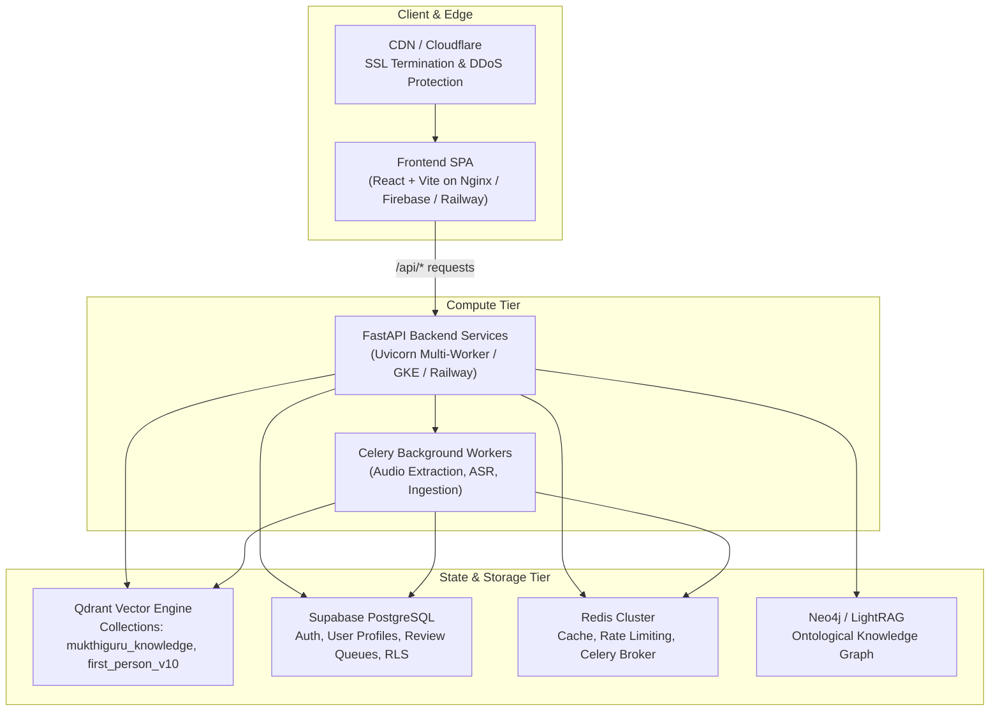
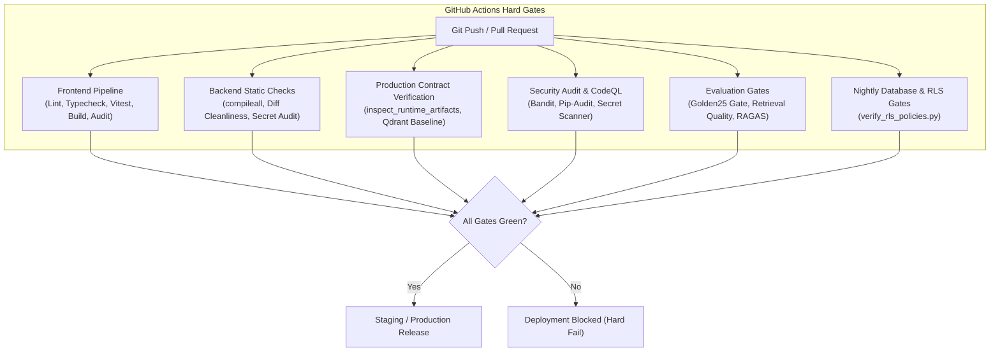

# Operations, Deployment & CI/CD Pipeline Gates

This document outlines the deployment topology, container orchestration, automated continuous integration (CI) gates, and operational runbooks for **AskMukthiGuru**.

---

## 1. Deployment Topology & Architecture

AskMukthiGuru operates as a resilient, multi-tiered architecture orchestrated across containerized microservices and managed cloud datastores.



### Environment Configurations

1. **Local Development & Staging (Docker Compose)**:
   - Primary definition: `docker-compose.yml` (repo root) and `backend/docker-compose.yml`.
   - Starts API, Celery worker, local Qdrant, Redis, and mock storage containers.
   - **Script Tree Mount Invariant (X1, X2, X28)**:
     - The repository maintains reconciled script trees between `scripts/` and `backend/scripts/`.
     - `backend/docker-compose.yml` mounts repo-root `scripts/` at `/app/scripts`.
     - Container operational scripts run safely via `bash scripts/docker-safe.sh docker compose ...`.

2. **Cloud Deployment (Railway / Cloud Run / Kubernetes)**:
   - **Backend API**: Scaled horizontally based on incoming HTTP request volume and p95 turn latency.
   - **Celery Workers**: Scaled independently to handle asynchronous batch ingestion tasks without degrading interactive chat responsiveness.
   - **Health & Readiness Endpoints**:
     - `GET /health`: Liveness probe ensuring the FastAPI event loop is responsive.
     - `GET /ready`: Readiness probe verifying active connections to Supabase, Qdrant, and Redis.

---

## 2. CI/CD Pipeline Gates

Every pull request and merge to the `main` branch must clear strict automated validation pipelines defined in `.github/workflows/`. A failure in any hard gate immediately halts deployment.



### Detailed Pipeline Breakdown

### 1. Main Hard Gates (`.github/workflows/main-hard-gates.yml`)

The primary pre-merge gate consisting of four concurrent jobs:

- **`frontend` Job**:
  - `npm run lint`: Enforces ESLint rules and TypeScript strict mode.
  - `npm run typecheck`: Validates full React type safety without implicit `any`.
  - `npm test -- --run`: Executes complete Vitest unit and component test suites.
  - `npm run build`: Validates asset bundling and tree-shaking cleanliness.
  - `npm audit --omit=dev --audit-level=high`: Blocks builds with high or critical npm vulnerabilities.

- **`backend-static` Job**:
  - `python -m compileall -q backend`: Compiles all Python modules to catch syntax errors or invalid imports across Python 3.12.
  - `git diff --check`: Disallows trailing whitespace and git conflict markers.
  - `python scripts/security_audit.py --report`: Rejects accidental commits of API keys, private certificates, or development tokens.

- **`repository-production-contract` Job**:
  - Validates critical source paths (`backend/app/config.py`, `backend/app/chat_uploads.py`, `docs/production/PRODUCTION_READINESS.md`).
  - **Qdrant Baseline Non-Degeneracy Check**: Verifies `memory/qdrant_quality_baseline.json`. Ensures baseline `mean_ndcg > 0.0`. A baseline with zero discriminative capability fails the build immediately.
  - **Runtime Artifacts Integrity**: Executes `inspect_runtime_artifacts()`, asserting that all required runtime files exist and pass integrity checks.

- **`load-evidence-policy` Job**:
  - Enforces that nightly load workflows cannot pass vacuously when services are unreachable. Validates that `ALLOW_UNREACHABLE_SUCCESS` hard-fails builds that lack real execution evidence.

---

### 2. Security Audits & CodeQL (`security-audit.yml`, `codeql.yml`)

- **Dependency Vulnerability Scanning**: Runs `pip-audit` against `backend/requirements.txt` and `requirements.lock`.
- **AST Security Linter**: Runs `bandit` to identify security antipatterns (e.g., hardcoded bind addresses, insecure hashing, dangerous shell invocations).
- **GitHub CodeQL**: Deep semantic code analysis scanning for data leakage, path traversals, and injection risks.

---

### 3. Evaluation & Golden Question Gates (`eval-gate.yml`, `golden25-gate.yml`)

- **Retrieval Regression Gate**: Evaluates search quality against curated benchmark queries. If mean nDCG drops by more than $0.02$ compared to baseline, the gate blocks promotion.
- **RAGAS Evaluation Gate**: Assesses RAG output along three dimensions:
  - **Faithfulness**: Are all claims grounded in the retrieved teaching excerpts?
  - **Answer Relevance**: Does the generated answer directly address the seeker's query?
  - **Hallucination Anomaly Detection**: Unattributed philosophical claims trigger automated PR rejection.

---

### 4. Nightly Row-Level Security Gate (`nightly-rls.yml`)

- Executes `scripts/verify_rls_policies.py` against a staging Supabase instance.
- **Security Probing**: Simulates anonymous (`anon`) and authenticated user tokens attempting unauthorized SELECT/INSERT/DELETE queries on protected tables (`corpus_gate_rejections`, `canonical_memories`, `admin_audit_logs`).
- Any permission bypass causes an immediate P0 notification to on-call engineers.

---

## 3. Operational Runbooks & Procedures

The repository includes battle-tested operational runbooks located in `docs/runbooks/`:

### 1. Release Rollback (`docs/runbooks/rollback-release.md`)
- **When to Use**: Severe latency degradation (p95 > 3500ms), elevated error rates (> 1% on `/api/chat`), or hallucination anomalies in production.
- **Procedure**:
  1. Revert Git HEAD to the previous tagged green release.
  2. Redeploy frontend and backend containers via Railway CLI or Kubernetes deployment rollback:
     ```bash
     kubectl rollout undo deployment/askmukthiguru-backend
     ```
  3. Verify `/ready` endpoint status and inspect live query traces in the Admin Portal.

---

### 2. Source Quarantine & Content Purge (`docs/runbooks/purge-source.md`)
- **When to Use**: When a copyright holder revokes permission, or a video discourse is found to contain unverified guest audio.
- **Procedure**:
  1. Identify the target URL or video ID in `docs/rights/CONTENT-RIGHTS.md`.
  2. Mark rights status as revoked or execute the automated purge script:
     ```bash
     python scripts/ops/purge_source.py --source-url "https://www.youtube.com/watch?v=TARGET_ID" --dry-run
     python scripts/ops/purge_source.py --source-url "https://www.youtube.com/watch?v=TARGET_ID" --execute
     ```
  3. The script deletes points from Qdrant, purges Neo4j entity nodes, and invalidates Redis exact match caches.

---

### 3. Collection Reindexing & Snapshot Restore (`docs/runbooks/reindex.md`, `restore-snapshot.md`)
- **When to Use**: Schema migrations, chunker version upgrades (e.g., migrating from recursive to boundary chunking), or vector dimension shifts.
- **Procedure**:
  1. Create a point-in-time snapshot of the active Qdrant collection:
     ```bash
     python scripts/ops/qdrant_snapshot.py --collection mukthiguru_knowledge --create
     ```
  2. Build the new collection under a versioned alias (e.g., `mukthiguru_knowledge_v2`).
  3. Run batch reindexing via Celery worker pool.
  4. Perform atomic alias switchover once validation tests pass:
     ```bash
     python scripts/ops/switch_collection_alias.py --alias mukthiguru_knowledge --target mukthiguru_knowledge_v2
     ```

---

### 4. Secret & Key Rotation (`docs/runbooks/SECRET_ROTATION.md`)
- Detailed steps for zero-downtime rotation of Supabase Service Role Keys, Qdrant API keys, Redis passwords, and LLM Provider tokens.

---

## 4. Monitoring, Alerting & On-Call Triage

- **Alerting Rules (`docs/runbooks/ALERTING.md`)**: Configured thresholds for PagerDuty and Slack alerts:
  - **P0**: Chat endpoint error rate $> 2\%$ over a 5-minute rolling window.
  - **P0**: Failure or bypass of the **Serene Mind** crisis triage stage.
  - **P1**: p95 turn latency $> 2500$ ms for 10 consecutive minutes.
  - **P1**: Qdrant vector retrieval timeouts or connection drops.
  - **P2**: Ingestion worker queue lag $> 500$ pending jobs.

---

## 5. Related Documentation

- [Architecture Overview](file:///Users/harshodaikolluru/Public/askmukthiguru-8119b0e8/docs/wiki/architecture/index.md)
- [Corpus Ingestion Pipeline](file:///Users/harshodaikolluru/Public/askmukthiguru-8119b0e8/docs/wiki/architecture/ingestion.md)
- [Admin Portal Guide](file:///Users/harshodaikolluru/Public/askmukthiguru-8119b0e8/docs/wiki/admin/portal-guide.md)
- [On-Call Guide](file:///Users/harshodaikolluru/Public/askmukthiguru-8119b0e8/docs/runbooks/ONCALL.md)
- [Alerting Specifications](file:///Users/harshodaikolluru/Public/askmukthiguru-8119b0e8/docs/runbooks/ALERTING.md)
